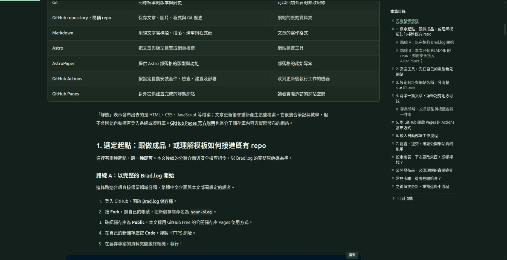
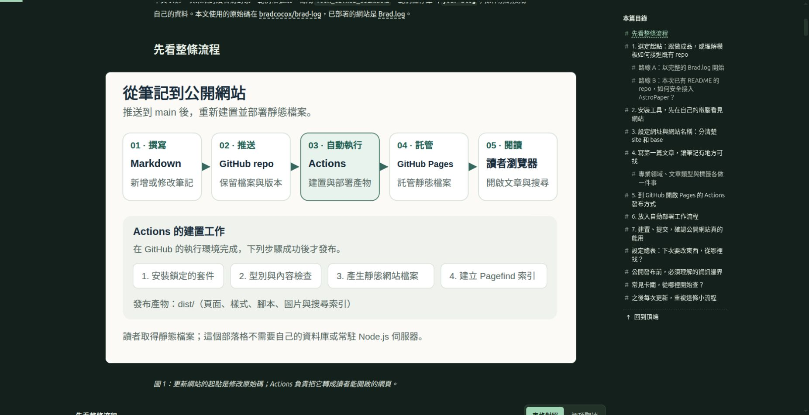
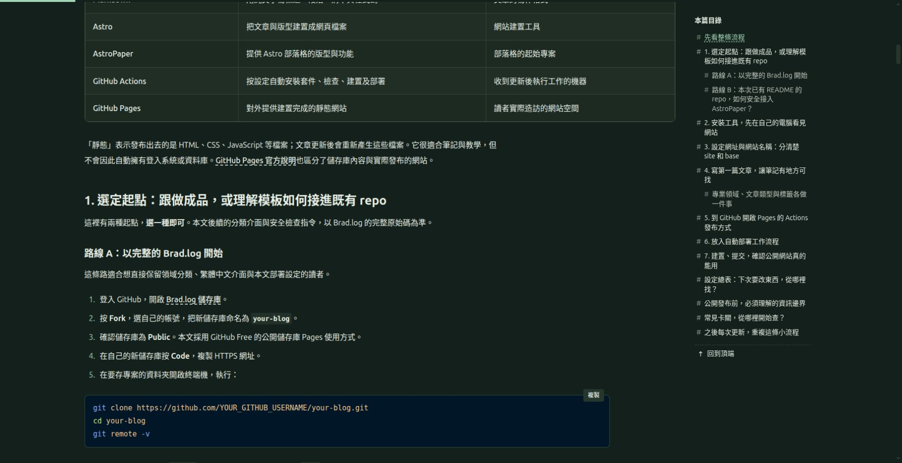
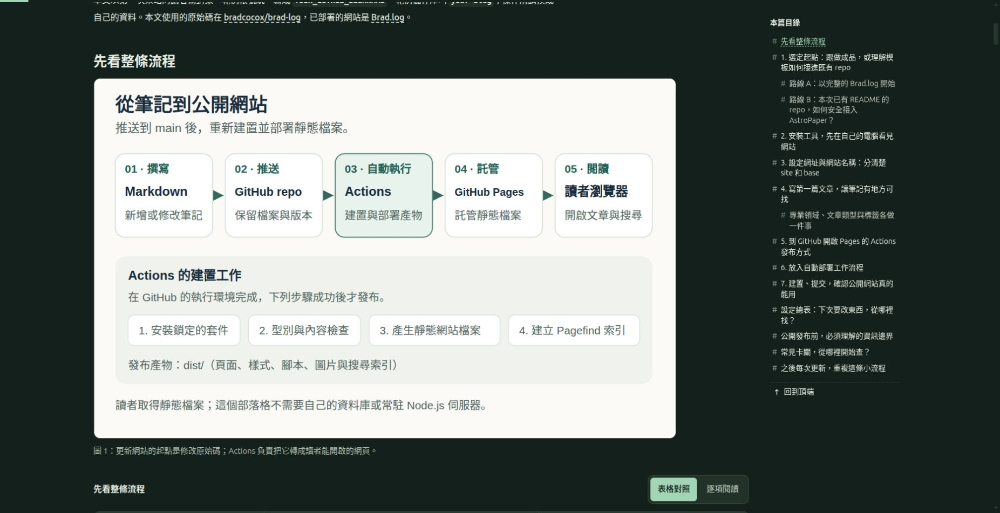
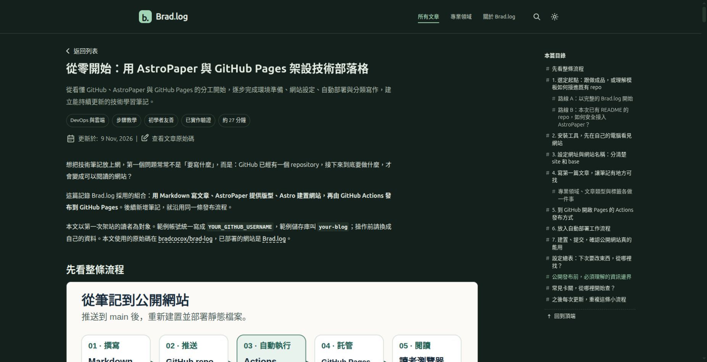
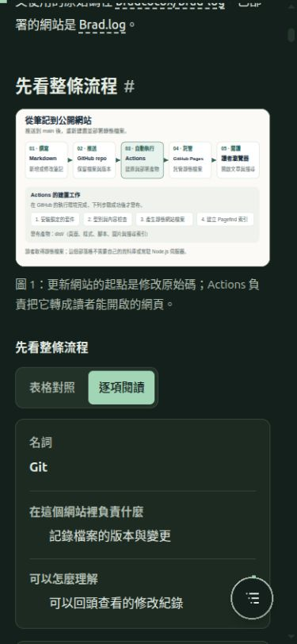

# Brad.log 文章對齊與視覺組織檢視

**狀態：本輪對齊與圖說修正已部署，並完成下列範圍的現場驗證及獨立設計複核。**

記錄日期：2026-11-09。基準版本為 [`ce1e6fb35127451768eeeb0fe63b6b3108ebeca1`](https://github.com/bradcocox/brad-log/commit/ce1e6fb35127451768eeeb0fe63b6b3108ebeca1)。本輪針對首篇教學的文章左邊界、寬媒體與正文的關係，以及圖片和圖說的視覺連結進行 designer review。

## 1. 本輪問題與範圍

使用者指出圖片、表格相對文字版面向外突出，左側沒有對齊。新的現場截圖與量測確認：正文、媒體及表格雖然各自在容器中置中，卻形成三條不同的左邊界。讀者從表格回到正文，或從標題轉到圖片時，內容的起點會突然左右移動。

這是閱讀對齊與視覺組織問題。「沒有整張頁面的水平溢位」只描述內容是否超出頁面，不能據此判定文章對齊已解決。本輪聚焦上述呈現問題；上一輪的表格可讀性、卡片與互動結果保留在 [UI_LAYOUT_REVIEW.md](UI_LAYOUT_REVIEW.md)，本文件不改寫那些既有紀錄。

## 2. 本輪修正前證據

本輪重新擷取的 viewport 為 **1868 × 959**。以下為該次 DOM 量測的 CSS px；`x` 為元素左邊界，寬度保留原始數值。

| 元素／區塊 | 左邊界 x | 寬度 | 相對主內容左邊界 |
| --- | --- | --- | --- |
| `.post-primary` 主內容欄 | 174.5px | 1224px | 基準 |
| 文章 header、一般段落、圖說段落 | 354.5px | 864px | 向右 180px |
| 圖片、程式碼區塊 | 242.5px | 1088px | 向右 68px |
| 表格外框 | 174.5px | 1224px | 與主內容相同 |
| 側邊目錄 | 1438.5px | 240px | 位於獨立目錄欄 |

依上述量測，正文與表格的左邊界相差 **180px**；正文與圖片／程式碼相差 **112px**。主內容、媒體與正文的三種寬度各自置中，使同一篇文章在區塊切換時缺少穩定的閱讀起點。

### 圖 1：表格末尾轉接正文、標題與程式碼



這張重新擷取的截圖同時呈現表格末尾、後續段落、章節標題與程式碼入口。表格的左邊界在 174.5px，文字區塊在 354.5px，程式碼在 242.5px；問題可從連續閱讀的轉接處直接觀察。

### 圖 2：標題、圖片與圖說



圖片左邊界為 242.5px，標題與圖說則為 354.5px。圖片與其圖說使用不同寬度和置中位置，讓圖說看起來與圖片脫節。

### 圖說樣式未對應實際結構

本篇 Markdown 的圖片與圖說會產生相鄰的兩個段落，結構如下：

```html
<p></p>
<p><em>圖 1：圖片說明。</em></p>
```

既有的 `img + em` 選擇器要求 `em` 緊接在同一層的 `img` 後面，因此不會命中上述圖說。修正需同時處理圖說段落的對齊與真正適用的選擇器，不能只更改沒有命中的樣式規則。

## 3. 已確認的設計與實作

獨立 designer review 已同意採取最少範圍的修正：以 `.post-primary` 的左邊界統一文章 header、h1、摘要、meta、返回入口、正文各區塊外框、圖片、圖說、程式碼、表格及文章尾端。不同內容仍保留各自寬度，較寬的內容從共同起點向右延伸，右端留在主內容欄內；清單與引用區塊的合理內距繼續保留。

這個選擇同時保留先前解決的閱讀需求：正文維持 864px；圖碼維持 1088px；表格使用主欄全寬，本輪桌機基準為 1224px。若全部壓成 864px，表格會再次縮窄；若正文也全部拉成 1224px，文字行長會過長。目錄沿用已穩定的 240px 欄位與 40px 間隔，不為這次對齊調整重新配置。

### 已核對的 CSS 變更

變更集中在 [`src/styles/article.css`](../src/styles/article.css)。以下為實際程式設定，並非修正後現場量測值：

| 位置／選擇器 | 已採用設定 | 用途 |
| --- | --- | --- |
| `.post-header, .article-back, .post-end` | `margin-inline: 0 auto`；保留 `max-width: var(--reading-width)` | 標題資訊、返回入口與文章尾端從主欄共同左線開始 |
| `.post-prose > :not(.article-table)` | `margin-inline: 0 auto`；正文寬度維持 54rem | 正文各區塊不再各自置中；清單與引用的內部縮排不因此清零 |
| 圖片段落、`pre`、`figure`、`.expressive-code`、`.code-block` | 保留 `max-width: 68rem` | 圖碼從共同左線向右使用較寬空間 |
| `.post-prose > p > img` | `margin-block: 0` | 移除 Tailwind typography 對圖片的預設垂直外距，避免原本 32px 外距破壞圖片與圖說的成組間距 |
| `.post-prose > p:has(> img):has(+ p > em:only-child)` | `margin-bottom: 0.65rem` | 讓有圖說的圖片段落控制兩者間距 |
| `.post-prose > p:has(> img) + p:has(> em:only-child)` | `max-width: 68rem`、`margin-top: 0`、字級 `0.94rem`（根字體 16px 時為 15.04px）、行高 `1.7`、`var(--muted-foreground)` | 命中實際的相鄰圖說段落，保持與圖片的共同左線及次要說明層級 |
| 上述圖說段落的 `> em` | `font-style: normal` | 保留 Markdown 圖說寫法，避免整段斜體削弱中文閱讀 |

`.post-page` 頁面容器本身仍以 `margin-inline: auto` 置中；改的是主內容內部各區塊的閱讀起點。維護時應分清這兩個層級，避免把所有置中規則一併移除。

### 本輪判定準則

| 判準 | 本輪要確認的結果 |
| --- | --- |
| 穩定的共同左線 | 文章 header、標題、一般段落、表格外框、圖片與程式碼的區塊起點有共同依據；不把表格內部 padding 或清單符號縮排誤當成外框對齊問題 |
| 保留正文適讀寬度 | 正文維持目前 864px 的閱讀寬度基準，不為了與表格等寬而把所有段落拉滿主欄 |
| 寬媒體有清楚的擴展方向 | 圖片、程式碼與表格在主內容欄內向右使用所需空間，保留先前改善的可讀性，也不與目錄重疊 |
| 圖說明確屬於圖片 | 圖說使用符合實際 DOM 的樣式，與圖片有一致的對齊及清楚的間距關係；從畫面上能直接理解其歸屬 |

本輪後測採用兩個相同閱讀轉接場景：表格末尾接正文／標題／程式碼，以及標題接圖片／圖說，同時核對實際畫面與各區塊左邊界。檢視範圍聚焦閱讀對齊，水平溢位則作為額外的幾何檢查。

## 4. 部署與修正後現場結果

本輪驗證日期為 **2026-11-09**。修正後四張截圖均已保存並實際重新開啟檢查；以下座標與尺寸取自現場 DOM 量測，與設計設定分開記錄。

| 階段／項目 | 實際紀錄 |
| --- | --- |
| 主要對齊變更 | commit [`9c2ef4d34089fff4e6b7a2e0f6ad18d323152c39`](https://github.com/bradcocox/brad-log/commit/9c2ef4d34089fff4e6b7a2e0f6ad18d323152c39)；[Actions run 42576981709](https://github.com/bradcocox/brad-log/actions/runs/42576981709) |
| 最後圖片外距修正 | commit [`36551cf00bc6e0773b1fb691d1f4b5e55ca6cd32`](https://github.com/bradcocox/brad-log/commit/36551cf00bc6e0773b1fb691d1f4b5e55ca6cd32) |
| 最終 CI 與部署 | [Actions run 42577282888](https://github.com/bradcocox/brad-log/actions/runs/42577282888) 成功；最後 CSS 變更經正式 workflow 完整建置與部署 |
| 本輪本機完整建置紀錄 | 0 errors、0 warnings、0 hints；19 頁、2877 詞、2 個篩選；檔案檢查紀錄為 68 檔通過。此為本機紀錄，最終版本另以上方 CI 為準 |
| 現場尺寸 | 桌機 1868 × 959、中間尺寸 1024 × 900、手機模擬 390 × 844 |
| 獨立設計複核 | 審閱者另行開啟圖 3、圖 4，確認左邊界錯位與圖說脫節兩項問題已解決，本輪沒有阻擋性問題 |

**證據保存的大小限制：** 一次性來源匯入 workflow 曾因檔案為 571,576 bytes，超過 GitHub 工作流程檔的 500 KB 上限，在驗證階段停止，沒有啟動匯入 job；見 [失敗紀錄 42578887889](https://github.com/bradcocox/brad-log/actions/runs/42578887889)。因此改為分批交付，每份 YAML 維持小於 500,000 bytes，單一步驟仍維持小於 21,000 字元。這是保存報告與原始截圖時遇到的限制；上方已完成的 CSS 正式部署不受影響。日常寫作仍使用正常 Git 推送與 `Publish Brad.log`。

### 1. 表格 → 正文 → 程式碼：共同左線已成立

在 1868 × 959 viewport，`.post-primary` 的左邊界為 **174.5px**。正文標題、段落、圖片、圖說、程式碼與表格外框皆從同一位置開始。當次可見的文章直接區塊，最大左邊界差距 `maxLeftDelta` 為 **0px**，最大右側超出量 `maxRightExcess` 為 **0px**，整頁 `pageOverflow` 為 **0px**。

| 桌機區塊 | 修正前左邊界 | 修正後左邊界 | 修正後寬度 |
| --- | --- | --- | --- |
| 正文標題與一般段落 | 354.5px | 174.5px | 864px |
| 圖片與程式碼 | 242.5px | 174.5px | 1088px |
| 圖說段落 | 354.5px | 174.5px | 1088px |
| 表格外框 | 174.5px | 174.5px | 1224px |

表格沒有被重新縮回正文寬度；不同內容保留各自所需空間，但閱讀起點已一致。清單、引用及表格儲存格內部的合理 padding／縮排仍保留，對齊比較的是區塊外框。



圖 3：相同閱讀轉接場景的修正後實拍。獨立設計審閱者已重新開啟此圖，確認各區塊不再使用三條不同左線。

### 2. 圖片 → 圖說：對齊與成組間距已修正

桌機流程圖與圖說均為左邊界 **174.5px**、寬度 **1088px**。圖說實測字級 **15.04px**、行高 **25.568px**、字型樣式 `normal`；圖片與圖說之間的實際間距為 **10.390625px**，圖片上下 margin 均為 **0px**。這些值來自修正後的現場量測，確認最後的圖片外距修正已生效。



圖 4：圖片與圖說已形成同一組內容。獨立設計審閱者實際開啟此圖後，確認原本的圖說脫節問題已解決。

### 3. 文章資訊區、返回入口與正文：現場核對通過

回到頁面最上方（`scrollY = 0`），文章 header、返回入口、h1、摘要、meta 與後續正文均對齊 **174.5px** 的共同左線；文章尾端 `post-end` 的區塊起點亦一致。此處的 header 指文章資訊區，與網站全域導覽列的版面分開判讀。



圖 6：頁頂文章資訊區的修正後實拍，由現場驗證者完成視覺核對。獨立設計審閱者另行開圖複核的範圍為圖 3、圖 4。

### 4. 手機與中間尺寸：維持對齊與既有閱讀方式

| viewport | 主內容左邊界／寬度 | 可見直接區塊最大左差 | 最大右側超出量 | 整頁水平溢位 | 其他現場結果 |
| --- | --- | --- | --- | --- | --- |
| 1024 × 900 | 30.265625px／948.46875px | 0px | 0px | 0px | 側邊目錄隱藏，內容維持共同起點 |
| 390 × 844 | 20px／335px | 0px | 0px | 0px | 主內容、圖片、圖說及文章區塊左邊界一致；6 張表格均預設為逐項閱讀 |

手機尺寸下，圖片與圖說同樣為 **335px** 寬。浮動目錄可開啟，選擇「先看整條流程」後成功跳轉並關閉。量測只描述當次可見區塊；沒有把隱藏的表格模式或內部合法捲動內容誤算成對齊問題。



圖 5：手機尺寸的修正後實拍。窄畫面保留完整寬度的圖片與圖說，表格仍以逐項閱讀卡片呈現。

## 5. 本輪結論與驗證範圍

本輪以共同左線保留不同內容寬度，解決了正文、圖碼、表格之間的水平跳動；圖說也已對應實際 DOM 結構，與圖片的對齊及間距一併修正。上述結論以現場座標、實際畫面中的閱讀關係及獨立設計複核為依據。

本輪只修改 CSS 對齊與圖說呈現，未重新執行全站搜尋、所有互動、明暗主題、真機或完整無障礙測試。手機為瀏覽器模擬尺寸，不能等同實體裝置驗證。前一輪寬度、表格功能與其他回歸的歷史結果保留於 [UI_LAYOUT_REVIEW.md](UI_LAYOUT_REVIEW.md)；本輪完成範圍限於上方列出的對齊、圖說及目錄操作。
