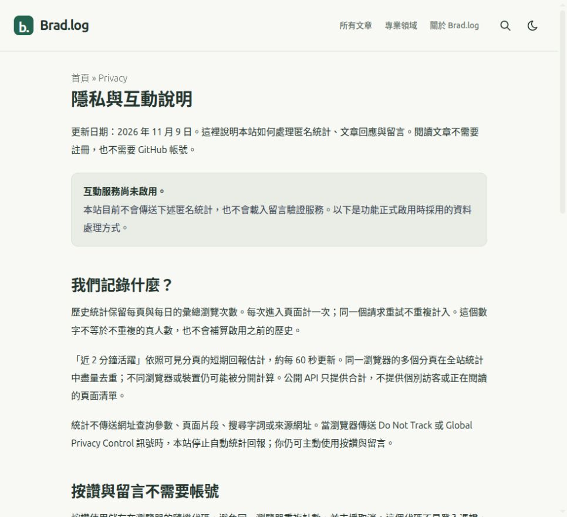

# Brad.log 部署與驗證紀錄

初次驗證時間：2026-11-09 12:35（Asia/Taipei）。文章版面修正與後測：同日約 14:35–14:48。本文件記錄初次上線、圖文補充及閱讀版面修正；未來更新以 GitHub Actions 最新成功的執行紀錄為準。

## 正式入口

- [Brad.log 首頁](https://bradcocox.github.io/brad-log/)
- [第一篇完整架站教學](https://bradcocox.github.io/brad-log/posts/github-pages-astropaper-guide/)
- [儲存庫](https://github.com/bradcocox/brad-log)
- [所有發布紀錄](https://github.com/bradcocox/brad-log/actions/workflows/deploy.yml)
- [完整設定與維護手冊](SETUP.md)

## 已完成的初次部署

1. 已審閱的 122 個來源檔案成功匯入既有 Git 歷史，與本機交付版本逐位元組一致。詳見 [來源匯入 run](https://github.com/bradcocox/brad-log/actions/runs/42561558484)。
2. `.github/workflows/deploy.yml` 已換成正式 `Publish Brad.log`。建置只有 `contents: read`，checkout 不持久保存認證；僅 deploy job 取得 Pages 與短效身分驗證所需權限。
3. 首次正式部署 commit 為 `0d267fd25cf9762c1e9957ed16ccf29dcda5f5be`。[run 42562002827](https://github.com/bradcocox/brad-log/actions/runs/42562002827) 的 `build` 與 `deploy` 均成功。
4. Pages Source 為 GitHub Actions；自訂網域留空；預設網域使用 HTTPS。已從本機 Chrome 開啟正式網站與文章，確認不是本機預覽。

## 實際瀏覽器驗證

| 項目 | 已觀察結果 |
| --- | --- |
| 首頁與文章 | 品牌、摘要、日期、文章入口與樣式正常；直接開啟文章網址可讀取 |
| 專業領域 | 六個入口與真實文章數；資料工程空分類顯示清楚的空狀態與返回文章入口 |
| 所有文章篩選 | 領域、文章型態、清除篩選正常，網址保留選項；排序選單與網址狀態正常，初次只有一篇文章，未以多篇資料驗證排序次序 |
| 搜尋 | 中文「部署」、英文「AstroPaper」各找到首篇；無結果提示、清除輸入與網址參數正常 |
| 明暗主題 | 已切換並檢視深色畫面，再恢復淺色 |
| 手機寬度 | 390 × 844 視窗；首頁與長文章無整頁橫向溢出；選單展開與 Escape 關閉正常 |
| 圖文 | 四張 SVG 說明圖已在瀏覽器放大檢視，中文字體與內容正常；圖片預覽可關閉及使用 Escape |
| 長文目錄 | 目錄可展開，點選章節可跳到對應位置 |
| 瀏覽器紀錄 | 上述操作期間未觀察到 warning 或 error |

以上是本次 Chrome 的功能與畫面檢查，未宣稱已涵蓋所有瀏覽器、所有裝置或完整無障礙稽核。

## 文章版面修正與後測

初次檢查確認了功能與整頁溢位，但未充分檢查表格實際可讀性。使用者指出文章欄位過窄後，重新擷取正式站的修正前證據，調整文章容器、目錄、表格欄寬與手機閱讀方式，並再次驗證。

- 版面修正來源 commit：[`02f2a62`](https://github.com/bradcocox/brad-log/commit/02f2a62)。正式發布 commit：[`c45e089`](https://github.com/bradcocox/brad-log/commit/c45e0890bc0a1b892e41ff77d1d5fe112bc7f7cb)。
- [版面修正部署 run 42573535715](https://github.com/bradcocox/brad-log/actions/runs/42573535715) 成功，實際檢查的是 GitHub Pages 正式文章。
- 1868px 寬度下，表格容器由 720px 增為 1224px；「用途」欄由約 31px 增為 171px，五欄完整可見。正文維持 864px，圖解與程式碼最多 1088px，側邊目錄有獨立空間。
- 390px 寬度下預設逐項閱讀，可切回表格對照；左右捲動、邊界狀態及方向鍵操作已驗證。1440px 與 1024px 的目錄及表格配置亦已檢查。
- 6 張表格共 52 筆資料，與卡片的文字及欄位標籤逐項一致；整篇沒有重複 ID。搜尋、兩種篩選、程式碼複製及圖片預覽／Escape 已完成回歸檢查。
- 版面來源及本次實拍／報告仍以已審閱的差異檔案匯入，完成後恢復正常 `Publish Brad.log`；沒有增加常駐憑證或改寫既有歷史。

完整證據與限制見 [UI_LAYOUT_REVIEW.md](UI_LAYOUT_REVIEW.md)，維護設定見 [SETUP.md](SETUP.md) 的 3.1 節。手機結果來自本機 Chrome 的指定尺寸檢視，不等同實體手機或完整無障礙稽核。

### 後續：文章對齊與圖說複核

使用者進一步指出，表格雖然變寬，正文、圖片與表格各自置中仍造成三條不同的左邊界。本輪由獨立 UI/UX review agent 檢視新截圖，再將文章內部區塊統一到主欄左緣，保留正文與圖表各自需要的寬度，並修正 Markdown 圖說的選擇器、字體與間距。

- 對齊修正 commit：[`9c2ef4d`](https://github.com/bradcocox/brad-log/commit/9c2ef4d34089fff4e6b7a2e0f6ad18d323152c39)。圖說間距修正 commit：[`36551cf`](https://github.com/bradcocox/brad-log/commit/36551cf00bc6e0773b1fb691d1f4b5e55ca6cd32)。
- [最終 CSS 部署 run 42577282888](https://github.com/bradcocox/brad-log/actions/runs/42577282888) 成功。
- 1868px、1024px 與 390px 寬度下，文章直接內容區塊與主欄左緣的最大差異均為 0px，右緣沒有超出主欄，也沒有整頁水平溢位。手機預設逐項閱讀持續正常。
- 獨立 reviewer 另行檢視修正後的「表格接正文與程式碼」及「標題接圖片與圖說」，確認本輪兩項錯位問題已解決；文章頂端由實作端另外檢查。

本輪新證據、設定與驗證界線見 [ARTICLE_ALIGNMENT_REVIEW.md](ARTICLE_ALIGNMENT_REVIEW.md)。這次 CSS 對齊複核不延伸為全站功能或完整無障礙重新驗證。

## 內容與建置

- 第一篇為初學者教學，已補入七張圖：四張說明圖、Pages Source 設定實拍、Actions 成功實拍、正式首頁實拍。
- `actions-success.jpg` 僅保留工作流程與公開站點；圖片不含登入選單、通知、私人聯絡資料或憑證。`site-home.jpg` 為初次上線的正式首頁。
- 首篇狀態更新為 `verified`，新增實際修訂時間；日常學習筆記仍可使用 `learning`。
- 本機與首次 CI 建置通過；Astro 檢查 67 檔案，無 errors、warnings 或 hints，產生 19 頁及 zh-tw Pagefind 索引。
- 來源及建置輸出中的常見憑證模式掃描通過。掃描器不能取代人工審查，不檢查圖片文字或歷史中所有敏感資料。
- 本次為補入實拍與驗證文件，再使用同一種一次性匯入方式交付差異檔案，完成後同樣換回正式最小權限 workflow；日常文章更新使用正常 Git 推送。

本次沒有建立 PAT、自訂部署 Secret 或部署私鑰，沒有改寫既有 Git 歷史或修改帳戶層級設定。公開 repo 的原始檔與 Git 歷史仍屬公開資料；保密規則與處置方式請見 [SECURITY.md](../SECURITY.md)。

## 免費匿名互動：程式完成，等待免費帳戶配置

後續需求已確定為「讀者沒有 GitHub 帳號也能參與」與「零支出」。新增 Cloudflare Workers Free＋D1 Free＋Turnstile Free 的後端，以及同正文左界的匿名按讚／留言、每頁／全站統計元件。詳細設定與可重現步驟見 [ENGAGEMENT_SETUP.md](ENGAGEMENT_SETUP.md)。

- 前端與後端開關仍關閉；Cloudflare 本機 Chrome 顯示登入頁。此階段沒有建立正式 D1、Worker 或 Turnstile 資源，也沒有新增付款方式或啟用付費服務。
- [匿名互動來源匯入 run 42590030877](https://github.com/bradcocox/brad-log/actions/runs/42590030877) 已成功，包含 27 個來源與文件差異檔案。這是原始碼保存紀錄，不是動態服務上線紀錄。
- 已通過 18 項 Node 24＋SQLite 的實際 SQL/API 測試，涵蓋資料去重、並發重試、匿名在線去重、按讚取消、審核可見範圍、Turnstile 驗證條件、CORS、大小限制、限流、清理及頁面允許清單。
- `pnpm build` 納入這組後端測試，再執行 Astro 檢查、靜態輸出與公開內容掃描；本機 Astro 檢查 80 檔案無 errors／warnings／hints，輸出 20 個靜態頁面與 19 頁／1 篇文章的公開互動允許清單。
- 新增 `/privacy/`，明確顯示互動尚未啟用及預定資料處理方式。未設定服務時，文章上不顯示無法使用的按鈕，也不傳送統計與 Turnstile 請求。
- 正式靜態發布 commit 為 [`11104f1`](https://github.com/bradcocox/brad-log/commit/11104f1e445b6c854156701932858de6e7321338)；[run 42591023407](https://github.com/bradcocox/brad-log/actions/runs/42591023407) 的 build 與 deploy 均成功，正式 workflow 已恢復最小權限的 `Publish Brad.log`。
- 本機 Chrome 已開啟正式 `/privacy/`，確認一般視窗（981px）及 390px 手機寬度沒有整頁水平溢位，服務狀態清楚顯示尚未啟用；DOM 中沒有互動設定根節點或 Turnstile script。實拍見下方，手機檢查後已恢復原視窗設定。
- 正式首篇文章的 6 張表格仍存在，本輪一般視窗檢查沒有整頁水平溢位，頁尾新增隱私說明入口。此項只確認目前關閉互動時的基本回歸，不代表已完成啟用後的互動或全部裝置驗證。
- 本機測試不能替代正式 Cloudflare D1／Turnstile、實際 CPU／配額、桌機與手機互動驗證。這些項目需在使用者登入免費帳戶、完成設定後再確認；本段不宣稱互動功能已正式上線。

已保存不含帳密的 [Cloudflare 登入頁實拍](ui-review/community/01-cloudflare-sign-in.jpg)，並在設定手冊說明目前待完成的步驟。後續 Pages 發布結果以 [Publish Brad.log](https://github.com/bradcocox/brad-log/actions/workflows/deploy.yml) 的正式紀錄為準；動態服務啟用須另外明確記錄，不以靜態網站部署成功代替。
