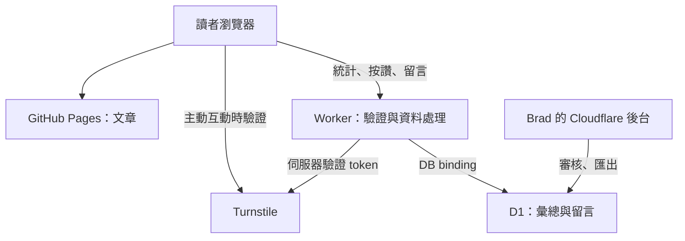
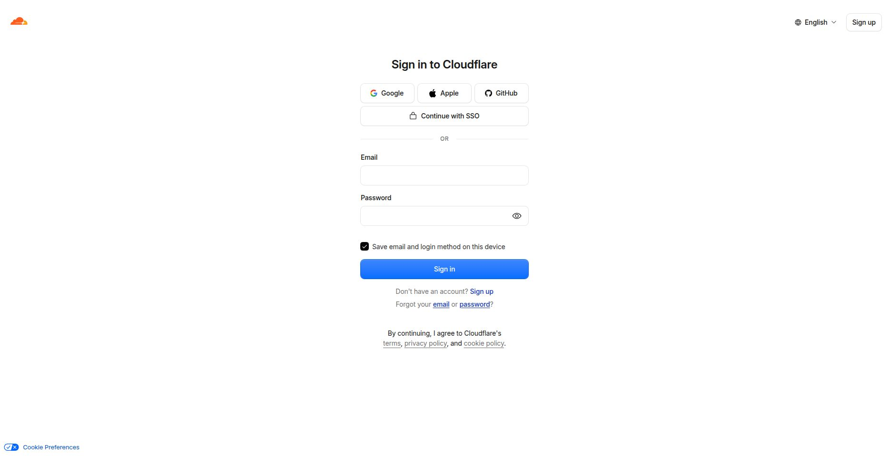
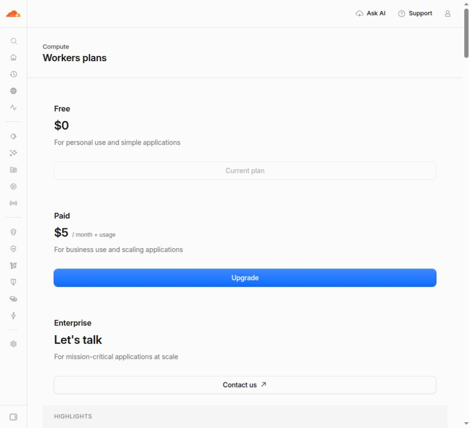
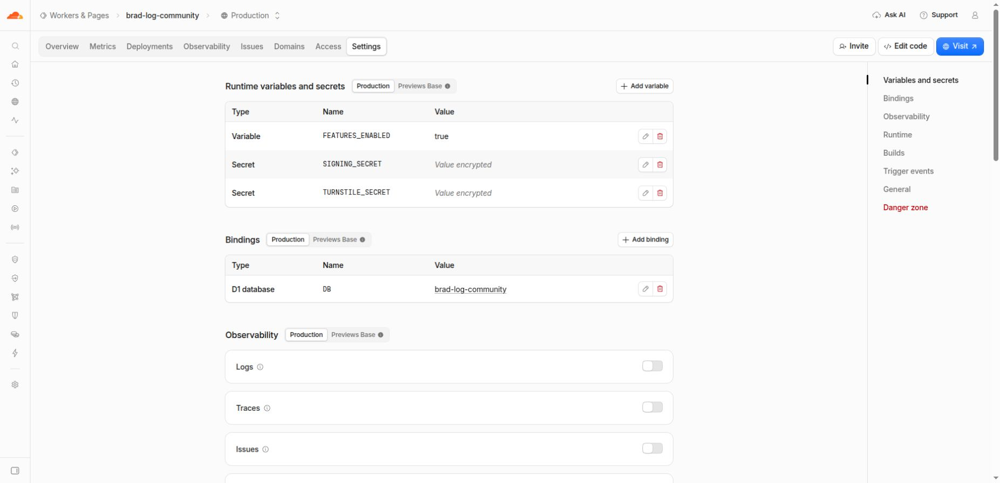
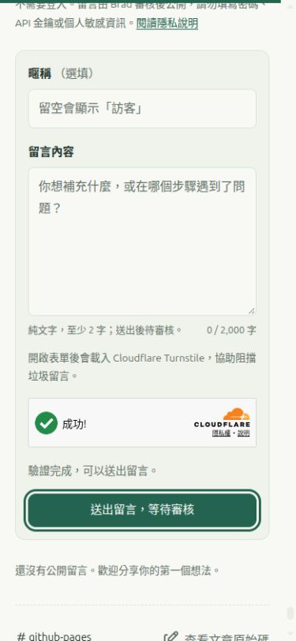
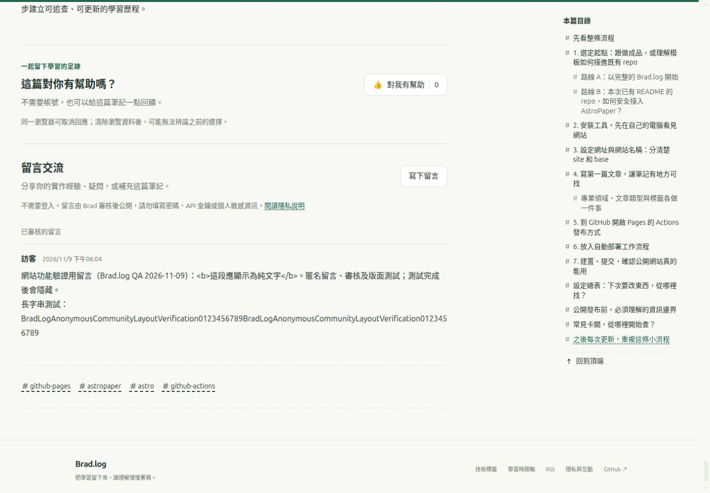

# Brad.log 免費匿名互動與統計設定手冊

本文件記錄「讀者不必有 GitHub 帳號」的按讚、留言，以及每頁／全站統計的設定方式。建置原則是 **只使用免費方案、不綁信用卡、不升級付費方案**；服務達到免費額度時暫停互動，文章仍由 GitHub Pages 正常提供。

查核日期：2026-11-09，使用者時區為 Asia/Taipei。費用與配額以文末的官方文件及實際帳戶畫面為準；這份文件不授權購買、升級或啟用付費試用。

## 1. 目前進度與啟用條件

| 項目 | 目前狀態 | 完成後應保留的證據 |
| --- | --- | --- |
| 方案選擇 | 已選 Cloudflare Workers Free＋D1 Free＋Turnstile Free | 本文件與可公開的設定檔 |
| Cloudflare 帳戶登入 | 已在使用者的本機 Chrome 完成登入與設定 | 不保存帳密、驗證碼、私人 Email、account ID 或登入 cookie |
| 帳戶 Workers 方案 | 已核對 **Workers Free、$0**；本次未綁卡、未購買或升級 | 截圖只保留方案名稱及免費額度，排除私人帳戶資訊 |
| D1 正式資料庫 | `brad-log-community` 已建立；應用程式 schema 為 **8 表、6 索引、3 觸發器** | 記錄名稱與檢查結果，不保存實際 database UUID |
| Worker 正式網址 | [brad-log-community.bradcocox.workers.dev](https://brad-log-community.bradcocox.workers.dev) | 使用平台提供的 `workers.dev`；未購買或設定自訂網域 |
| Worker Production 設定 | `DB` binding、`FEATURES_ENABLED="true"`、兩個加密 secrets、10 分鐘 cron 已設定 | 實際值對照第 4 節；repository 中的 Wrangler 檔仍是關閉的模板 |
| Turnstile | Managed、hostname `bradcocox.github.io`、pre-clearance 關閉；正式 `like`／`comment` 驗證已通過 | 公開 site key 可記錄；secret key 不記錄；實際流程見第 13 節 |
| 正式 API 與統計 | `/health` 回 `status: "configured"`；統計由初始全 0 變成正式瀏覽產生的非零彙總 | 文章與首頁讀取頁面／全站統計；精確 120 秒邊界未另做正式等待測試 |
| 前端與讀者互動 | **前後端已上線，主要功能已正式驗證**；前端 `enabled: true` | 按讚、重新整理保存、取消、留言待審／批准／拒絕，以及桌機／手機結果見第 13 節 |
| 本機測試與建置 | 18 項 SQLite／API 測試通過；修正後完整建置通過 | 與正式瀏覽器操作分開記錄，不把受控測試當成所有平台情境實測 |
| Cron 清理 | 每 10 分鐘排程已設定；已觀察到過期 `presence` 紀錄清除 | 資料層驗證見第 13 節；Cron Events 列表尚未顯示紀錄，未推定確切執行時間 |
| 授權及部署方式 | Dashboard 手動貼上 bundle；本次未安裝 GitHub App、未建立 PAT | Pages 與 Worker 各自發布，沒有新增付費部署服務 |

以下同時保存可重現流程與本次實際設定。**主要功能已在正式網站完成驗證**；完整結果、未測範圍與持續維護項目見第 13 節。全新重建時仍先關閉前後端開關，先完成 schema、binding 與 secrets，再驗證後端，最後發布前端。本次成功依據包括實際按讚、留言與審核操作，並非只看初始全 0 或單一健康檢查。

首階段互動模組原始碼透過 [來源匯入 run 42590030877](https://github.com/bradcocox/brad-log/actions/runs/42590030877) 保存到 GitHub。[Pages run 42591023407](https://github.com/bradcocox/brad-log/actions/runs/42591023407) 的 build 與 deploy 均成功；當時正式 `/privacy/` 頁在本機 Chrome 檢視，標示互動尚未啟用。這是啟用前的歷史紀錄。後續發布結果請查看 [Publish Brad.log](https://github.com/bradcocox/brad-log/actions/workflows/deploy.yml) 及 [部署狀態](DEPLOYMENT_STATUS.md)；Pages 成功不代表 Worker 版本或互動流程也已通過。

首次啟用的公開來源為 [9809387](https://github.com/bradcocox/brad-log/commit/9809387)，Pages 發布版本為 [44e625e](https://github.com/bradcocox/brad-log/commit/44e625e80fa4408115c31fd1b91720c45208c865)，[run 42596459899](https://github.com/bradcocox/brad-log/actions/runs/42596459899) 成功。正式測試後完成 Turnstile 載入修正 [946e30e](https://github.com/bradcocox/brad-log/commit/946e30e1e93d0e7b35c80b9c45530f87ad1dc23c)／[run 42597413477](https://github.com/bradcocox/brad-log/actions/runs/42597413477)，以及手機浮動目錄避讓修正 [bf437ae](https://github.com/bradcocox/brad-log/commit/bf437aeffe460b61ba8ef77ee23a6f950da7ea6b)／[run 42598765590](https://github.com/bradcocox/brad-log/actions/runs/42598765590)，兩次發布均成功並完成對應後測。Worker 相容性版已部署；本輪使用正式金鑰與實際 D1 資料驗證，沒有以測試 key 代替。

## 2. 服務分工與資料流

GitHub Pages 繼續提供文章與分類頁。Cloudflare Worker 接收統計及互動請求，透過私有的 D1 binding 存取資料；Turnstile 只用於訪客主動按讚或留言時的防濫用驗證。管理員從 Cloudflare 的已登入後台審核留言，第一版沒有公開管理 API。



公開網頁只能取得聚合數字及已批准的留言。D1 不直接對讀者開放，Worker 不回傳個別訪客的 presence 狀態、限流識別碼或待審內容。

## 3. 第一步：登入並確認免費方案

本次已完成此步，並在帳戶畫面確認 Workers Free、$0。以下保留新帳戶或日後維護時的操作順序；沒有新增付款方式，也沒有啟用 Paid／付費試用。

1. 在使用者的本機瀏覽器開啟 [Cloudflare Dashboard](https://dash.cloudflare.com/)。沒有帳戶時，使用免費註冊流程建立帳戶。
2. 帳密、驗證信、MFA／驗證碼由使用者完成；不把內容貼進聊天、文件或 repo。
3. 選擇要放置 Brad.log 後端的帳戶，確認 **Workers 方案為 Free**。Workers 的方案與額度依帳戶管理，不因 Worker 名稱包含 `free` 就自動免費。
4. 記錄「查核日期、Workers Free、未新增付款方式、未啟用 Paid／付費試用」。如需截圖，先確認沒有 Email、帳戶識別資料、權杖或其他私人專案資訊。
5. 使用現有的 `github.io` 與平台提供的 `workers.dev` 網址。Custom domain 留空，不購買網域，也不需要把 GitHub Pages DNS 搬到 Cloudflare。

若某一步要求新增信用卡、選擇付費方案或開始會轉付費的試用，就停在該步，保留文章服務與關閉中的互動功能；不要為了讓部署繼續而按升級。官方 D1 產品頁目前寫明免費開始不需要信用卡，Workers 預設提供 Free 方案。[D1 產品與免費註冊](https://www.cloudflare.com/products/d1/)；[Workers pricing](https://developers.cloudflare.com/workers/platform/pricing/)。



2026-11-09 初始設定階段實拍：這是**完成登入之前的歷史畫面**，後續已完成登入與後端配置。圖中只保留空白登入頁，不含帳密、驗證碼或其他帳戶內容。這是網站管理者的設定流程，讀者不需要註冊 Cloudflare 或 GitHub。



2026-11-09 完成設定後的實拍：Current plan 為 **Free、$0**。截圖收合了側邊欄，不包含私人 Email 或秘密。這張圖確認當時帳戶方案；仍應在日後維護時確認沒有被改成 Paid，不能把一次截圖當作永久價格保證。

## 4. 設定對照表：哪些可以公開

| 位置 | 欄位／資源 | 設定值或規則 | 公開性 |
| --- | --- | --- | --- |
| Cloudflare | Worker 名稱 | `brad-log-community` | 可以公開 |
| Cloudflare | D1 名稱 | `brad-log-community` | 可以公開 |
| Worker binding | `DB` | 指向上述 D1 資料庫；名稱必須完全相同 | binding 名稱可以公開；不提供資料庫直接存取 |
| Worker 正式入口 | HTTPS origin | `https://brad-log-community.bradcocox.workers.dev` | 可以公開，不需要自訂網域 |
| Worker 環境 | Production | 本次只配置 Production 的變數、秘密與 binding | 不把 Preview 設定當作 Production 設定 |
| Worker runtime variable | `FEATURES_ENABLED` | Production 現為字串 `true`；新建時先設 `false` | 可以公開；repo 模板仍為 `false` |
| Worker runtime secret | `SIGNING_SECRET` | Production 已以 **Secret／Encrypted** 保存；獨立隨機值至少 32 個字元，建議 32 bytes 以上隨機資料 | **不可公開，也不寫入任何來源或產物檔案** |
| Worker runtime secret | `TURNSTILE_SECRET` | Production 已以 **Secret／Encrypted** 保存，值來自該 Turnstile widget | **不可公開，也不寫入任何來源或產物檔案** |
| `backend/worker.mjs` | `ORIGIN` | `https://bradcocox.github.io` | 允許的網站 origin；可以公開，包含協定，不含 `/brad-log/` |
| 同上 | `HOSTNAME` | `bradcocox.github.io` | Turnstile 預期 hostname；可以公開，不含協定或路徑 |
| Worker Runtime | Compatibility date | `2026-11-09` | 本次 Production 設定；模板使用相同日期 |
| Worker Domains & Routes | Preview URLs | **Off**，已確認開關未勾選 | 本次使用正式 `workers.dev` 入口 |
| Worker Observability | Logs／Traces／Issues | 本次全部關閉 | 不代表 Cloudflare 平台完全沒有安全日誌 |
| Worker Cron Trigger | 排程 | `*/10 * * * *` | 已設定每 10 分鐘觸發，並觀察到過期 presence 清除；事件列表另行觀察 |
| Turnstile | 模式／hostname／pre-clearance | Managed／`bradcocox.github.io`／Off | 不開啟跨服務預先放行功能 |
| Turnstile | Public site key | `0x4AAAAAAF5s44CmPYe6KGwg` | 本來就要提供給瀏覽器，可以公開；不是 secret key |
| `backend/wrangler.jsonc` | `database_id` | **保留** `REPLACE_WITH_D1_DATABASE_ID` | Dashboard 已建立 `DB` binding；本文件與 repo 不保存實際 database UUID |
| 同上 | `FEATURES_ENABLED` | **保留** `false` | 此檔是未部署的安全起始模板，不是 Production 狀態備份 |
| 同上 | `workers_dev`／`preview_urls`／`observability.enabled` | 模板為 `true`／`false`／`false` | 模板值不等於所有 Dashboard 設定已自動套用 |
| `src/data/engagement.ts` | `enabled` | 本次已設 `true` 並完成 Pages 發布；新建時先設 `false` | 主要互動已驗證，結果見第 13 節 |
| 同上 | `apiBase` | `https://brad-log-community.bradcocox.workers.dev`，不加 `/v1` | 公開前端連線值 |
| 同上 | `turnstileSiteKey` | 上述 public site key | 只能填 site key，不能填 secret key |

**沒有 `PUBLIC_SIGNING_SECRET` 或 `PUBLIC_TURNSTILE_SECRET`。** 即使某值原本來自 CI Secret，只要被編譯進前端 JavaScript，訪客就能讀到。後端秘密只能放 Worker 的 runtime **Secret** 類型，不能放 GitHub Pages 的原始碼、公開文章、截圖或一般前端變數。



圖中可以核對 `FEATURES_ENABLED` 為 `true`、兩個 Secret 都顯示 `Value encrypted`，以及 `DB` 指向正式資料庫。Logs、Traces、Issues 開關維持關閉；截圖不包含秘密值、帳戶 Email 或資料庫 UUID。

**不要直接用目前的 `backend/wrangler.jsonc` 執行 `wrangler deploy`。** 它保留 placeholder D1 ID 與 `FEATURES_ENABLED="false"`；以它覆蓋手動配置的 Production，可能讓部署失敗、使用錯誤 binding，或把已啟用的服務關掉。此次正式 Worker 使用第 7.2 節的 Dashboard 流程；第 7.3 節只說明日後改用 Git 部署時必須重新整理的設定。

目前 origin 與 hostname 是後端原始碼的固定限制，不是另行建立 `ALLOWED_ORIGIN` 等環境變數。換網域時，必須一起修改後端限制、Turnstile hostname 與前端網址，再重新驗證。CORS 只限制一般瀏覽器跨來源存取，不是防偽造或防機器人的完整機制。

## 5. 第二步：建立 D1 並初始化資料表

1. 在 Cloudflare 帳戶中找到 **D1 SQL database**，選擇建立資料庫。
2. 名稱使用 `brad-log-community`。保持免費方案；區域若可選，依實際需求選擇並記錄，不把區域選擇誤寫成法規資料落地保證。
3. 先在本機準備適合 Console 貼上的 SQL。使用 Node.js 24 以上，在 **repo 根目錄**開啟終端機，執行：

   ```sh
   cd backend
   npm run migration:console
   ```

4. 確認輸出包含 `one SQL line`，以及 `SQLite comparison passed: 8 tables, 6 indexes, 3 triggers; initial counters match.`。檔案產生在 repo 根目錄下的 **`backend/dist/0001_community.console.sql`**。此命令只做本機產生與檢查，不會自行連線 Cloudflare 或修改正式資料庫。
5. 建立 D1 後開啟該資料庫的 **Console**。開啟剛產生的 `backend/dist/0001_community.console.sql`，複製其中完整的一行 SQL，貼進 Console，再按 **Execute**。不要複製終端機的檢查訊息，也不要直接貼原始 migration 的 `--` 註解。
6. 到 **Tables** 確認下表的 8 個應用程式資料表；另確認 6 個自訂索引及 3 個觸發器。Cloudflare／SQLite 的內部物件不計入這組應用程式數量。
7. 查詢 `SELECT id, visits FROM site_counters;`，確認有 `id = 1` 的初始列。全新資料庫的 `visits` 應為 `0`；已有正式流量時可大於 0，不得為了符合範例而歸零。
8. 本次透過 Worker Dashboard 的 **Bindings** 選擇這個資料庫；不用複製實際 database UUID 到 repo 或文件。完成本機命令後可用 `cd ..` 回到 repo 根目錄。

| 應用程式物件 | 應有名稱 |
| --- | --- |
| 8 個 tables | `site_counters`、`page_counters`、`page_daily`、`view_events`、`presence`、`reactions`、`comments`、`rate_buckets` |
| 6 個 indexes | `view_events_expiry`、`presence_recent`、`presence_page_recent`、`comments_public`、`comments_expiry`、`rate_buckets_expiry` |
| 3 個 triggers | `record_view`、`add_like`、`remove_like` |

**為什麼要多跑一個 helper？** 本次實際使用的 D1 Console 會移除貼上文字中的換行。原始 `backend/migrations/0001_community.sql` 有 `--` 單行註解；換行消失時，後面的 SQL 可能一起變成註解，造成看似執行了、實際卻沒有建表。`backend/scripts/console-migration.mjs` 會移除完整註解行、保留 SQL 分號，產生一行可貼上的文字，再用本機 SQLite 比對原始與單行版本的 schema、初始計數與重複執行結果。

這個 helper 只處理本次初始 migration；遇到不支援的行內／區塊註解或跨行字串會停止，不是任意 SQL 都能使用的壓縮器。原始 migration 仍是可閱讀、受版本管理的來源，`dist/` 中的單行檔只是 Console 交付產物。本次正式 D1 已核對上述 **8 表、6 索引、3 觸發器**，並成功讀取初始計數。

初始 migration 使用 `CREATE ... IF NOT EXISTS`，但後續 schema 更新仍應新增 migration 並保留版本；不要為了重新執行教學而刪掉正式資料表。官方 Console 建表流程見 [D1 getting started](https://developers.cloudflare.com/d1/get-started/)。

## 6. 第三步：設定 Turnstile

1. 在 Cloudflare 帳戶中開啟 **Turnstile**，建立一個 Free widget，例如 `Brad.log community`。
2. hostname 填 **`bradcocox.github.io`**，不包含 `https://`、`/brad-log/` 或文章路徑。
3. widget 使用 **Managed** 模式；本方案不需要 Enterprise、任意 hostname 或其他付費功能。
4. **Pre-clearance 保持 Off**。本次只需要 Turnstile challenge，不需要設定自訂網域、搬動 DNS 或啟用額外的預先放行流程。
5. 將公開的 **site key** 留待前端設定；本次為 `0x4AAAAAAF5s44CmPYe6KGwg`。將 **secret key** 直接填入 Worker **Production** 的 `TURNSTILE_SECRET` runtime secret，確認類型為 **Secret／Encrypted**；不存成文字檔、不放入 bundle、不截圖秘密值。
6. 前端主動按讚時的 action 為 **`like`**；留言表單的 action 為 **`comment`**。這兩個 action 由程式傳入，後端驗證 token 的成功狀態、hostname 與 action，不能只有前端圖形驗證。
7. 正式網頁不得使用官方測試用的「永遠通過」金鑰；本機測試與正式設定分開記錄。Widget 建立及 secret 存入成功，不代表已通過真實讀者 challenge，結果需另記於第 13 節。

Turnstile token 有效期為 5 分鐘，而且只能驗證一次；超時或重送要取得新 token。Siteverify 是後端必要步驟，不可因前端顯示驗證成功就直接接受留言。[Free plan](https://developers.cloudflare.com/turnstile/plans/)；[Server-side validation](https://developers.cloudflare.com/turnstile/get-started/server-side-validation/)。

## 7. 第四步：部署 Worker

### 7.1 準備正式頁面清單與後端檔案

先在 repo 根目錄執行 `pnpm build`。建置使用 `scripts/generate-engagement-manifest.mjs`，從 Astro 實際輸出的頁面產生 `dist/engagement-pages.json`。部署後固定網址為 `https://bradcocox.github.io/brad-log/engagement-pages.json`，Worker 只從這個固定的第一方位置取得新增頁面清單，最多快取 5 分鐘。

清單包含 `pages` 與 `articles`：前者是允許統計的頁面，後者是允許按讚／留言的文章。只有正式公開頁面才加入；草稿、404、查詢字串、任意外部網址及尚未存在的文章不能作為無限制的新資料鍵。標示 `engagement-exclude` 的 QA 頁面也不加入。正常新增文章後，Pages 的新清單會讓後端認得該頁，不需要每次新增文章都重部署 Worker。

首次準備 Worker 或更新離線備援清單時，在已完成 `pnpm build` 的 repo 根目錄執行：

```sh
pnpm engagement:manifest
```

這會更新 `backend/allowed-pages.json`，供 Worker bundle 在無法取得公開清單時使用。**目前內建備援中的頁面仍會被接受**：若要撤下曾經加入備援的頁面／文章，必須同步更新備援清單並重部署 Worker，不能只刪除公開文章就假設 API 一併拒絕。這些清單是公開路徑，不含使用者資料或秘密。

在 repo 根目錄開啟終端機，先進入 `backend/`，再執行：

```sh
cd backend
npm test
npm run bundle
```

`npm run bundle` 產生 repo 根目錄下的 `backend/dist/worker.mjs`，將後端及允許頁面清單組合成供 Dashboard 使用的單一 module。這個 bundle 步驟不需要安裝外部套件或提供秘密。後端使用 Node.js 24 以上；測試結果與正式連線驗證要分開記錄，本機測試通過不代表 Cloudflare 的 binding、secret 或 Turnstile 已設定。回到 repo 根目錄時執行 `cd ..`。

### 7.2 路徑 A：Dashboard 手動部署

**本次實際採用此路徑。** 沒有連接 Cloudflare GitHub App，也沒有建立個人 PAT；GitHub Pages 的 Actions 只負責靜態網站，並不自動更新 Worker。

1. Workers & Pages → **Create application**，使用 Dashboard 建立 `brad-log-community` Worker。選擇可直接編輯程式的起始流程；不需匯入 Git repository，也不需升級方案。
2. 開啟 Worker 的 **Edit Code**，將編輯區的起始範例替換成剛產生的 **`backend/dist/worker.mjs` 完整內容**，以 module Worker 儲存及部署。不要貼尚有 JSON import 的原始 `backend/worker.mjs`，也不要只貼其中一段函式。
3. 在設定頁核對操作環境為 **Production**。本次的變數、秘密與 binding 都配置於 Production；其他環境同名設定不能代替正式設定。
4. Worker → **Bindings** → **Add binding** → **D1 database**。變數名稱必須是 **`DB`**，選擇 **`brad-log-community`** D1，保存並依畫面完成部署。
5. Worker → **Variables and Secrets**，新增 `FEATURES_ENABLED`，類型為一般文字，值先設 **`false`**。Schema、binding 與 secrets 準備好後，再改為字串 **`true`** 進行受控驗證；本次 Production 已完成這一步。
6. 新增 **`SIGNING_SECRET`** 與 **`TURNSTILE_SECRET`**，兩者均選 **Secret** 類型。第一個以密碼管理器產生足夠長的獨立隨機值；第二個使用正式 Turnstile widget 的 secret key。確認保存後顯示 **Encrypted**；記錄已配置，不複製值到來源碼、檔案、聊天或截圖。
7. Runtime 的 **Compatibility date** 設為 **`2026-11-09`**。每次改相容性日期或 runtime 相關程式都要重新驗證；本機 Node 測試不等於 Cloudflare runtime 測試。
8. Observability 中的 **Logs、Traces、Issues 全部關閉**。這是此次應用程式設定，不代表 Cloudflare 完全不處理網路或安全日誌。
9. 在 **Cron Triggers** 新增 **`*/10 * * * *`**，保存後確認對應 Worker 的 `scheduled` handler。這是每 10 分鐘的短期資料清理工作，會消耗免費資源；關閉互動開關時仍保留 DB binding 與 cron。
10. 使用平台提供的正式網址 **`https://brad-log-community.bradcocox.workers.dev`**。Custom domain 留空，不購買網域；在 **Domains & Routes** 確認 **Preview URLs 關閉**，本次已核對開關未勾選。根路徑不是文章首頁；開啟 [/health](https://brad-log-community.bradcocox.workers.dev/health) 檢查基本設定，再從正式網站來源驗證 API。
11. 每次保存或部署後，重新查看 Production 的變數存在狀態、`DB` binding、cron、日期與免費方案。Dashboard 編輯器的預覽結果不能取代正式 `workers.dev` URL 的結果。

後續改後端時，先修改 repo 的來源，重新跑 `npm test`、`npm run bundle`，再把新的完整 bundle 貼入 Dashboard 並部署；不用重建 D1，也不要重設計數。只在 Dashboard 改程式卻沒有更新 repo，會使下次部署蓋掉線上修正。**Dashboard 的變數、secret、binding 與 cron 不會因本機產生 bundle 就自動設定。** 官方 binding／Edit Code 操作見 [D1 remote development](https://developers.cloudflare.com/d1/best-practices/remote-development/)。

### 7.3 日後可選的 GitHub 自動部署：本次未使用

目前沒有配置此路徑，**不能直接拿 repo 中的 Wrangler 模板部署正式服務**。若日後改用 Git，先完成下列設定核對，再啟用自動發布：

1. 先盤點第 4 節的 Production 設定，決定自動部署如何保留正確 `DB` binding、兩個 runtime secrets、`FEATURES_ENABLED`、cron、相容性日期與關閉的 Observability。現在的 placeholder 模板不能還原這些實際設定；不要把實際 account ID、Email 或 database UUID 寫入公開 repo。
2. 透過 Workers & Pages 匯入既有 Git repository。若決定授權 Cloudflare GitHub 整合，只選 **`bradcocox/brad-log`**，檢查當下要求的最小權限，不選所有 repositories；這是未來可選的授權，並非本次已安裝。
3. Production branch 使用 `main`；root directory 為 **`backend`**，Worker 名稱為 `brad-log-community`。先完成可安全管理既有 Production 設定的部署配置，才執行 Wrangler；不以未填寫的模板嘗試碰運氣部署。
4. 核對並釘選實際使用的 Wrangler 版本。Repo 目前沒有 `npm run deploy` 指令，不能把它當成已建好的發布流程。前端建置不需要 Cloudflare API token，兩個秘密仍只放 Worker runtime secrets。
5. 先驗證自動部署不會將 `FEATURES_ENABLED` 從 `true` 蓋回 `false`，也不會移除或替換 `DB` binding；再核對正式 URL、cron、Compatibility date、secret 存在狀態與 Workers Free。只見 build 成功不代表設定正確。

這裡的 `backend/` 是同一個 repo 的後端子目錄，GitHub Pages 仍照原本的 workflow 建置文章。可以限制後端自動建置的監看路徑，避免單純修改文章就不必要地建置後端；公開 manifest 會支援新增頁面，後端程式或內建備援清單改變時才需要部署 Worker。

官方文件：[Dashboard 建置與免費 workers.dev](https://developers.cloudflare.com/workers/get-started/dashboard/)；[GitHub integration](https://developers.cloudflare.com/workers/ci-cd/builds/git-integration/github-integration/)；[Workers Builds 免費額度](https://developers.cloudflare.com/workers/ci-cd/builds/limits-and-pricing/)。

### 7.4 本次 runtime 相容性修正

本機 SQLite／API 測試通過後，本次正式部署仍發現 `TextDecoder` 的 runtime 相容性差異。原始碼已在兩處明確使用 `new TextDecoder("utf-8", { fatal: true, ignoreBOM: false })`：一處讀取受限的公開頁面 manifest，另一處讀取 API 請求的 JSON body。這兩條路徑都需要更新；只修正其中一處會留下另一種請求失敗的可能。

修正流程為 **更新來源 → 本機測試 → 重新產生 bundle → Dashboard 部署 → 正式 API 與前端驗證**。本次新的正式 bundle 已部署，Cloudflare 編輯器顯示 0 errors；後續也完成真實統計、Turnstile、按讚與留言操作。第 13 節記錄具體結果，編輯器沒有錯誤與功能實測各自列明。

## 8. 第五步：驗證後才開啟前端

### 本次實機排錯：Turnstile 的載入順序

首次上線測試時，統計可以讀寫，但按讚停在「正在驗證」。Chrome 的錯誤指出，非同步載入的 Turnstile script 不可搭配當時的 `turnstile.ready()` 呼叫方式。這種問題不會由後端 SQL 測試或靜態建置檢查自動發現，必須在正式網站驗證。

修正位於 `src/scripts/engagement.ts`：讀者第一次主動互動時，先準備具名的載入回呼，再加入官方 `api.js?render=explicit&onload=...` script；回呼確認 SDK 可用後才建立驗證元件。已載入的 SDK 共用，逾時不重複插入仍在下載的 script，真正下載失敗時才允許明確重試。沒有換成測試 key，也沒有跳過 Worker 的 Siteverify、hostname 或 action 檢查。這套方式依據 [Cloudflare 官方顯式渲染與 onload 回呼文件](https://developers.cloudflare.com/turnstile/get-started/client-side-rendering/)。

### 開啟前端的順序

本次已完成後端配置，`FEATURES_ENABLED` 在 Production 為 `true`；前端為 `enabled: true`，已完成 Pages 發布與**主要功能的正式驗證**。以下保留完整重建順序，實際結果及未測範圍見第 13 節。

1. 保持前端 `enabled: false`，先完成 Worker、DB、secret 與 Turnstile 設定。
2. 在受控驗證時才把後端 `FEATURES_ENABLED` 設為字串 `true`。錯誤來源、未允許頁面、無效 token、錯誤 action、超長留言及重送請求都應按預期被拒絕或去重。
3. 在 `src/data/engagement.ts` 填入 `apiBase: "https://brad-log-community.bradcocox.workers.dev"` 與 `turnstileSiteKey: "0x4AAAAAAF5s44CmPYe6KGwg"`。`apiBase` 是完整 HTTPS origin，不含結尾 `/v1`；不用把 secret 填在任何前端欄位。
4. 將 `enabled` 設為 `true`，建置並部署 GitHub Pages。
5. 按一般讀者流程驗證閱讀統計、按讚／取消、提交留言、待審提示、審核後公開；不輸入 GitHub 帳密或授權 GitHub OAuth。測試留言需明確標示為測試，不假冒讀者；另記實際瀏覽器是否已有登入狀態，不能把同一視窗的結果寫成登出／無痕驗證。
6. 核對手機、桌機、深淺色、長內容與長網址沒有溢位，文章之間導覽不重複初始化或把 A 文留言放到 B 文。
7. 模擬 API 失敗時，介面應顯示「統計暫時無法取得」或「留言暫時無法載入」等狀態，文章仍完整。未成功回傳的計數不補假 `0`。
8. 完成後在本文件開頭與部署紀錄補上實際結果；沒做的情境保留「未驗證」。

### 手機表單與浮動目錄的實際後測

本次 390px 視窗檢查發現，右下角浮動目錄可能接觸留言送出按鈕。修正後，進入文章互動區時 `#post-fab` 會設為 `hidden` 並呈現 `display: none`；回到正文後恢復可用。已在正式版本確認送出按鈕完整可點、目錄 popover 能開啟，按 Escape 可關閉。



最終手機版實拍：視窗寬 390px、可用內容寬 375px；正文、標題、互動區與表單的左界均為 20px，寬 335px，整頁水平溢位為 0，主要操作按鈕高 44px。切換深色時保留草稿、暫停送出並提示重新驗證；實際重新驗證成功。測試完成後已恢復淺色，清空並收起未送出的 QA 草稿。這是本機 Chrome 的指定尺寸檢視，不是實體手機測試。

第一版公開端點如下；這些是 API 路由，不是管理後台：

| 端點 | 功能與公開範圍 |
| --- | --- |
| `GET /health` | 檢查開關、DB binding、秘密是否存在及初始 `site_counters` 列可讀；成功回 `status: "configured"`。仍須以真正 challenge 驗證 Turnstile 金鑰，且不代表完整互動流程已通過 |
| `POST /v1/pulse` | 提交頁面訪問／短期活躍訊號；訪問去重與在線更新由後端處理 |
| `GET /v1/stats?pageId=...` | 讀取該頁與全站聚合數字，不取得訪客名冊 |
| `GET /v1/reaction` | 讀取文章按讚資訊及該匿名識別碼的狀態 |
| `PUT /v1/reaction` | 按讚或取消；使用 `like` Turnstile action |
| `GET /v1/comments` | 依 article ID／cursor 分頁讀取已批准留言 |
| `POST /v1/comments` | 送出待審留言；使用 `comment` Turnstile action |

`backend/worker.mjs` 的 `LIMITS` 保存第一版伺服器限流設定，採每日輪替的網路位址 HMAC 作為範圍；同公司／家庭的共用出口可能共用限制，不是每個真人各自一份額度：

| 操作 | 限制 |
| --- | --- |
| pulse | 每分鐘 60 次，且每小時 1,500 次 |
| stats | 每分鐘 120 次 |
| 讀取按讚狀態 | 每分鐘 120 次 |
| 按讚／取消 | 每分鐘 10 次，且每天 100 次；取消同樣需要 `like` 驗證 |
| 讀取留言 | 每分鐘 60 次 |
| 送出留言 | 每小時 5 次，且每天 15 次 |

達到應用程式限流回傳 `429` 及 `Retry-After`；平台／資料庫不可用則回安全的暫時失敗資訊，不把 SQL、IP、環境變數或驗證 token 傳給訪客。這些限制可依實際使用調整，但每次調整都應評估免費配額與共用網路的讀者體驗。

## 9. 留言審核：不用提供讀者任何管理密碼

留言資料表 `comments` 的狀態為 `pending`、`approved`、`rejected`，時間 `created_at` 使用 Unix 毫秒。暱稱可留空，後端使用「訪客」；有填寫時最多 32 字元，留言 2–2000 字元。留言以純文字處理，不允許自行執行 HTML／JavaScript。

在已登入 Cloudflare 的 D1 Console 查看待審留言：

```sql
SELECT id, article_id, nickname, body,
       datetime(created_at / 1000, 'unixepoch', '+8 hours') AS created_at_taipei
FROM comments
WHERE status = 'pending'
ORDER BY created_at ASC
LIMIT 50;
```

確認內容後，只對剛剛查到的單筆 ID 執行。以下 `COMMENT_ID_FROM_QUERY` 是佔位值，需換成實際查詢取得的 ID，不可移除 `WHERE`：

```sql
UPDATE comments
SET status = 'approved'
WHERE id = 'COMMENT_ID_FROM_QUERY' AND status = 'pending';
```

拒絕留言：

```sql
UPDATE comments
SET status = 'rejected'
WHERE id = 'COMMENT_ID_FROM_QUERY' AND status = 'pending';
```

審核後以 `SELECT id, status FROM comments WHERE id = 'COMMENT_ID_FROM_QUERY';` 核對。若已公開留言有問題，可將該筆 `status` 改為 `rejected`，再確認公開頁已不顯示。誤貼的秘密需要立即從資料與可取得的副本處理，並撤銷或輪替該秘密；單純把留言隱藏不等於秘密未曾外洩。

使用暱稱不代表身分驗證，訪客可以輸入相同暱稱。不要把匿名留言顯示成「已驗證 Brad」或其他認證標記。先審後發能降低垃圾訊息公開的機會，仍需要管理員定期檢視。



2026-11-09 正式審核流程實拍：同一筆 QA 留言先為 `pending`，重新整理時沒有出現在公開列表；管理員批准後才顯示「訪客」與內容。測試中的 `<b>` 保持字面文字，留言 DOM 的 `b` 元素數量為 0；102 字元長字串能在欄寬內換行。**驗證後已將同一筆 QA 留言改為 `rejected`，重新整理確認公開列表恢復空白。** 圖片保留當時的驗證證據，不代表目前頁面仍有這則留言，也不是預先填入的讀者討論。

## 10. 統計口徑、隱私與保留期限

### 10.1 數字代表什麼

- **累積訪問次數：**頁面載入產生訪問事件，重送同一事件由後端去重；heartbeat 只更新活躍狀態，不反覆增加訪問。全站累計代表被接受的頁面訪問總數，不能稱為終身不重複人數。
- **近 2 分鐘活躍：**最近 120 秒收到訊號的短期匿名 session。前端在可見頁面每 60 秒更新；離開、背景分頁、斷線到過期之間會有延遲，不是即時真人名冊。
- **跨頁與跨裝置：**全站活躍計數要對同一短期 session 去重；不同裝置、不同瀏覽器或清除儲存後，無法可靠知道是否同一個人。
- **匿名按讚：**以文章及瀏覽器的匿名識別碼去重；不是自然人一人一票的保證。清除瀏覽資料後可能不能取消之前的讚，也可能產生新的識別碼。
- **歷史起點：**從功能正式啟用後開始累積，沒有蒐集過的舊流量無法回補。腳本被封鎖、網路錯誤、DNT／GPC、免費額度耗盡都可能造成低估；一般公開統計也不能保證完全排除機器人。
- **文章識別：**目前以包含 `/brad-log/` 的正式頁面路徑作為 page／article ID。改文章標題但路徑不變時沿用原資料；改 slug、base path 或合併文章前，必須規劃資料對應與遷移，否則新路徑會被視為另一篇，舊留言不會自動搬過去。
- **統計日期：**後端日彙總使用 UTC 日期，每日邊界為台灣時間 08:00。文章顯示日期仍按網站的 Asia/Taipei 設定；兩者不能混用。

### 10.2 瀏覽器儲存與選擇

| 項目 | 行為 |
| --- | --- |
| `bradlog:engagement:presence:v1` | 儲存當日 UTC 日期與隨機 UUID，每日輪替；用於短期在線去重。儲存被封鎖時使用記憶體備援 |
| `bradlog:engagement:reaction:v1` | 讀者第一次主動按讚後才保留隨機識別碼，直到使用者清除網站儲存；不是姓名、Email 或登入帳號 |
| 留言草稿 | 不把暱稱或留言內容保存到 localStorage |
| Do Not Track／Global Privacy Control | `navigator.doNotTrack === "1"` 或 GPC 開啟時，不自動送 pulse；讀者主動按讚／留言仍可使用 |
| Turnstile 載入 | 只在主動按讚或開啟留言表單時使用，會連線到 Cloudflare；不能描述成零第三方資料處理 |

後端使用 `SIGNING_SECRET` 對限流／去重資料做 HMAC；原始 IP、User-Agent、Email、referrer 不在應用程式資料表中。這不等於網路傳輸、Cloudflare 或 GitHub 平台完全不處理 IP／安全日誌。隨機代碼與 HMAC 仍應按用途限制存取與保留，不宣稱可以任意永久保存個人瀏覽軌跡。

### 10.3 後端保留與清理

| 資料 | 保留方式 | 原因 |
| --- | --- | --- |
| `site_counters`、`page_counters`、`page_daily` | 彙總持續保留，受資料庫容量、備份與平台政策限制 | 保存全站／每頁累計及每日趨勢 |
| `reactions` | 維持匿名文章回應狀態，直到取消或管理員處理 | 提供去重與取消功能；不包含真人身分 |
| `presence` | 超過 10 分鐘的暫存列由清理工作移除；公開活躍窗口仍是 120 秒 | 10 分鐘是儲存清理期限，不是「在線」定義 |
| `view_events` | 48 小時後清理 | 只作重送去重，不作長期訪客歷程 |
| `rate_buckets` | 48 小時內的短期限流資料，過期後清理 | 降低濫用並限制持續保存 |
| 待審／拒絕留言 | 30 天後清理 | 避免無限累積未公開內容；管理員需在期限內審核 |
| 已批准留言 | 持續保留，直到管理員移除或依維護政策處理 | 形成文章討論內容 |

程式設計以每 10 分鐘 cron 執行清理；即使 `FEATURES_ENABLED` 設回 `false`，清理 handler 仍可在 DB binding 與排程存在時運作。本次除了確認排程設定，也觀察到首頁已過期的 presence 紀錄由 1 筆變成 0 筆，沒有手動刪除該紀錄；詳細證據與推論範圍見第 13 節。Cron Events 列表仍尚未顯示紀錄，不能據此指定清理的確切時間。平台故障或額度耗盡也可能延遲，不能宣稱每筆資料在期限到達的那一秒即刪除。維護時應比對 D1 最舊資料日期及 Worker 排程結果，不能只看 cron 設定存在。

更換 `SIGNING_SECRET` 會改變匿名識別碼的對應：既有讚仍保留在總數中，但原瀏覽器的代碼不再對應舊讚，不能直接取消該筆；彙總與留言不會因此自動刪除。除必要的洩露處理外，不隨意輪替而忽略資料遷移。真實秘密洩露時仍應立即撤銷／輪替，再處理這些資料影響，不能為維持按讚對應而繼續使用洩露的密鑰。

## 11. 免費額度與零支出故障策略

| 免費資源 | 本次官方查核額度 | 超額行為 |
| --- | --- | --- |
| Workers | 每帳戶每天 100,000 requests；每次 10 ms CPU | 每日 request 額度超出時回 1027，等重置 |
| D1 | 每天讀取 5,000,000 rows、寫入 100,000 rows | 到限後查詢失敗；索引更新也會消耗寫入額度 |
| D1 儲存 | 單資料庫 500 MB、帳戶最多 10 個資料庫／總計 5 GB | 滿額需清理，不升級付費換容量 |
| D1 Time Travel | Free 7 天 | 不能取代自己的長期備份 |
| Turnstile | Free 20 widgets、每 widget 10 hostnames、驗證次數不限 | 本站只需一個正式 widget |
| Workers Builds（本次未使用 Git 自動建置） | 每月 3,000 build minutes、同時 1 個 build、單次最多 20 分鐘 | 日後若採 Git 路徑才需規劃此額度；不開 Paid 換取額外分鐘 |

Workers／D1 的每日額度在 **UTC 00:00，即台灣時間 08:00** 重置。D1 官方從 2026-09-01 明確強制 Free 讀寫日上限：超額回錯誤，已保存資料不因此刪除。Free 的停用／拒絕與 Paid 的超額計費不同，維持 Free 是本專案的必要條件。[Workers limits](https://developers.cloudflare.com/workers/platform/limits/)；[D1 pricing](https://developers.cloudflare.com/d1/platform/pricing/)；[D1 limits](https://developers.cloudflare.com/d1/platform/limits/)；[D1 Free tier enforcement](https://developers.cloudflare.com/changelog/post/2026-09-01-d1-free-tier-limit-enforcement/)。

發生故障時：

1. 網站持續提供 GitHub Pages 上的文章；不把文章渲染依賴到互動 API。
2. 前端停止或退避重試，顯示暫時無法取得資料；不持續高頻呼叫，也不把失敗當成零次訪問。
3. 查看是否為每日配額、CPU、資料庫容量、Turnstile、binding 或平台故障；不能假設每個錯誤等到 08:00 就會解決。
4. 需要時把 `FEATURES_ENABLED` 設回 `false`，並將前端 `enabled` 設回 `false` 後重新發布。
5. 優先減少輪詢、改善索引、清理過期資料、限制濫用與匯出備份；不改用付費方案，也不另開帳戶繞過平台額度。

## 12. 備份與長期維護

使用 Cloudflare 支援的 D1 匯出方式，將 schema 與資料匯出到受保護的位置。若使用已安裝並驗證版本的 Wrangler，可依官方文件執行 `wrangler d1 export brad-log-community --remote --output=<PRIVATE_BACKUP_PATH>`；先確認輸出位置不在 repo、`public/`、`src/assets/`、公開 Actions artifact 或會同步公開的資料夾。

備份包含留言、暱稱、待審內容及匿名識別資料，**不能提交到公開 GitHub repo**。只把備份日期、工具版本、還原驗證結果與保留政策寫進公開手冊；不要把資料庫 dump 附在教學中。Free Time Travel 只有 7 天，仍需另外安排可負擔的備份頻率與受保護儲存，且不自行新增付費備份服務。[D1 import/export](https://developers.cloudflare.com/d1/best-practices/import-export-data/)；[D1 Time Travel](https://developers.cloudflare.com/d1/reference/time-travel/)。

每次維護檢查：方案仍為 Free、開關狀態與部署一致、allowed page 清單符合公開頁面、清理工作有執行、待審留言未超過保留期、備份可還原、手機與桌機沒有溢位。第三方服務條款或額度若改變，先維持零支出與文章可讀，再調整互動方案。

## 13. 正式驗證紀錄

**2026-11-09：前後端已上線，主要功能已正式驗證。** 統計讀寫、真正的 Turnstile、按讚／取消、匿名留言與審核流程均已實際操作；桌機／手機對齊、浮動目錄避讓、草稿與主題切換亦完成後測。下列紀錄將已驗證結果、本機測試及尚未涵蓋的情境分開。

### 13.1 正式配置與發布

| 驗證項目 | 結果 |
| --- | --- |
| 正式 Cloudflare Workers Free／費用 | 已在本機 Chrome 核對 **Free、$0**；本次沒有付款、綁卡或 Paid 升級 |
| D1 migration | 正式 `brad-log-community` 已建立應用程式 **8 表、6 索引、3 觸發器**；使用 Console 單行 SQL，未公開 database UUID |
| Production binding 與 runtime secrets | `DB` 指向上述 D1；`SIGNING_SECRET`、`TURNSTILE_SECRET` 均以 Encrypted secret 保存；不記錄值 |
| Production runtime | `FEATURES_ENABLED="true"`、Compatibility date `2026-11-09`、cron `*/10 * * * *`；Logs／Traces／Issues 關閉，Preview URLs 開關未勾選 |
| Turnstile widget 設定 | Managed、hostname `bradcocox.github.io`、pre-clearance Off；public site key 已記錄於第 4 節 |
| 正式 `/health` | 成功回傳 `status: "configured"`；此結果記作基本設定與 schema 可讀，真正的互動驗證另列於下表 |
| `TextDecoder` 相容性修正 | JSON body 與公開 manifest 兩處設定 `ignoreBOM: false`；正式 bundle 已更新，Cloudflare 編輯器顯示 0 errors；後續真實 API 操作成功 |
| 首次前端啟用 | `enabled: true`，公開 API origin 與 site key 已配置；來源 [9809387](https://github.com/bradcocox/brad-log/commit/9809387)，發布 [44e625e](https://github.com/bradcocox/brad-log/commit/44e625e80fa4408115c31fd1b91720c45208c865)，[run 42596459899](https://github.com/bradcocox/brad-log/actions/runs/42596459899) 成功 |
| Turnstile 載入修正 | [946e30e](https://github.com/bradcocox/brad-log/commit/946e30e1e93d0e7b35c80b9c45530f87ad1dc23c)／[run 42597413477](https://github.com/bradcocox/brad-log/actions/runs/42597413477) 成功；以下按讚與留言結果來自修正後的正式站 |
| 手機浮動目錄修正 | [bf437ae](https://github.com/bradcocox/brad-log/commit/bf437aeffe460b61ba8ef77ee23a6f950da7ea6b)／[run 42598765590](https://github.com/bradcocox/brad-log/actions/runs/42598765590) 成功，且正式後測通過 |
| 正式 Worker URL | `https://brad-log-community.bradcocox.workers.dev`；採 Dashboard 手動 bundle 部署，未安裝 GitHub App 或建立 PAT |

### 13.2 正式讀者操作與版面

| 驗證項目 | 實際觀察 |
| --- | --- |
| 每頁／全站統計 | 新資料庫最初回傳全 0，其後正式瀏覽產生非零彙總；文章與首頁顯示實際累積訪問及近 2 分鐘活躍估計。初始 0 並非前端失敗時填入的假數字 |
| 延後載入 Turnstile | 首次重新載入文章時沒有 Turnstile script／iframe；按讚或開啟留言表單後才載入 |
| 真實 `like`／`comment` 驗證 | 使用正式 widget 與 Worker Siteverify 完成按讚、取消及留言送出；沒有改成永遠通過的測試 key |
| 按讚、重新整理與取消 | 按讚 **0 → 1**；重新整理後仍為 1 且 `aria-pressed=true`；取消後回到 **0／false**，顯示「已取消回應。」 |
| 匿名留言送出 | 暱稱留空、內容明確標為 QA；完成驗證後送出成功，進入 `pending`，表單收起，焦點回到「再寫一則留言」 |
| 待審與批准 | `pending` 時重新整理公開列表仍空白；只批准同一筆 QA 留言後，公開頁才顯示「訪客」及內容 |
| 純文字與長字串 | `<b>` 保持字面文字，留言 DOM 中 `b` 元素為 0；106 字元長字串在欄內換行，沒有水平溢位 |
| 測試留言收尾 | 將同一筆 QA 留言改為 `rejected`，重新整理確認公開列表恢復空白；未刪除其他留言或歸零瀏覽統計 |
| 草稿收起／重開 | 同次頁面中收起表單再開啟，輸入內容仍保留；沒有將留言草稿寫入 localStorage |
| 主題切換與重新驗證 | 切換深色後草稿保留，submit 暫停並提示重新驗證；實際重新驗證成功。測試後已回淺色、清空並收起未送出草稿 |
| 頁面導覽 | 首頁 → 文章、返回及前進後，互動設定根節點與文章互動區維持單一份；此操作不視為真正 BFCache 測試 |
| 桌機對齊 | **1440px 視窗**：標題、正文、互動區左界均為 **42.75px**、寬 **864px**；整頁水平溢位 **0px** |
| 手機對齊 | **390px 視窗、可用內容寬 375px**：標題、正文、互動區及表單左界均為 **20px**、寬 **335px**；整頁水平溢位 **0px**，三個主要按鈕均高 **44px** |
| 手機浮動目錄避讓 | 進入互動區時 `#post-fab.hidden=true`、`display:none`，44px 送出按鈕完整可用且無遮擋；回到正文後浮鈕可見，開啟 popover 及 Escape 關閉均成功 |

**測試環境：**使用者的本機 Chrome 仍有 GitHub 登入狀態；網站互動沒有要求 GitHub 登入，也沒有 GitHub OAuth／帳號憑證流程。匿名設計與本輪成功操作有實作及實測依據，但本輪沒有另外測試登出、無痕或跨裝置。手機結果是 Chrome 指定尺寸檢視，不等同實體手機測試。第 8、9 節的安全截圖保存手機表單與批准 QA 留言的當時畫面。

### 13.3 本機測試、建置與內容檢查

**短期資料清理的補充觀察：**2026-11-09 10:20 UTC，首頁的 presence 查詢仍有 1 筆，最後回報時間為 10:01:46 UTC；截至 10:28 UTC 複查時，同頁紀錄已為 0。期間沒有手動刪除 presence；現有應用程式唯一清除 presence 的路徑是 `scheduled()` 呼叫的 cleanup。因此，從程式路徑與資料變化判斷，這是定時清理已生效的資料層證據。Cloudflare 的 Cron Events 當時仍顯示無事件，故未宣稱取得確切開始／完成時間。此項只觀察短期 presence，沒有將它延伸為已實際等待驗證 48 小時或 30 天的所有保留規則。

修正後完整 `pnpm build` 已通過：**18 項後端測試、81 個 Astro 檢查檔案（0 errors／warnings／hints）、20 個靜態頁面，以及 19 頁／1 篇文章的公開允許清單**。本輪正式 Pages CI 也通過；來源與輸出的支援憑證模式掃描成功，安全截圖另做人工檢視。

後端測試使用 SQLite 配接器與受控驗證回應，涵蓋來源限制、請求大小、錯誤遮蔽、訪問／按讚／留言重送去重、120 秒 presence、待審不公開、分頁、限流、保留清理與受限 manifest。這些測試確認應用程式與 SQL 的行為；正式 Turnstile 及主要互動另外依上表實測。模式掃描與本輪操作不等同完整安全或無障礙稽核。

### 13.4 未測範圍與持續維護

主要功能已完成，以下保留本輪未覆蓋的情境及維護觀察，不將它們寫成已通過：

| 範圍 | 本輪界線 |
| --- | --- |
| Cron 事件與長期清理 | 已觀察到過期 presence 清除，與現有 scheduled cleanup 路徑相符；Cron Events 列表仍無紀錄，尚不能核對確切執行時間。48 小時／30 天規則有本機受控測試，未在正式站實際等待完整期限 |
| DNT／GPC、背景分頁與多分頁 | 行為規則已在程式中定義，未完整做正式瀏覽器情境實測；120 秒活躍判定有後端受控測試，尚未以正式等待測試逐一確認到期邊界 |
| 429、CPU／免費額度耗盡及 API 故障 | 沒有刻意製造大量流量或耗盡平台額度；限流、錯誤遮蔽與退避依程式／本機測試說明，正式失敗 UI 不冒充實測通過 |
| BFCache、登出／無痕與跨裝置 | 一般頁面導覽已測，但未測真正 BFCache 的中途送出恢復，亦未另做登出／無痕、跨裝置或不同瀏覽器驗證 |
| 實體手機與完整無障礙 | 已測 Chrome 的 390px／1440px 版面與上述操作；實體裝置、完整輔助科技及其他瀏覽器未全面覆蓋 |

未來發布與新增驗證結果同步記錄於 [部署狀態](DEPLOYMENT_STATUS.md)。日常維護仍需確認方案維持 Free、cron 有實際執行、待審留言未超過保留期及備份可還原；這些持續工作不以一次上線測試取代。

