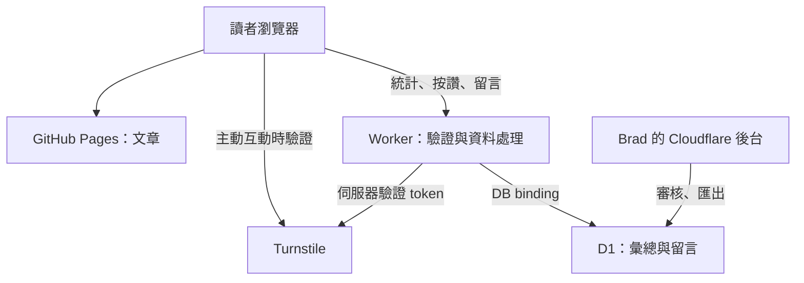

# Brad.log 免費匿名互動與統計設定手冊

本文件記錄「讀者不必有 GitHub 帳號」的按讚、留言，以及每頁／全站統計的設定方式。建置原則是 **只使用免費方案、不綁信用卡、不升級付費方案**；服務達到免費額度時暫停互動，文章仍由 GitHub Pages 正常提供。

查核日期：2026-11-09，使用者時區為 Asia/Taipei。費用與配額以文末的官方文件及實際帳戶畫面為準；這份文件不授權購買、升級或啟用付費試用。

## 1. 目前進度與啟用條件

| 項目 | 目前狀態 | 完成後應保留的證據 |
| --- | --- | --- |
| 方案選擇 | 已選 Cloudflare Workers Free＋D1 Free＋Turnstile Free | 本文件與可公開的設定檔 |
| Cloudflare 帳戶登入 | 待使用者完成；主流程已遇到登入畫面 | 不保存帳密、驗證碼或登入 cookie |
| 帳戶 Workers 方案 | 待登入後核對 Free | 截圖只保留方案名稱及免費額度，排除私人帳戶資訊 |
| D1／Worker／Turnstile 正式資源 | 尚未建立與驗證完成 | 公開服務網址、資源名稱、設定結果；不保存秘密值 |
| 前端開關 | `enabled: false` | 關閉時不載入互動介面，也不發送統計或 Turnstile 請求 |
| 後端開關 | `FEATURES_ENABLED: "false"` | 通過後端與正式來源驗證後才開啟 |
| 後端本機測試 | 18 項 SQLite／API 測試通過，主流程已複核 | 不等同 Cloudflare 或真實 Turnstile 整合通過 |
| 網站建置與正式部署 | 本機建置通過；正式動態服務待配置 | 實際命令結果、commit／部署連結及未驗證範圍 |

以下是可重現的設定流程，**不是已完成上線的聲明**。未填入真實 API 網址與 site key、未完成資料庫及秘密設定時，保持兩個開關關閉。不要把範例值或測試成功頁誤認為正式服務。

## 2. 服務分工與資料流

GitHub Pages 繼續提供文章與分類頁。Cloudflare Worker 接收統計及互動請求，透過私有的 D1 binding 存取資料；Turnstile 只用於訪客主動按讚或留言時的防濫用驗證。管理員從 Cloudflare 的已登入後台審核留言，第一版沒有公開管理 API。



公開網頁只能取得聚合數字及已批准的留言。D1 不直接對讀者開放，Worker 不回傳個別訪客的 presence 狀態、限流識別碼或待審內容。

## 3. 第一步：登入並確認免費方案

1. 在使用者的本機瀏覽器開啟 [Cloudflare Dashboard](https://dash.cloudflare.com/)。沒有帳戶時，使用免費註冊流程建立帳戶。
2. 帳密、驗證信、MFA／驗證碼由使用者完成；不把內容貼進聊天、文件或 repo。
3. 選擇要放置 Brad.log 後端的帳戶，確認 **Workers 方案為 Free**。Workers 的方案與額度依帳戶管理，不因 Worker 名稱包含 `free` 就自動免費。
4. 記錄「查核日期、Workers Free、未新增付款方式、未啟用 Paid／付費試用」。如需截圖，先確認沒有 Email、帳戶識別資料、權杖或其他私人專案資訊。
5. 使用現有的 `github.io` 與平台提供的 `workers.dev` 網址。Custom domain 留空，不購買網域，也不需要把 GitHub Pages DNS 搬到 Cloudflare。

若某一步要求新增信用卡、選擇付費方案或開始會轉付費的試用，就停在該步，保留文章服務與關閉中的互動功能；不要為了讓部署繼續而按升級。官方 D1 產品頁目前寫明免費開始不需要信用卡，Workers 預設提供 Free 方案。[D1 產品與免費註冊](https://www.cloudflare.com/products/d1/)；[Workers pricing](https://developers.cloudflare.com/workers/platform/pricing/)。

## 4. 設定對照表：哪些可以公開

| 位置 | 欄位／資源 | 設定值或規則 | 公開性 |
| --- | --- | --- | --- |
| Cloudflare | Worker 名稱 | `brad-log-community` | 可以公開 |
| Cloudflare | D1 名稱 | `brad-log-community` | 可以公開 |
| Worker binding | `DB` | 指向上述 D1 資料庫；名稱必須完全相同 | binding 名稱可以公開；不提供資料庫直接存取 |
| Worker runtime variable | `FEATURES_ENABLED` | 初始為字串 `false`；準備完成後才設 `true` | 可以公開 |
| Worker runtime secret | `SIGNING_SECRET` | 使用密碼管理器產生獨立、隨機的長秘密值，至少 32 個字元；建議 32 bytes 以上的隨機資料 | **不可公開** |
| Worker runtime secret | `TURNSTILE_SECRET` | 由該 Turnstile widget 提供的 secret key | **不可公開** |
| `backend/worker.mjs` | `ORIGIN` | `https://bradcocox.github.io` | 允許的網站 origin；可以公開，包含協定，不含 `/brad-log/` |
| 同上 | `HOSTNAME` | `bradcocox.github.io` | Turnstile 預期 hostname；可以公開，不含協定或路徑 |
| `backend/wrangler.jsonc` | `database_id` | 建立 D1 後替換 `REPLACE_WITH_D1_DATABASE_ID` | ID 不是憑證；文件毋須複製真實帳戶資料 |
| `backend/wrangler.jsonc` | `workers_dev`／`preview_urls` | `true`／`false` | 使用正式免費子網域；避免額外預覽入口 |
| `backend/wrangler.jsonc` | `observability.enabled` | `false` | 第一版不啟用應用程式請求日誌；不代表平台完全沒有安全日誌 |
| `backend/wrangler.jsonc` | cron | `*/10 * * * *` | 每 10 分鐘執行短期資料清理 |
| `src/data/engagement.ts` | `enabled` | 初始 `false` | 完成驗證後最後才開 |
| 同上 | `apiBase` | 正式 Worker 的 HTTPS origin，不加 `/v1` | 公開網址，不是秘密 |
| 同上 | `turnstileSiteKey` | 正式 Turnstile widget 的 site key | 本來就要提供給瀏覽器，可以公開 |

**沒有 `PUBLIC_SIGNING_SECRET` 或 `PUBLIC_TURNSTILE_SECRET`。** 即使某值原本來自 CI Secret，只要被編譯進前端 JavaScript，訪客就能讀到。後端秘密只能放 Worker 的 runtime **Secret** 類型，不能放 GitHub Pages 的原始碼、公開文章、截圖或一般前端變數。

目前 origin 與 hostname 是後端原始碼的固定限制，不是另行建立 `ALLOWED_ORIGIN` 等環境變數。換網域時，必須一起修改後端限制、Turnstile hostname 與前端網址，再重新驗證。CORS 只限制一般瀏覽器跨來源存取，不是防偽造或防機器人的完整機制。

## 5. 第二步：建立 D1 並初始化資料表

1. 在 Cloudflare 帳戶中找到 **D1 SQL database**，選擇建立資料庫。
2. 名稱使用 `brad-log-community`。保持免費方案；區域若可選，依實際需求選擇並記錄，不把區域選擇誤寫成法規資料落地保證。
3. 建立後開啟該資料庫的 **Console**。
4. 開啟 repo 的 `backend/migrations/0001_community.sql`，複製完整內容貼進 Console，執行 **Execute**。
5. 到 **Tables** 確認有 `site_counters`、`page_counters`、`page_daily`、`view_events`、`presence`、`reactions`、`comments`、`rate_buckets`。
6. 查詢 `SELECT id, visits FROM site_counters;`，確認有 `id = 1` 的初始列。這是剛建立資料庫的初始值，不是正式網站訪問統計已開始的證明。
7. 若選擇 Git／Wrangler 部署，把 D1 的 database ID 填進 `backend/wrangler.jsonc`；若選擇 Dashboard 手動部署，後續透過 UI 綁定即可。

初始 migration 使用 `CREATE ... IF NOT EXISTS`，但後續 schema 更新仍應新增 migration 並保留版本；不要為了重新執行教學而刪掉正式資料表。官方 Console 建表流程見 [D1 getting started](https://developers.cloudflare.com/d1/get-started/)。

## 6. 第三步：設定 Turnstile

1. 在 Cloudflare 帳戶中開啟 **Turnstile**，建立一個 Free widget，例如 `Brad.log community`。
2. hostname 填 **`bradcocox.github.io`**，不包含 `https://`、`/brad-log/` 或文章路徑。
3. widget 使用 **Managed** 模式；本方案不需要 Enterprise、任意 hostname 或其他付費功能。
4. 將公開的 **site key** 留待前端設定；將 **secret key** 放入 Worker 的 `TURNSTILE_SECRET` runtime secret。
5. 前端主動按讚時的 action 為 **`like`**；留言表單的 action 為 **`comment`**。後端必須驗證 token 的成功狀態、hostname 與 action，不能只有前端圖形驗證。
6. 正式網頁不得使用官方測試用的「永遠通過」金鑰；本機測試與正式設定分開記錄。

Turnstile token 有效期為 5 分鐘，而且只能驗證一次；超時或重送要取得新 token。Siteverify 是後端必要步驟，不可因前端顯示驗證成功就直接接受留言。[Free plan](https://developers.cloudflare.com/turnstile/plans/)；[Server-side validation](https://developers.cloudflare.com/turnstile/get-started/server-side-validation/)。

## 7. 第四步：部署 Worker

### 7.1 準備正式頁面清單與後端檔案

先在 repo 根目錄執行 `pnpm build`。建置使用 `scripts/generate-engagement-manifest.mjs`，從 Astro 實際輸出的頁面產生 `dist/engagement-pages.json`。部署後固定網址為 `https://bradcocox.github.io/brad-log/engagement-pages.json`，Worker 只從這個固定的第一方位置取得新增頁面清單，最多快取 5 分鐘。

清單包含 `pages` 與 `articles`：前者是允許統計的頁面，後者是允許按讚／留言的文章。只有正式公開頁面才加入；草稿、404、查詢字串、任意外部網址及尚未存在的文章不能作為無限制的新資料鍵。標示 `engagement-exclude` 的 QA 頁面也不加入。正常新增文章後，Pages 的新清單會讓後端認得該頁，不需要每次新增文章都重部署 Worker。

首次準備 Worker 或更新離線備援清單時，在已完成 `pnpm build` 的 repo 根目錄執行：

```sh
pnpm engagement:manifest
```

這會更新 `backend/allowed-pages.json`，供 Worker bundle 在無法取得公開清單時使用。**目前內建備援中的頁面仍會被接受**：若要撤下曾經加入備援的頁面／文章，必須同步更新備援清單並重部署 Worker，不能只刪除公開文章就假設 API 一併拒絕。這些清單是公開路徑，不含使用者資料或秘密。

在 repo 根目錄開啟終端機，先進入 `backend/`，再執行：

```sh
cd backend
npm test
npm run bundle
```

`npm run bundle` 產生 repo 根目錄下的 `backend/dist/worker.mjs`，將後端及允許頁面清單組合成供 Dashboard 使用的單一 module。這個 bundle 步驟不需要安裝外部套件或提供秘密。後端使用 Node.js 24 以上；測試結果與正式連線驗證要分開記錄，本機測試通過不代表 Cloudflare 的 binding、secret 或 Turnstile 已設定。回到 repo 根目錄時執行 `cd ..`。

### 7.2 路徑 A：Dashboard 手動部署

1. Workers & Pages → **Create application**，建立 `brad-log-community` Worker。介面若要求從 Git 開始，可採下一節的 Git 路徑；不要為了使用某個建立方式升級方案。
2. 在 Worker 的 **Edit Code** 中使用剛產生的 `backend/dist/worker.mjs`。以 module Worker 部署，保留 `fetch` 與排程處理器。
3. Worker → **Bindings** → **Add binding** → **D1 database**。變數名稱必須是 `DB`，選擇 `brad-log-community` D1。
4. Worker → 設定頁的 Variables and Secrets，新增 `FEATURES_ENABLED` 為一般文字變數，值先設 `false`。
5. 新增 `SIGNING_SECRET` 與 `TURNSTILE_SECRET`，兩者均選 **Secret** 類型。記錄已設定及更新日期，不記錄值。
6. 在排程觸發設定新增 `*/10 * * * *`，對應 `scheduled` handler。這是免費額度內的清理作業，不是用來繞過平台限制或模擬人類流量。
7. 開啟平台給的正式 `https://<WORKER_SUBDOMAIN>.workers.dev` 網址，記錄實際 URL。根路徑不是文章頁；以實際 API 路由驗證。

後端檔案的變更先回寫 repo 再 bundle。只在 Dashboard 改程式但沒有更新 repo，會使後續重部署覆蓋線上修正。官方 binding／Edit Code 操作見 [D1 remote development](https://developers.cloudflare.com/d1/best-practices/remote-development/)。

### 7.3 路徑 B：連接 GitHub 自動部署

1. Workers & Pages → Create application → 匯入現有 Git repository。
2. 安裝或授權 Cloudflare 的 GitHub 整合時，只選本次需要的 `bradcocox/brad-log`。檢查當下顯示的權限，避免選擇所有 repositories。
3. production branch 使用 `main`；root directory 指向 **`backend`**，Worker 名稱為 `brad-log-community`，與 Wrangler 設定相同。
4. 先把 `backend/wrangler.jsonc` 的 D1 ID 替換成實際建立的資料庫 ID。`DB` binding、cron、`workers_dev` 等由這份設定管理。
5. 部署命令使用經核對版本的 Wrangler 執行 `wrangler deploy`；若平台提供 `npx wrangler deploy` 預設值，先核對建置紀錄中的版本並記錄。正式流程應釘選工具版本，不能把沒有安裝的 `npm run deploy` 當成既有命令。
6. `SIGNING_SECRET` 與 `TURNSTILE_SECRET` 仍放 Worker **runtime secrets**，不用把它們提供給文章建置或提交到 Git。Git 自動部署的憑證交由平台整合管理，前端不需要 Cloudflare API token。
7. 若用 Wrangler 管理 `FEATURES_ENABLED`，啟用時同步更新 config，避免下一次部署把 Dashboard 的 `true` 覆蓋成 `false`。首次部署保持關閉。
8. 部署成功後核對正式 URL、D1 binding、秘密存在狀態、cron 與 Workers Free 方案。只有 build 成功不能證明所有設定正確。

這裡的 `backend/` 是同一個 repo 的後端子目錄，GitHub Pages 仍照原本的 workflow 建置文章。可以限制後端自動建置的監看路徑，避免單純修改文章就不必要地建置後端；公開 manifest 會支援新增頁面，後端程式或內建備援清單改變時才需要部署 Worker。

官方文件：[Dashboard 建置與免費 workers.dev](https://developers.cloudflare.com/workers/get-started/dashboard/)；[GitHub integration](https://developers.cloudflare.com/workers/ci-cd/builds/git-integration/github-integration/)；[Workers Builds 免費額度](https://developers.cloudflare.com/workers/ci-cd/builds/limits-and-pricing/)。

## 8. 第五步：驗證後才開啟前端

1. 保持前端 `enabled: false`，先完成 Worker、DB、secret 與 Turnstile 設定。
2. 在受控驗證時才把後端 `FEATURES_ENABLED` 設為字串 `true`。錯誤來源、未允許頁面、無效 token、錯誤 action、超長留言及重送請求都應按預期被拒絕或去重。
3. 在 `src/data/engagement.ts` 填入 `apiBase` 與 `turnstileSiteKey`。`apiBase` 是完整 HTTPS origin，不含結尾 `/v1`；不用把 secret 填在任何前端欄位。
4. 將 `enabled` 設為 `true`，建置並部署 GitHub Pages。
5. 用未登入 GitHub 的瀏覽器驗證閱讀統計、按讚／取消、提交留言、待審提示、審核後公開；測試留言需使用明確的測試內容，不假冒讀者。
6. 核對手機、桌機、深淺色、長內容與長網址沒有溢位，文章之間導覽不重複初始化或把 A 文留言放到 B 文。
7. 模擬 API 失敗時，介面應顯示「統計暫時無法取得」或「留言暫時無法載入」等狀態，文章仍完整。未成功回傳的計數不補假 `0`。
8. 完成後在本文件開頭與部署紀錄補上實際結果；沒做的情境保留「未驗證」。

第一版公開端點如下；這些是 API 路由，不是管理後台：

| 端點 | 功能與公開範圍 |
| --- | --- |
| `GET /health` | 檢查開關、DB binding、秘密是否存在及初始 `site_counters` 列可讀；成功回 `status: "configured"`。仍須以真正 challenge 驗證 Turnstile 金鑰，且不代表完整互動流程已通過 |
| `POST /v1/pulse` | 提交頁面訪問／短期活躍訊號；訪問去重與在線更新由後端處理 |
| `GET /v1/stats?pageId=...` | 讀取該頁與全站聚合數字，不取得訪客名冊 |
| `GET /v1/reaction` | 讀取文章按讚資訊及該匿名識別碼的狀態 |
| `PUT /v1/reaction` | 按讚或取消；使用 `like` Turnstile action |
| `GET /v1/comments` | 依 article ID／cursor 分頁讀取已批准留言 |
| `POST /v1/comments` | 送出待審留言；使用 `comment` Turnstile action |

`backend/worker.mjs` 的 `LIMITS` 保存第一版伺服器限流設定，採每日輪替的網路位址 HMAC 作為範圍；同公司／家庭的共用出口可能共用限制，不是每個真人各自一份額度：

| 操作 | 限制 |
| --- | --- |
| pulse | 每分鐘 60 次，且每小時 1,500 次 |
| stats | 每分鐘 120 次 |
| 讀取按讚狀態 | 每分鐘 120 次 |
| 按讚／取消 | 每分鐘 10 次，且每天 100 次；取消同樣需要 `like` 驗證 |
| 讀取留言 | 每分鐘 60 次 |
| 送出留言 | 每小時 5 次，且每天 15 次 |

達到應用程式限流回傳 `429` 及 `Retry-After`；平台／資料庫不可用則回安全的暫時失敗資訊，不把 SQL、IP、環境變數或驗證 token 傳給訪客。這些限制可依實際使用調整，但每次調整都應評估免費配額與共用網路的讀者體驗。

## 9. 留言審核：不用提供讀者任何管理密碼

留言資料表 `comments` 的狀態為 `pending`、`approved`、`rejected`，時間 `created_at` 使用 Unix 毫秒。暱稱可留空，後端使用「訪客」；有填寫時最多 32 字元，留言 2–2000 字元。留言以純文字處理，不允許自行執行 HTML／JavaScript。

在已登入 Cloudflare 的 D1 Console 查看待審留言：

```sql
SELECT id, article_id, nickname, body,
       datetime(created_at / 1000, 'unixepoch', '+8 hours') AS created_at_taipei
FROM comments
WHERE status = 'pending'
ORDER BY created_at ASC
LIMIT 50;
```

確認內容後，只對剛剛查到的單筆 ID 執行。以下 `COMMENT_ID_FROM_QUERY` 是佔位值，需換成實際查詢取得的 ID，不可移除 `WHERE`：

```sql
UPDATE comments
SET status = 'approved'
WHERE id = 'COMMENT_ID_FROM_QUERY' AND status = 'pending';
```

拒絕留言：

```sql
UPDATE comments
SET status = 'rejected'
WHERE id = 'COMMENT_ID_FROM_QUERY' AND status = 'pending';
```

審核後以 `SELECT id, status FROM comments WHERE id = 'COMMENT_ID_FROM_QUERY';` 核對。若已公開留言有問題，可將該筆 `status` 改為 `rejected`，再確認公開頁已不顯示。誤貼的秘密需要立即從資料與可取得的副本處理，並撤銷或輪替該秘密；單純把留言隱藏不等於秘密未曾外洩。

使用暱稱不代表身分驗證，訪客可以輸入相同暱稱。不要把匿名留言顯示成「已驗證 Brad」或其他認證標記。先審後發能降低垃圾訊息公開的機會，仍需要管理員定期檢視。

## 10. 統計口徑、隱私與保留期限

### 10.1 數字代表什麼

- **累積訪問次數：**頁面載入產生訪問事件，重送同一事件由後端去重；heartbeat 只更新活躍狀態，不反覆增加訪問。全站累計代表被接受的頁面訪問總數，不能稱為終身不重複人數。
- **近 2 分鐘活躍：**最近 120 秒收到訊號的短期匿名 session。前端在可見頁面每 60 秒更新；離開、背景分頁、斷線到過期之間會有延遲，不是即時真人名冊。
- **跨頁與跨裝置：**全站活躍計數要對同一短期 session 去重；不同裝置、不同瀏覽器或清除儲存後，無法可靠知道是否同一個人。
- **匿名按讚：**以文章及瀏覽器的匿名識別碼去重；不是自然人一人一票的保證。清除瀏覽資料後可能不能取消之前的讚，也可能產生新的識別碼。
- **歷史起點：**從功能正式啟用後開始累積，沒有蒐集過的舊流量無法回補。腳本被封鎖、網路錯誤、DNT／GPC、免費額度耗盡都可能造成低估；一般公開統計也不能保證完全排除機器人。
- **文章識別：**目前以包含 `/brad-log/` 的正式頁面路徑作為 page／article ID。改文章標題但路徑不變時沿用原資料；改 slug、base path 或合併文章前，必須規劃資料對應與遷移，否則新路徑會被視為另一篇，舊留言不會自動搬過去。
- **統計日期：**後端日彙總使用 UTC 日期，每日邊界為台灣時間 08:00。文章顯示日期仍按網站的 Asia/Taipei 設定；兩者不能混用。

### 10.2 瀏覽器儲存與選擇

| 項目 | 行為 |
| --- | --- |
| `bradlog:engagement:presence:v1` | 儲存當日 UTC 日期與隨機 UUID，每日輪替；用於短期在線去重。儲存被封鎖時使用記憶體備援 |
| `bradlog:engagement:reaction:v1` | 讀者第一次主動按讚後才保留隨機識別碼，直到使用者清除網站儲存；不是姓名、Email 或登入帳號 |
| 留言草稿 | 不把暱稱或留言內容保存到 localStorage |
| Do Not Track／Global Privacy Control | `navigator.doNotTrack === "1"` 或 GPC 開啟時，不自動送 pulse；讀者主動按讚／留言仍可使用 |
| Turnstile 載入 | 只在主動按讚或開啟留言表單時使用，會連線到 Cloudflare；不能描述成零第三方資料處理 |

後端使用 `SIGNING_SECRET` 對限流／去重資料做 HMAC；原始 IP、User-Agent、Email、referrer 不在應用程式資料表中。這不等於網路傳輸、Cloudflare 或 GitHub 平台完全不處理 IP／安全日誌。隨機代碼與 HMAC 仍應按用途限制存取與保留，不宣稱可以任意永久保存個人瀏覽軌跡。

### 10.3 後端保留與清理

| 資料 | 保留方式 | 原因 |
| --- | --- | --- |
| `site_counters`、`page_counters`、`page_daily` | 彙總持續保留，受資料庫容量、備份與平台政策限制 | 保存全站／每頁累計及每日趨勢 |
| `reactions` | 維持匿名文章回應狀態，直到取消或管理員處理 | 提供去重與取消功能；不包含真人身分 |
| `presence` | 超過 10 分鐘的暫存列由清理工作移除；公開活躍窗口仍是 120 秒 | 10 分鐘是儲存清理期限，不是「在線」定義 |
| `view_events` | 48 小時後清理 | 只作重送去重，不作長期訪客歷程 |
| `rate_buckets` | 48 小時內的短期限流資料，過期後清理 | 降低濫用並限制持續保存 |
| 待審／拒絕留言 | 30 天後清理 | 避免無限累積未公開內容；管理員需在期限內審核 |
| 已批准留言 | 持續保留，直到管理員移除或依維護政策處理 | 形成文章討論內容 |

清理依每 10 分鐘 cron 執行；即使 `FEATURES_ENABLED` 設回 `false`，只要 DB binding 與排程仍存在，清理仍會執行。平台故障或額度耗盡會延遲，不能宣稱每筆資料在期限到達的那一秒即刪除。可在 D1 查詢最舊資料日期及 Worker 排程結果確認。

更換 `SIGNING_SECRET` 會改變匿名識別碼的對應：既有讚仍保留在總數中，但原瀏覽器的代碼不再對應舊讚，不能直接取消該筆；彙總與留言不會因此自動刪除。除必要的洩露處理外，不隨意輪替而忽略資料遷移。真實秘密洩露時仍應立即撤銷／輪替，再處理這些資料影響，不能為維持按讚對應而繼續使用洩露的密鑰。

## 11. 免費額度與零支出故障策略

| 免費資源 | 本次官方查核額度 | 超額行為 |
| --- | --- | --- |
| Workers | 每帳戶每天 100,000 requests；每次 10 ms CPU | 每日 request 額度超出時回 1027，等重置 |
| D1 | 每天讀取 5,000,000 rows、寫入 100,000 rows | 到限後查詢失敗；索引更新也會消耗寫入額度 |
| D1 儲存 | 單資料庫 500 MB、帳戶最多 10 個資料庫／總計 5 GB | 滿額需清理，不升級付費換容量 |
| D1 Time Travel | Free 7 天 | 不能取代自己的長期備份 |
| Turnstile | Free 20 widgets、每 widget 10 hostnames、驗證次數不限 | 本站只需一個正式 widget |
| Workers Builds | 每月 3,000 build minutes、同時 1 個 build、單次最多 20 分鐘 | 配額有限；不開 Paid 換取額外分鐘 |

Workers／D1 的每日額度在 **UTC 00:00，即台灣時間 08:00** 重置。D1 官方從 2026-09-01 明確強制 Free 讀寫日上限：超額回錯誤，已保存資料不因此刪除。Free 的停用／拒絕與 Paid 的超額計費不同，維持 Free 是本專案的必要條件。[Workers limits](https://developers.cloudflare.com/workers/platform/limits/)；[D1 pricing](https://developers.cloudflare.com/d1/platform/pricing/)；[D1 limits](https://developers.cloudflare.com/d1/platform/limits/)；[D1 Free tier enforcement](https://developers.cloudflare.com/changelog/post/2026-09-01-d1-free-tier-limit-enforcement/)。

發生故障時：

1. 網站持續提供 GitHub Pages 上的文章；不把文章渲染依賴到互動 API。
2. 前端停止或退避重試，顯示暫時無法取得資料；不持續高頻呼叫，也不把失敗當成零次訪問。
3. 查看是否為每日配額、CPU、資料庫容量、Turnstile、binding 或平台故障；不能假設每個錯誤等到 08:00 就會解決。
4. 需要時把 `FEATURES_ENABLED` 設回 `false`，並將前端 `enabled` 設回 `false` 後重新發布。
5. 優先減少輪詢、改善索引、清理過期資料、限制濫用與匯出備份；不改用付費方案，也不另開帳戶繞過平台額度。

## 12. 備份與長期維護

使用 Cloudflare 支援的 D1 匯出方式，將 schema 與資料匯出到受保護的位置。若使用已安裝並驗證版本的 Wrangler，可依官方文件執行 `wrangler d1 export brad-log-community --remote --output=<PRIVATE_BACKUP_PATH>`；先確認輸出位置不在 repo、`public/`、`src/assets/`、公開 Actions artifact 或會同步公開的資料夾。

備份包含留言、暱稱、待審內容及匿名識別資料，**不能提交到公開 GitHub repo**。只把備份日期、工具版本、還原驗證結果與保留政策寫進公開手冊；不要把資料庫 dump 附在教學中。Free Time Travel 只有 7 天，仍需另外安排可負擔的備份頻率與受保護儲存，且不自行新增付費備份服務。[D1 import/export](https://developers.cloudflare.com/d1/best-practices/import-export-data/)；[D1 Time Travel](https://developers.cloudflare.com/d1/reference/time-travel/)。

每次維護檢查：方案仍為 Free、開關狀態與部署一致、allowed page 清單符合公開頁面、清理工作有執行、待審留言未超過保留期、備份可還原、手機與桌機沒有溢位。第三方服務條款或額度若改變，先維持零支出與文章可讀，再調整互動方案。

## 13. 正式驗證紀錄（待完成後補記）

| 驗證項目 | 結果 |
| --- | --- |
| 本機 backend 測試 | `node --test backend/test/worker.test.mjs`：18 項通過，主流程已複核 |
| 網站 build | `pnpm build` 通過：80 個 Astro 檢查檔無 errors／warnings／hints；20 個靜態頁面；公開 manifest 含 19 頁及 1 篇文章。build／CI 同時執行 18 項後端測試 |
| 正式 Cloudflare Workers Free／未綁卡 | 待登入後核對 |
| D1 migration、binding、兩個 runtime secrets | 待正式設定 |
| Turnstile 正確 hostname／like 與 comment actions | 待正式驗證 |
| 未登入 GitHub 的按讚、取消與送出留言 | 待正式驗證 |
| 待審不公開、批准後可見 | 待正式驗證 |
| 頁面／全站統計與 120 秒活躍窗口 | 待正式驗證 |
| DNT／GPC、背景分頁與多分頁 | 待正式驗證 |
| 服務失敗不顯示假數字，文章仍可讀 | 待正式驗證 |
| 手機／桌機、明暗主題、長內容與左側對齊 | 待正式驗證 |
| 公開 repo／前端產物秘密掃描 | 來源 143 個文字檔、靜態輸出 72 個文字檔通過支援模式掃描；掃描不能取代人工審查或正式設定驗證 |
| 正式 commit、部署 URL 與首次啟用日期 | 尚未啟用 |

上述本機測試使用 SQLite 配接器與受控的驗證回應，涵蓋來源限制、請求大小、錯誤遮蔽、訪問／按讚／留言重送去重、120 秒 presence、待審不公開、分頁、限流、保留清理與受限 manifest。它們確認應用程式與 SQL 行為，尚未證明真實 Cloudflare D1 的部署設定、平台配額行為或正式 Turnstile challenge 可用。完整正式整合結果必須在登入與資源建立後另外補上。

