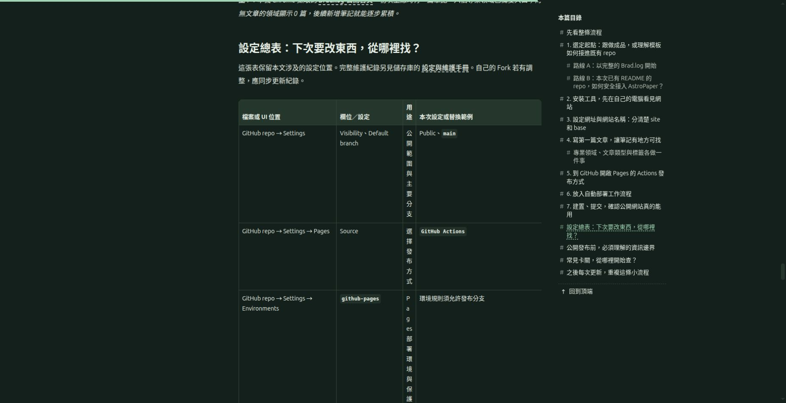
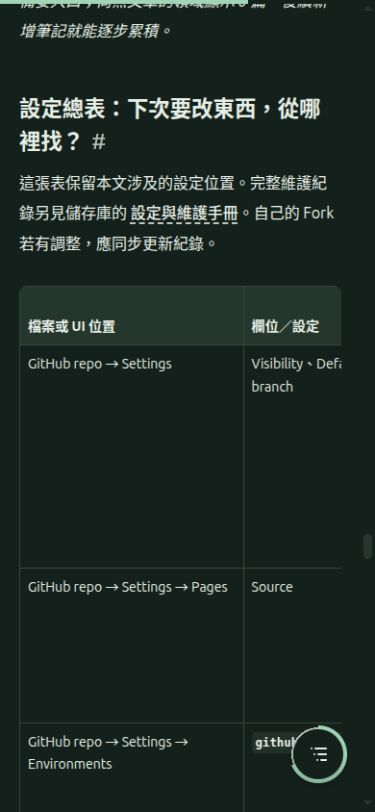
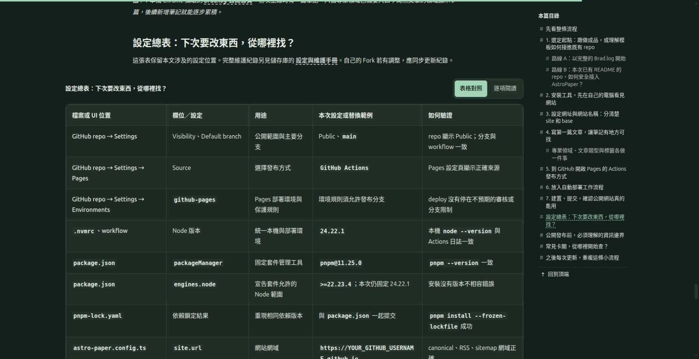
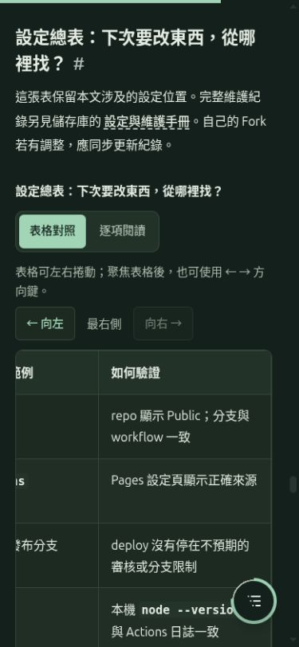

# Brad.log 文章閱讀版面與表格檢視紀錄

本文件保留前一輪「表格可讀性」修正的版本與量測。後續針對正文、圖片、表格左側不一致的檢視與修正，請見 [文章對齊與圖說檢視紀錄](ARTICLE_ALIGNMENT_REVIEW.md)；目前的對齊規則以該紀錄及 [SETUP.md](SETUP.md) 為準。

**狀態：本次已執行範圍的檢視與回歸驗證完成。**

記錄日期：2026-11-09。檢視對象為 [Brad.log](https://bradcocox.github.io/brad-log/) 的首篇教學〈從零開始：用 AstroPaper 與 GitHub Pages 架設技術部落格〉，尤其是「設定總表：下次要改東西，從哪裡找？」的五欄資料表。文章來源為 [`src/content/posts/github-pages-astropaper-guide.md`](../src/content/posts/github-pages-astropaper-guide.md)。

## 1. 回饋與本次修正範圍

使用者反映文章閱讀區過窄、表格無法閱讀。修正前的桌機畫面有大量可用空間，但文章與表格容器只有 720px；表格欄位又分配不均，「用途」欄被擠成約 31px，造成中文近似逐字直排。「如何驗證」欄超出初始可見範圍。手機上則只能看到表格前方欄位，缺少清楚的水平捲動指引。

這次處理文章容器、正文與圖碼寬度、目錄配置，以及表格的閱讀方式與操作提示。表格資料繼續由同一份 Markdown 產生，不要求作者另寫手機版內容；本文件不把版面改善當成文章內容正確性或全站無障礙合規的證明。

## 2. 修正前的量測與畫面證據

下列為修正前的現場量測。尺寸以 CSS px 記錄，保留原始小數；沒有量測的項目標示為「未記錄」，不由截圖推算。表格整體邊界與各欄邊界可能含有不同的框線計算，不以欄寬加總取代表格實測值。

| 項目 | 桌機修正前 | 手機修正前 |
| --- | --- | --- |
| 瀏覽區域 | 1868 × 959 | 390 × 844 |
| 文章／表格可見容器寬度 | 720px | 表格 wrapper 335px |
| 五欄設定總表實際寬度 | 809.34375px | 約 809px，沿用相同表格 |
| 表格列數 | 24 列，含 1 列表頭，即 23 筆資料 | 未另行量測 |
| 首筆資料列高度 | 232.296875px | 未記錄 |
| 整張表格高度 | 5524.28125px | 未記錄 |
| 可見問題 | 用途欄過窄、中文逐字斷行；最後一欄超出初始可見範圍 | 初始畫面只能看見前兩欄，沒有清楚提示剩餘內容的位置 |

桌機五欄的實測分配如下：

| 欄位 | 修正前寬度 | 對閱讀的影響 |
| --- | --- | --- |
| 檔案或 UI 位置 | 232.5625px | 占用較多可見空間 |
| 欄位／設定 | 157.703125px | 英文設定值需要換行 |
| 用途 | 31.09375px | 一般中文說明被擠成近似逐字直排，拉高整列 |
| 本次設定或替換範例 | 306.6875px | 分配寬度明顯大於用途欄 |
| 如何驗證 | 80.296875px | 位於右側，超出初始可見範圍且本身偏窄 |

### 桌機修正前

圖 1：修正前桌機實拍。畫面顯示問題集中在容器寬度及欄位分配，並非原始資料缺少欄位。

### 手機修正前

圖 2：修正前手機尺寸的 Chrome 畫面。這是 responsive emulation 的證據，不能據此宣稱已在實體手機上驗證。

## 3. 已核對的程式修正

以下記錄原始碼設定，公開站的實際驗證結果見第 5 節；未執行的檢查另列於第 6 節。完整維護設定亦見 [SETUP.md](SETUP.md) 的「文章閱讀版面與表格」小節。`rem` 換算以根字體 16px 為基準。

| 修正 | 設定／行為 | 實作位置 |
| --- | --- | --- |
| 擴大文章頁 | `.post-page` 最大 100rem，即 1600px，含左右 `clamp(1.25rem, 3vw, 3rem)` 留白 | `src/styles/article.css` |
| 分開管理閱讀寬度 | 一般正文 54rem，即 864px；圖片與程式碼區塊最多 68rem，即 1088px；表格可使用主內容欄的寬度 | `src/styles/article.css` |
| 保留程式碼寬度 | 複製按鈕的包裹元素使用 `.code-block`，避免再次被一般段落寬度限制 | `src/pages/posts/[...slug]/index.astro`、`article.css` |
| 目錄獨立分欄 | 90rem，即約 1440px 以上，使用 `minmax(0, 1fr) 15rem` 雙欄，間隔 2.5rem；較窄時改用浮動目錄 | `PostToc.astro`、`BackToTopButton.astro` |
| 一份資料、兩種閱讀方式 | 從同一份表格語法樹產生原生表格及逐項卡片；簡單表格可切換「表格對照／逐項閱讀」 | `src/utils/rehypeTableWrapper.js`、`src/components/ArticleTables.astro` |
| 手機預設逐項閱讀 | 寬度 <=767px 預設卡片，>=768px 預設表格；手動選擇不因同頁 resize 被覆蓋 | `ArticleTables.astro`、`src/styles/article-tables.css` |
| 五欄表保留對照空間 | 最小寬度 64rem，即 1024px；各欄比例為 22%、18%、14%、24%、22% | `rehypeTableWrapper.js` |
| 水平捲動提示 | 有實際溢位時顯示左右控制、位置與提示；捲動區可用鍵盤聚焦，控制按鈕依左右邊界停用 | `ArticleTables.astro`、`article-tables.css` |
| 保留語意與欄位名稱 | 原生 `table`、欄／列表頭 `scope`；卡片用標題及 `dl`／`dt`／`dd` 顯示對應欄位標籤 | `rehypeTableWrapper.js` |
| 複雜表格保留原貌 | 不把合併儲存格等複雜結構強制轉成卡片；維持可捲動的原生表格 | `rehypeTableWrapper.js` |
| 避免搜尋重複收錄 | 卡片副本與操作提示設為 `data-pagefind-ignore`，保留原始表格內容供索引 | `rehypeTableWrapper.js` |
| 無 JavaScript 仍可讀 | 表格與卡片在建置階段生成；CSS 決定預設模式，互動控制在 JavaScript 初始化後才顯示 | 三個表格相關檔案 |

## 4. 已完成的建置檢查

本次版面修正的完整建置已回報以下結果。這些數值屬於該次建置快照；後續新增文件或調整內容可能改變檔案數與索引字數。

| 檢查項目 | 已回報結果 | 能確認的範圍 |
| --- | --- | --- |
| Astro 檢查 | 0 errors、0 warnings、0 hints | 該次型別與內容檢查通過 |
| 靜態頁面 | 19 pages | 該次網站輸出完成 |
| Pagefind | 2877 words、2 filters | 索引已產生；搜尋互動仍須實測 |
| 公開來源掃描 | 123 個檔案通過 | 已設定掃描規則未阻擋該次來源內容 |
| 建置輸出掃描 | 69 個檔案通過 | 已設定掃描規則未阻擋該次輸出文字 |

建置結果與現場結果分開判讀。建置成功不能單獨證明文字可讀、欄位完整可見或鍵盤操作正常，也不代表自動掃描能辨識所有私人資訊；已執行的公開站檢查記錄如下。

## 5. 公開站現場驗證結果

### 驗證版本、環境與證據

| 項目 | 本次紀錄 |
| --- | --- |
| 正式程式碼 commit | [`c45e0890bc0a1b892e41ff77d1d5fe112bc7f7cb`](https://github.com/bradcocox/brad-log/commit/c45e0890bc0a1b892e41ff77d1d5fe112bc7f7cb) |
| 正式部署 | [Actions run 42573535715](https://github.com/bradcocox/brad-log/actions/runs/42573535715)，部署成功 |
| 現場驗證時間 | 2026-11-09 約 06:35–06:48 UTC，即台北時間 14:35–14:48（Asia/Taipei） |
| 操作環境 | 使用者本機 Chrome，透過已連接的 browser extension 操作 |
| 瀏覽器版本／縮放 | 本次未另擷取 Chrome 版本與瀏覽器 zoom，不填推測值 |
| 根字體 | 實測 16px |
| 桌機 viewport | 1868 × 959 |
| 手機尺寸 viewport | 390 × 844，Chrome responsive emulation，非實體手機 |
| 中間尺寸 | 1440 × 1000、1024 × 900 |
| 修正後附件 | 圖 3 為 1853 × 951；圖 4、圖 5 均為 375 × 812 |
| 附件處理 | 三張修正後圖片均為原始 JPEG capture，未裁切或改圖，儲存後已實際重開檢查 |

viewport 是瀏覽器測試尺寸，附件尺寸是圖片檔案的像素尺寸，兩者分別記錄。以下量測採 DOM 的 CSS px，不由附件像素推算。

### 1. 桌機表格與文章寬度：通過本次檢查

1868 × 959 畫面中，五欄均完整可見，目錄為獨立的 240px 欄位，與主內容間隔 40px，沒有重疊。正文實測 864px，程式碼與圖片區塊 1088px，表格文字為 16px。

| 量測項目 | 修正前 | 修正後 |
| --- | --- | --- |
| 主內容／表格 wrapper 寬度 | 720px | 1224px |
| 表格本體寬度 | 809.34375px | 1222px |
| 首筆資料列高度 | 232.296875px | 84.1875px |
| 整張設定總表高度 | 5524.28125px | 2021.5px |
| 欄位可見性 | 用途欄近似逐字直排，驗證欄超出初始可見範圍 | 五欄均可見，用途與驗證內容可正常換行閱讀 |

| 欄位 | 修正前寬度 | 修正後寬度 |
| --- | --- | --- |
| 檔案或 UI 位置 | 232.5625px | 268.609375px |
| 欄位／設定 | 157.703125px | 219.765625px |
| 用途 | 31.09375px | 170.9375px |
| 本次設定或替換範例 | 306.6875px | 293.03125px |
| 如何驗證 | 80.296875px | 268.65625px |

圖 3：修正後桌機原始實拍。五個欄位同時可見，表格上方提供「表格對照／逐項閱讀」切換。

### 2. 手機逐項閱讀與模式切換：通過本次檢查

390 × 844 viewport 預設為逐項閱讀。卡片實測寬 335px，首張卡片高 480.40625px；閱讀模式按鈕高 44px。每筆的五個欄位標籤與值完整呈現，不需要依靠畫面外的表頭理解內容。由卡片切換到表格，再切回卡片，均成功。

圖 4：手機尺寸的逐項閱讀實拍。欄位名稱直接附在每筆內容旁，第一筆的五欄資訊完整可讀。

### 3. 表格水平捲動與方向鍵：通過已執行的操作

手機切換為表格後，wrapper 外寬 335px、`clientWidth` 333px，表格本體 1024px；用途欄實測 143.21875px。畫面出現水平捲動提示與左右按鈕，表格溢位沒有造成整張頁面水平溢位。

實際點擊向右按鈕，`scrollLeft` 從 0 增加至 240；聚焦表格後按 `ArrowRight`，增加至 280。繼續點向右到末端，可完整讀到最後的「如何驗證」欄，位置顯示「最右側」，右按鈕為停用狀態。這項結果涵蓋已執行的按鈕與方向鍵操作，不延伸宣稱完整 Tab 巡覽或所有鍵盤路徑已通過。

圖 5：手機表格模式最右側的原始實拍。畫面包含捲動說明、位置與左右控制，最後一欄可直接閱讀。

### 4. 中間尺寸與目錄：通過已測尺寸

| viewport | 主內容寬度 | 表格寬度 | 目錄與溢位結果 |
| --- | --- | --- | --- |
| 1440 × 1000 | 1059.5px | 1057.5px | 側邊目錄 240px、欄間距 40px；無整頁水平溢位 |
| 1024 × 900 | 948.46875px | 1024px | 側邊目錄隱藏，表格溢位提示可用；浮動目錄可開啟，點擊標題後成功跳轉並關閉；無整頁水平溢位 |

這兩個尺寸確認了寬螢幕目錄分欄及中等寬度下的表格捲動／浮動目錄行為；沒有把未測的其他斷點尺寸列為通過。

### 5. 明暗主題：通過已檢視範圍

桌機明、暗主題都已實際擷取畫面並檢視，完成後恢復原本的暗色主題；手機暗色主題亦已檢視。桌機亮色截圖未列入公開附件，本文件不建立不存在的附件連結。手機亮色主題及文字對比值未另行測試。

### 6. 表格／卡片一致性與 DOM 語意：通過本次比對

公開頁面以 DOM 逐表比對，共 6 張表、52 筆資料；各表筆數依序為 7、4、6、4、23、8。原生表格與卡片的全部文字、全部欄位標籤均一致。這是 DOM 比對結果，不冒充逐字人工校稿或讀屏測試。

同次檢查確認頁面有 **0 個重複 ID**；所有表頭 `thead th` 均有 `scope="col"`，每筆資料首欄均為 `scope="row"`；卡片容器全部設有 `data-pagefind-ignore`。原生表格語意與卡片去重設定已存在，不代表已完成所有輔助技術的相容性測試。

### 7. 中文／英文搜尋與篩選：通過本次回歸

正式搜尋「部署」找到 1 篇正確教學；搜尋表格中的英文欄位「Visibility」也找到 1 篇，並提供設定總表的段落連結。勾選「DevOps 與雲端 (1)」及「步驟教學 (1)」兩個篩選條件後，結果仍為 1 篇；實際點擊搜尋結果，成功返回該文章。這次操作確認了原始表格文字可被搜尋，以及搜尋與篩選結果能導向正確內容。

### 8. 程式碼複製與重複初始化：通過本次回歸

由搜尋結果回到文章後，頁面有 12 個 `pre`、12 個 `.code-block`、12 個複製按鈕，沒有重複包裹或重複按鈕。點擊第一個「複製」按鈕後，讀回剪貼簿進行相等比對，與該程式碼的 `code.innerText.trim()` 一致，結果為 `true`。檢查僅記錄布林結果，沒有輸出或保存其他剪貼簿內容。

### 9. 圖片預覽與 Escape 關閉：通過本次回歸

點擊首張流程圖的圖片按鈕，成功開啟具有名稱的圖片預覽 dialog；按下 Escape 後，該 dialog 的 `isVisible` 為 `false`。這項結果確認本次操作中的開啟與關閉行為，未延伸宣稱所有縮放手勢或輔助技術操作均已測試。

## 6. 未測範圍與結論的適用界線

下列項目未納入本次已完成的實測範圍：

- 767px、768px、1439px 等其他斷點邊界，以及所有可能的視窗尺寸。
- 完整 Tab 巡覽、所有鍵盤操作路徑、讀屏軟體及其他輔助技術。
- 文字與控制項的數值對比量測、完整 WCAG 稽核。
- 停用 JavaScript 後的現場 UI 測試；無 JavaScript 行為目前僅有程式設定紀錄。
- 手機亮色主題。
- 實體手機、其他瀏覽器與裝置的觸控、字體、效能或相容性測試。

Chrome responsive emulation 可提供指定 viewport 的版面與部分互動證據，不能等同真機驗證。本次結果支持：在已測的桌機、手機模擬及中間尺寸中，原本過窄的表格已改善，完整欄位可透過桌機對照或手機逐項閱讀取得，水平捲動及目錄配置在已執行的操作中正常。中文／英文搜尋、兩個篩選條件、結果連結、程式碼複製及圖片預覽的 Escape 關閉，亦完成上述範圍的回歸驗證。後續若擴充測試範圍，應另記環境、證據與結果，不回填未曾執行的通過結論。
