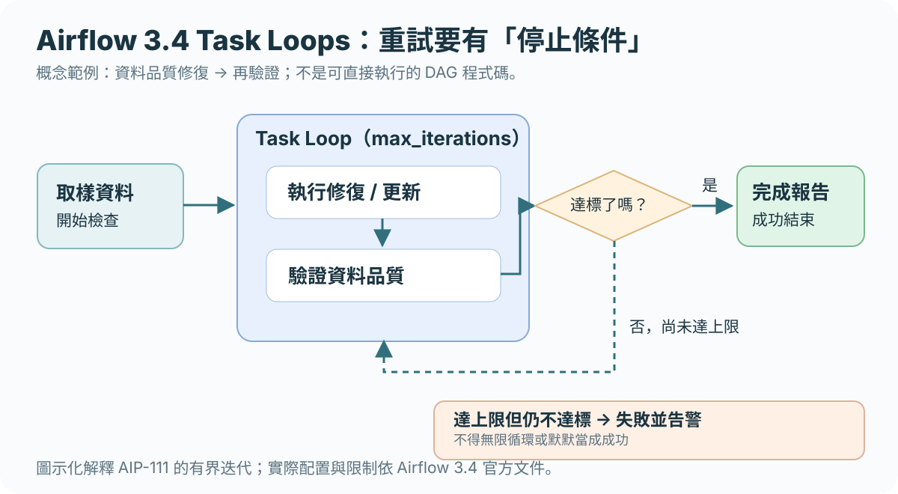

做 Data Engineering 最常見的工作之一，就是讓每天的資料管線按時執行、失敗能重跑、有問題可以追查。因此我們熟悉的 Apache Airflow 常被理解成：**用 Python 定義 DAG，再由排程器依賴順序執行 Task**。

但 2026 年 11 月 6 日發布的 **Apache Airflow 3.4.0**，開始讓這個印象改變：它正式加入 **Task Loops**、支援以 TypeScript／Go／Java／YAML 定義整個 DAG 的實驗性機制，並擴展 AI Agent 與人工審核的工作流程整合。

這些功能讓人想問：**Airflow 會從資料排程工具，逐漸變成一般的 Workflow／Agent Orchestrator 嗎？又有多少功能已適合正式環境？**

> **本文驗證狀態：官方文件整理，未實際部署。** 以下已核對 Airflow 3.4.0 官方公告與 Release Notes；Task Loops 的原理與版本限制來自第一手資料。本文沒有把概念圖當實際 UI 截圖，也沒有聲稱完成 Airflow 3.4 的容器部署或 Agent 執行測試。

## 1. 先記住三個重點

| 3.4 更新                   | 用一句話理解                                         | 對資料工程的影響                            | 成熟度提醒                                              |
| -------------------------- | ---------------------------------------------------- | ------------------------------------------- | ------------------------------------------------------- |
| **Task Loops（AIP-111）**  | 一個任務群組可以依結果重複有限次                     | 迭代檢查、逐步修正、有限次重試型流程        | 有明確 `max_iterations` 與失敗語義                      |
| **DAG Importer（AIP-85）** | 不只 Python，也可定義 TypeScript、Go、Java、YAML DAG | 對跨語言團隊更友善                          | 官方頁面對成熟度的敘述有差異，升級前應核對              |
| **Common AI Provider**     | 把模型呼叫、Agent 和人工審核放進 Airflow Task        | AI 輔助資料處理、異常分析與需核准的工具呼叫 | Provider 1.1.0 於 3.4 期間 GA；部分進階能力仍是實驗預覽 |

這三項來自 [Airflow 官方 3.4 介紹](https://airflow.apache.org/blog/airflow-3.4.0/)；是否適合目前團隊，取決於既有 DAG 複雜度、Python 版本、維運負擔及安全審批需求。

## 2. Task Loops：以前常用奇怪的方式繞過去，現在有正式語意

假設你有一條資料品質流程：

1. 抽樣資料，檢查 Null 比例與主鍵重複。
2. 嘗試修復可自動處理的問題。
3. 再次檢查是否達標。
4. 如果不達標，最多再做幾輪；一直不達標就明確失敗與告警。

你可能曾用固定 N 個 Task、手工展開依賴，或讓 DAG 自己觸發下一輪。Airflow 3.4 的 Task Loops 是把**有限次的依結果迭代**變成第一級能力。

_圖 1：自製情境示意，非 Airflow UI。這裡的「修復資料」是教學假設；不要讓 Agent 自動修改生產資料。_

官方的 `.loop()` 允許指定 `max_iterations` 和選用的 `until` 條件。它有幾個很重要、也容易被誤解的語義：

- **至少跑一次**：條件是每次 body 做完才判定，類似 `do ... while`。
- **有上限**：`max_iterations` 是必填；不會無限循環。
- **未收斂不能假裝成功**：如果提供了 `until` 條件，達到上限仍不成立，最後一輪會標成失敗。
- **分輪保存資訊**：UI 有專門的 Loop Iterations 畫面，可以看每輪任務與停止原因。

這些與一般的「Task 失敗重試」不完全一樣：Task Loops 是**業務邏輯上的反覆迭代**；重試則常是處理網路暫時中斷、服務暫不可用等故障。兩者可以搭配，但應分開設計失敗與副作用。

### 真正的官方操作畫面在哪裡？

Airflow 官方發布頁提供了 [Task Loops 的 Iterations UI 截圖及範例](https://airflow.apache.org/blog/airflow-3.4.0/#-task-loops-aip-111-workflows-that-repeat-until-they-are-done)。打開該頁後，請依順序找：

1. **Iterations 分頁**：每輪執行是獨立可查看的紀錄。
2. **停止或繼續的原因**：不是看到 Task 綠色就代表整個 Loop 達標。
3. **目前在第幾輪**：需要確認沒有超過設定的上限。

這是**官方展示畫面**，不是本文自己部署拍到的截圖；不同版本 UI 可能調整。需要寫 DAG 時，請從同一頁的官方程式碼範例開始，別把上面的概念流程圖當可執行語法。

## 3. 不會 Python 的工程師，現在也能寫整個 DAG？

**部分情境可以，但先注意官方文件在成熟度上的不同敘述。**

Airflow 3.4 的 DAG Importer 讓 DAG Processor 辨認非 `.py` 的來源格式。官方列出的新支援包括 TypeScript、Go、Java SDK，以及使用 `$schema` 宣告的 YAML DAG。重點是整個 DAG 的定義（排程、Task、依賴）可以用非 Python 語言編寫，而不只是 Python DAG 呼叫其他語言的程式。

這裡值得記一個**官方文件本身的差異**：3.4 的發布文章將 TypeScript／Java／Go 三個 SDK 稱為 _generally available_，但 3.4 Release Notes 的 Significant Changes 同時將 DAG Importer 框架和語言 SDK 描述為 _experimental_、API 可能改變。本文不替官方推定哪句較新，而是採取保守的升級風險評估：在大型正式環境導入之前，先固定版本、驗證 DAG 載入、部署流程、測試能力、錯誤日誌和人員維護方式。YAML Importer 也應以實驗性路線評估。

| 團隊情境                           | 我會怎樣評估                                |
| ---------------------------------- | ------------------------------------------- |
| 全團隊已熟悉 Python，現有 DAG 穩定 | 沒必要只為了新語言重寫全部 DAG              |
| 主要是 Go／Java／TypeScript 開發者 | 可在隔離環境測試 DAG Importer 與 Task SDK   |
| YAML 設定式流程很多                | 先比對複雜依賴、模板與測試的表達能力        |
| 稽核、SRE、平台團隊有既定部署規範  | 先確保 CI、版本鎖定、回滾與可觀測性都能銜接 |

## 4. AI Agent 接進 Airflow，最需要談的是權限

Airflow 的 Common AI Provider 並不只是把一段 LLM Prompt 放進 Task。官方 3.4 發布介紹指出，Provider 1.1.0 隨 3.4 推進至 GA，可用正常的任務方式執行模型和 Agent 工作流程，也能使用人工審核；但某些進階能力（例如特定 sandbox、step-level replay）仍以實驗性預覽提供。

我會把「Agent 查資料庫」拆成三個問題：

1. **Agent 能讀到什麼？** 應使用唯讀帳號、限制表格、隔離敏感資料，不靠 Prompt 口頭要求保密。
2. **Agent 能改動什麼？** 涉及刪除、寫入或發送外部資料的工具呼叫，應有服務端權限與必要的人工核准。
3. **Agent 出錯後怎麼辦？** 不能因為 Airflow 有 Retry，就忽略 LLM 非決定性、費用、重複副作用或資料污染。

如果將來真的要實作，我會先從**只讀查詢、異常摘要、人工確認**開始，不讓模型直接修改正式數據。這是本文的架構建議，不是 Airflow 會自動替你做好所有安全設定。

可參考 [Common AI Provider 介紹](https://airflow.apache.org/blog/common-ai-provider-1.0/) 與 [Agent 安全官方文件](https://airflow.apache.org/docs/apache-airflow-providers-common-ai/stable/agent_security.html)。

## 5. 升級到 3.4 前別漏掉這幾件事

除了新功能，正式環境更該先讀 Release Notes 的 Breaking Changes：

| 必查項目                       | 為何重要                                                           |
| ------------------------------ | ------------------------------------------------------------------ |
| **Python 3.11+**               | Airflow 3.4 已移除 Python 3.10 支援                                |
| **PostgreSQL metadata driver** | 官方將 psycopg3 作為預設 driver，需核對連線、PgBouncer 與部署設定  |
| **XCom 格式與回退**            | 3.4 更動 XCom 資料表；降版可能搬移大量資料或遇到無法安全回退的紀錄 |
| **Asset-triggered DAG 語意**   | 部分單一 Asset 排程預設改成一個事件觸發一次 DAG run                |
| **實驗性 SDK**                 | 不要沒有版本鎖定與測試，就直接導入正式流程                         |

這些資訊可在 [Airflow 3.4.0 Release Notes](https://airflow.apache.org/docs/apache-airflow/3.4.0/release_notes.html) 查到。**在 MySQL metadata database 上尤其要保留可恢復的備份**，因為降版涉及資料庫 DDL 時不一定能像交易一樣回滾。

## 6. 初學者可以怎麼跟著研究？

這裡先給出不需要接觸公司資料的**官方文件學習路線**，而不是聲稱已替你完成安裝。

1. 先閱讀 [3.4 發布公告](https://airflow.apache.org/blog/airflow-3.4.0/) 的 Task Loops 範例，辨認 `max_iterations`、`until`、`loop.previous`。
2. 到官方公告的 **Iterations UI 圖**，理解成功、繼續及達上限失敗的差別。
3. 查看 [3.4 官方文件](https://airflow.apache.org/docs/apache-airflow/3.4.0/) 與對應的 Docker 映像 `apache/airflow:3.4.0`；有 Docker 的讀者可以先在隔離環境測試。
4. 想做實驗時，先以不含敏感資料的數學收斂或測試資料品質範例開始，記錄每輪結果、Retry、Log 與警報。
5. 最後再研究 DAG Importer 和 Common AI，並把所有 experimental 功能與依賴版本寫進測試紀錄。

**這是建議路線，尚未執行的部分要由讀者在自己的環境驗證。** 不需要為了跟上新版本就直接升級正式 Airflow Cluster。

## 7. 我真正想討論的問題

> 如果同一個 Workflow Engine 開始能跑「不斷修正直到達標」的任務、非 Python DAG，還能插入 LLM 與人工審批，那團隊還需要另一套專用的 Agent Orchestrator 嗎？

我的初步看法是：**需要清楚區分資料管線可靠性與即時 Agent 互動。** Airflow 擅長可追蹤、可排程、有依賴關係的工作；需要毫秒級互動、長連線、多輪對話狀態的 Agent 系統，未必應直接交給同一種架構。這是架構推論，仍需依 SLA、延遲、成本與故障模式驗證。

如果你已在使用 Airflow，可以先留言分享：你最想用 Task Loops 解決哪一段「為了反覆執行而寫得很彆扭」的資料管線？

延伸閱讀：[DuckDB 2.0：當 Agent 直接呼叫資料查詢工具](/brad-log/posts/duckdb-2-server-agent-variant-guide/)。

### 官方來源與查核日期

- [Apache Airflow：3.4.0 發布公告（2026-11-06）](https://airflow.apache.org/blog/airflow-3.4.0/)
- [Apache Airflow：3.4.0 Release Notes](https://airflow.apache.org/docs/apache-airflow/3.4.0/release_notes.html)
- [Apache Airflow：Common AI Provider 1.0](https://airflow.apache.org/blog/common-ai-provider-1.0/)
- [Apache Airflow：Securing agent tools](https://airflow.apache.org/docs/apache-airflow-providers-common-ai/stable/agent_security.html)

最後查核：2026-11-16（Asia/Taipei）。
