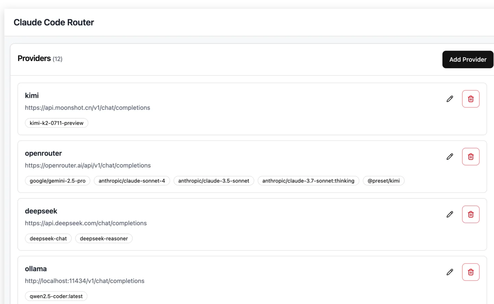
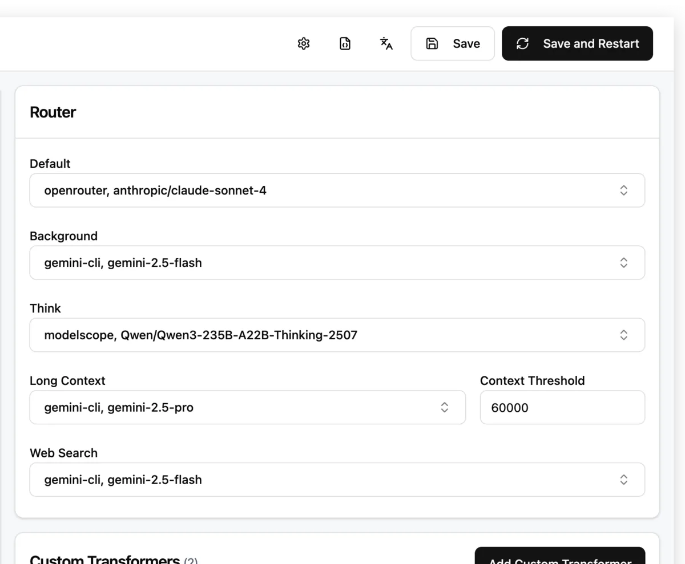

前面介紹的 [OpenCode](/brad-log/posts/opencode-beginner-guide/)、[Cline](/brad-log/posts/cline-beginner-guide/)和 [Kilo Code](/brad-log/posts/kilo-code-beginner-guide/)都是 **Coding Agent**：它們會讀取專案，安排工作並提出工具動作。

**Claude Code Router（通常縮寫 CCR）是不同類型的工具。**它偏向**模型路由閘道**：讓既有的 Coding Agent 透過本機服務連到不同模型提供者，並依照任務種類指定模型。**CCR 本身不是拿來編輯檔案的 Agent**。如果只裝 CCR，沒有可用的 Agent，就不會有完整的「AI 幫你改程式」體驗。

本文介紹的是社群開源專案 [musistudio/claude-code-router](https://github.com/musistudio/claude-code-router)，**不是 Anthropic 官方發布的 Claude Code 功能**。現在這個專案的用途已不只 Claude Code，也支援更多 Agent 的連接情境；初學時我們只驗證**本機管理畫面與設定流程**，不把安裝成功等同於免費模型一定能完成任務。

> **驗證狀態：學習整理。** 本文對照 2026-11-11 官方專案文件與管理介面截圖；沒有用真實 OpenRouter 金鑰執行模型端對端呼叫。截圖是專案作者公開的示範設定，**包含付費模型**，請勿直接照其型號操作。

## 1. 看畫面先搞懂：左邊 Provider、右邊 Router



*圖 1：官方真實管理 UI 的 Providers 區域，來自 [Claude Code Router 官方 GitHub](https://github.com/musistudio/claude-code-router/blob/main/blog/images/ui.png)。注意上方的 **Add Provider**。示範中 `openrouter` 區塊列有多個**付費模型**；本文不會使用那些型號。*



*圖 2：同一個官方截圖的 Router 區域。這些下拉選單是「什麼任務交給哪個模型」，**不是模型費率表**。所示路由設定只是官方示例，不能直接當作免費設定。*[原圖來源](https://github.com/musistudio/claude-code-router/blob/main/blog/images/ui.png)。

| 畫面區塊 | 它負責的事情 | 新手第一個檢查點 |
| --- | --- | --- |
| **Providers** | 設定 OpenRouter、其他模型服務或本機模型端點 | 金鑰只存在本地設定，不能公開 |
| **Add Provider** | 增加一個模型來源 | 選對 OpenRouter 與 API endpoint |
| **Router / Default** | 決定一般任務預設使用的模型 | 先指定經核對為 `$0` 的免費模型 |
| **Background / Think** | 為其他任務分類選擇不同模型 | **逐一核對**，避免背景任務偷偷選了付費模型 |
| **Save / Restart** | 儲存與重啟本機路由服務（依版本） | 修改後確認生效，不要只看到表單就以為已啟動 |

## 2. 誰需要 CCR？它與 OpenRouter 怎麼分工？

一個典型資料流是：

```text
你 → Coding Agent（例如 Claude Code）→ 本機 CCR → OpenRouter → 實際模型
```

- **Agent** 決定要讀什麼、要改什麼檔案、要執行哪些指令。
- **CCR** 把 Agent 的模型請求送往你配置的 Provider，並可依任務選擇不同模型。
- **OpenRouter** 是可選的上游聚合服務；也可以接其他符合要求的模型服務。
- **模型** 負責生成回覆或工具呼叫結果。它能否支援 Agent 所需協定與工具呼叫，必須另外核對。

本機 CCR 程式開源且可自行安裝，**但上游模型可能收費**。本篇將「不花錢」拆成兩條條件：**閘道軟體免費 + 每一條實際使用的模型路由價格是零**。

## 3. 安裝準備：Node.js 與本機安全範圍

1. 先檢查你電腦有相容的 Node.js（專案文件目前要求 **Node.js 22+**）：`node --version`、`npm --version`。
2. 從 [官方 GitHub README](https://github.com/musistudio/claude-code-router)確認目前的安裝方式與最低版本。
3. 選一個**沒有私人資訊**的練習環境。之後若要搭配 Agent，請另外建立全新 `ccr-playground` 資料夾。
4. 預先確認本機 **3456**、**3458** 等預設服務埠沒有被不明程式占用；若版本的埠號不同，優先採用官方說明。

官方 npm 套件的安裝與啟動方式：

```bash
npm install -g @musistudio/claude-code-router
ccr ui
```

`ccr ui` 會依版本啟動／開啟管理介面。官方預設管理 UI 通常在 `http://127.0.0.1:3458`、路由服務在 `127.0.0.1:3456`，請以終端機實際顯示的地址為準。**只使用本機 loopback（`127.0.0.1`），不要把含管理權限或金鑰的服務暴露到 `0.0.0.0` 或公網。**

### 畫面操作 ①：確認管理 UI

1. 保留執行 CCR 的終端機，檢查是否有錯誤。
2. 在**自己電腦**的瀏覽器開 `http://127.0.0.1:3458`（依實際輸出調整）。
3. 預期看到圖 1 的 Providers 與圖 2 的 Router 等設定區塊。版本不同時，可能改為側邊導覽或多頁式 UI。
4. 如果打不開，檢查服務是否啟動、埠是否衝突，**不要先開啟防火牆對外連線**。

**成功檢查：** 僅本機可進入管理介面，而且尚未把任何金鑰貼到聊天或 Repository。

## 4. 在 UI 新增 OpenRouter Provider

1. 前往 [OpenRouter](https://openrouter.ai/)的 API Keys 管理頁，建立只用於練習的金鑰。
2. 回到 CCR 管理 UI，在圖 1 上方點 **Add Provider**。
3. 依 UI 的 Provider 類型／範例，選擇 **OpenRouter** 或新增 OpenAI-compatible Provider。官方 OpenRouter Chat Completions 常見 endpoint 為 `https://openrouter.ai/api/v1/chat/completions`；**實際欄位要求 base URL 還是完整 endpoint，須看目前表單說明，不能混填**。
4. 在本機受保護的 Key 欄位輸入金鑰；不要放到 Git 追蹤的設定檔或文章截圖。
5. 加入當下 [OpenRouter 免費模型](https://openrouter.ai/collections/free-models)中確定為 `$0` 且支援所需工具呼叫的完整模型 ID（通常以 `:free` 結尾）。
6. 儲存，回到 Provider 清單檢查名稱與模型是否出現。

**畫面檢查：** Provider 應顯示你新增的 OpenRouter，但不應明文洩漏 Key。若 Provider 無法驗證，先回官方文件核對 endpoint、模型 ID、服務狀態；不必為了排錯去購買模型。

## 5. 指定路由：不只 Default 要免費

看圖 2 的 Router 區塊。依目前 UI，可能有 `Default`、`Background`、`Think`、`Long Context` 等任務類型。

**初學者的零費用做法：**

1. 先把 **Default** 指向剛剛選的免費模型。
2. 檢查**每一個可能啟用的其他路由欄位**。若某欄位仍指向付費示範模型，要依官方說明改成已驗證的免費模型或停用該路由。
3. 儲存／重啟。再打開頁面檢查值是否仍維持。
4. 如 UI 提供 Logs／Usage，第一次請求前先找到它的位置，稍後才能核對路由與費用。

不同免費模型的 Tool Calling、上下文長度與任務適配可能不一致，**一個模型填進所有欄位並不保證 Agent 可以運作**。如果找不到兼容且零費率的模型，本系列的正確做法是**停止測試**，不是讓程式自動降級到付費模型。

## 6. 對接 Coding Agent 與第一次任務

CCR 的新版本提供 Agent 設定／啟動整合；請在當前管理 UI 找 **Agent Config** 或對應 Agent 選項。選擇既有已安裝的 Agent（例如 Claude Code）並依官方程序套用**專用設定檔**。開始之前先備份 Agent 原設定，避免修改後不知道怎麼恢復。

這裡務必要分清楚兩段驗證：

| 驗證階段 | 要怎樣確認 | 不代表什麼 |
| --- | --- | --- |
| CCR 已啟動 | UI 可開啟、服務日誌顯示 listening／ready | **不代表**模型認證成功 |
| Provider 已配置 | OpenRouter 與免費 Model ID 出現在清單 | **不代表**Tool Calling 一定支援 |
| Agent 可透過 Router 工作 | Agent 在隔離專案完成一次唯讀問題，Router Logs 顯示請求 | **不代表**其後所有模型／背景路由都免費 |
| 安全完成寫檔任務 | 人工審查權限、檔案範圍並自行跑測試 | **不代表**可以把企業秘密交給遠端模型 |

第一次請先只問：

> 目前是空的練習專案。請說明建立 `greet(name)` 與內建 `unittest` 測試的計畫。先不要修改或執行任何東西。

檢查 CCR Logs 裡的模型 ID 與請求結果，再核對 OpenRouter Usage 是否真的為零費率。**某些 Connection Test 本身也會對外送出真實請求**，所以一定要先確認模型是免費的。

確認 Agent 授權提示後，才考慮讓它新增 `hello.py` 與 `test_hello.py`；驗收時自己跑 `python3 -m unittest -v`，核對 Diff。**本文沒有宣稱上述流程已在本機真實成功執行。**

## 7. 成本、隱私與故障排查

| 現象 | 先檢查 |
| --- | --- |
| `ccr` 找不到指令 | npm 全域路徑與 Node 版本；重開終端機 |
| UI 打不開 | 服務進程／埠號／是否只綁 loopback，避免打開公網 |
| Provider 回傳 401 | Key 是否有效；**不要**公開 Key 或要求 AI 記錄金鑰 |
| Provider 回傳 404 或模型不存在 | 完整模型 ID 與 endpoint 格式是否吻合 |
| 只能聊天不能編輯 | 上游模型是否支援 Tool Calling；Agent 是否真的連到 CCR |
| 收費／超出額度 | 立即停止；逐項檢查 Default、Background、Think 等路由 |
| 原本的 Agent 設定失效 | 從事前備份復原，避免盲目重裝與覆蓋 |

請記得：**本機閘道不代表資料留在本機。**只要 CCR 將請求轉送 OpenRouter 或其他遠端 Provider，Prompt、程式碼上下文與工具結果就可能離開你的電腦。對公開練習專案可以嘗試，但不適合拿公司程式碼當第一個實驗。

## 總結與系列導覽

Claude Code Router 適合**已經有 Coding Agent、又想集中管理模型選擇與任務路由**的人。新手第一次使用，先以管理 UI、模型 ID、路由設定和 Logs 理解資料流；需要改程式的動作由 Agent 負責，仍須人工授權。

系列：[OpenCode](/brad-log/posts/opencode-beginner-guide/) · [Cline](/brad-log/posts/cline-beginner-guide/) · [Kilo Code](/brad-log/posts/kilo-code-beginner-guide/) · **Claude Code Router** · [Codex Router](/brad-log/posts/codex-router-beginner-guide/) · [工具比較](/brad-log/posts/coding-agent-router-comparison/)。

### 官方參考

- [musistudio/claude-code-router 專案與 README](https://github.com/musistudio/claude-code-router)
- [Claude Code Router 專案文件](https://ccrdesk.top/)
- [OpenRouter 免費模型](https://openrouter.ai/collections/free-models)
- [OpenRouter Pricing](https://openrouter.ai/pricing)

最後核對：2026-11-11（台灣時間）。
