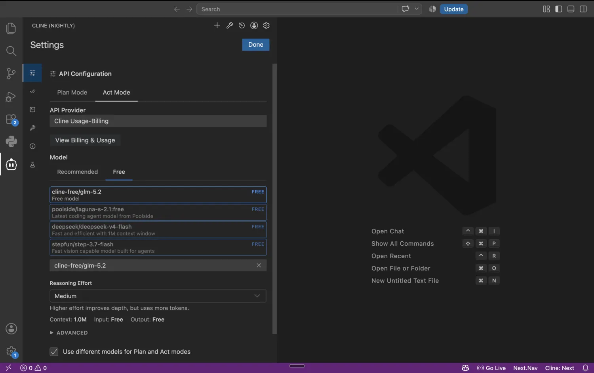

如果你平常使用 **Visual Studio Code（VS Code）** 編寫程式，Cline 是個很適合認識的 Coding Agent。它把 AI 的任務規劃、讀檔、修改程式和執行命令放在編輯器側邊欄，你可以一邊工作一邊查看提案。

這篇會從安裝開始，一步一步找到模型設定、辨認免費選項，再讓 Cline 在**全新且沒有私人資料的練習專案**中建立程式。網站與本篇練習都以不付費為原則，不要求綁卡或儲值。

> **驗證範圍：** 本文參考 2026-11-11 的 Cline 官方文件。附圖是**官方 Cline Nightly 的真實 VS Code 畫面**，不保證正式版今天的每個按鈕位置相同；本文沒有使用金鑰完成真實模型呼叫，以下「預期結果」不代表作者已實測成功。

## 1. 先看實際介面：免費模型在哪裡？



*圖 1：來自 [Cline 官方 Free Models 文件](https://docs.cline.bot/getting-started/free-models)的產品截圖。這是 Nightly 展示版本，畫面中 FREE 模型名稱及可用情況會變，不能把截圖當成永久免費清單。*

請在圖中找這四個位置：

| 圖中可見的文字 | 用途 | 初學者需要注意 |
| --- | --- | --- |
| **Settings** | 開啟 Cline 設定 | 通常由 Cline 面板的齒輪進入 |
| **API Provider** | 選擇模型來源 | `Cline` 的免費活動模型與 `OpenRouter` 是**兩條不同路線** |
| **Plan Mode / Act Mode** | 規劃與執行兩種工作方式 | 先選 Plan 理解需求，再決定是否進入 Act |
| **Free / FREE** | 目前標示為免費的模型 | 要再核對當天條件、剩餘額度和資料政策 |

這張圖的 Provider 是 Cline 自有服務，不是 OpenRouter 的設定畫面。若你選 OpenRouter，欄位和模型清單會不同。不要因為畫面有「Free」字樣，就直接點任何付費或升級按鈕。

## 2. 準備 VS Code 和隔離練習目錄

1. 從 [VS Code 官方網站](https://code.visualstudio.com/download)安裝編輯器。
2. 另從 [Python 官方網站](https://www.python.org/downloads/)取得 Python 3；完成後用終端機執行 `python3 --version`（Windows 也可用 `py --version`）。
3. 建立 `cline-playground` 這個新資料夾，用 VS Code 的 **File → Open Folder** 打開。
4. 建議安裝 Git，並在 VS Code 終端機執行 `git init`。它只在本機記錄版本，**不會自動上傳 GitHub**。

**這一步的畫面檢查：** VS Code 左側 Explorer 應指向 `cline-playground`，不是工作的專案、私人筆記或含有金鑰的資料夾。

## 3. 安裝 Cline 擴充功能

依 [官方安裝文件](https://docs.cline.bot/getting-started/installing-cline)：

1. 在 VS Code 左側點 **Extensions（擴充功能，四方塊圖示）**；也可使用 `Ctrl+Shift+X`／macOS `Cmd+Shift+X`。
2. 搜尋 `Cline`，核對官方名稱與發布者，再點 **Install**。
3. 安裝完後，在側邊欄找到 **Cline** 圖示並打開。
4. 若看到歡迎設定畫面，先認識 Provider／模型選擇，不需要立刻購買方案。

**確認成功：** 編輯器中看得到 Cline 面板和文字輸入區。若完全沒出現，先重新載入 VS Code 視窗，回 Extensions 確認它已啟用。

## 4. 免費模型：先選一條你能理解的路線

### 路線 A：Cline 官方當期的免費模型

1. 在 Cline 面板打開 **Settings**。
2. 依 [官方 Free Models 文件](https://docs.cline.bot/getting-started/free-models)，查看目前是否有標示 **Free** 的模型，以及帳號登入和使用限制。
3. 如果畫面或官方說明要求付費，**停止**。免費資格和型號會輪替，並非每個帳號／時段都相同。

此路線可能經由 Cline 服務轉送輸入給上游模型提供者；部分活動免費模型的資料使用條件可能不同於付費方案。請先閱讀當期條款，**不要拿私人或公司的原始碼測試**。

### 路線 B：連接 OpenRouter 的 `:free` 模型

1. 在 [OpenRouter](https://openrouter.ai/)註冊免費帳號，在 API Keys 管理頁建立一把練習用金鑰。
2. 打開 Cline 的 **Settings → API Provider**，選 **OpenRouter**（這時與圖 1 的 Cline Provider 畫面不同）。
3. 只在設定表單的金鑰輸入框貼上 Key；**不要**寫進程式檔、Markdown、Git Commit 或截圖。
4. 在 **Model** 選單選一個你已在 [OpenRouter 免費模型清單](https://openrouter.ai/collections/free-models)確認為零價格、且支援 **Tool Calling** 的 `:free` 模型。
5. 儲存設定並返回對話畫面。若列表沒有免費模型，不要改選付費模型；先檢查提供者連線與官方清單。

對照 [Cline 官方 OpenRouter 教學](https://docs.cline.bot/provider-config/openrouter)。**OpenRouter 免費模型有請求數限制**，實際可用型號、Tool Calling 支援與費率會變；「軟體免費」不代表連接的所有模型都免費。

| 你應該看到 | 如果看不到，先做什麼 |
| --- | --- |
| Provider 為 OpenRouter | 回設定確認選到的是 OpenRouter，而不是 Cline 或其他供應商 |
| Key 欄位已保存，畫面不顯示明文 | 不要把金鑰貼到聊天欄求助；用官方連線指引檢查 |
| Model 選單中的完整 `:free` 模型 ID | 先回 OpenRouter 價格頁確認是否仍有該版本 |
| 模型支援工具呼叫 | 如果只能對話無法改檔，檢查該模型能力，而非立即升級付費 |

## 5. 第一次任務：從 Plan 到 Act

為了和本系列其他工具比較，我們只做一個可以手動檢查的小題目：Python `greet` 函式。

### 操作畫面 ①：先在 Plan Mode 提問

在 Cline 對話面板選 **Plan**，貼上：

> 這是全新的 cline-playground。請先列出建立 `hello.py`、`test_hello.py` 的計畫，不要改檔、不安裝套件、不執行指令。`hello.py` 需有 `greet(name)`，回傳 `Hello, {name}!`。測試請使用 Python 內建的 `unittest`。

**此時應看什麼：** Cline 應先提出計畫。你要確認它沒有提議修改不相干檔案，也沒有引入外部套件。Plan 只是規劃工作方式；**不要把文字指令當成不可突破的權限邊界**。

### 操作畫面 ②：確認計畫後再切 Act

核對計畫後，切到 **Act**，要求：

> 請依照剛剛的計畫只建立 `hello.py` 與 `test_hello.py`。直接執行 `hello.py` 應顯示 `Hello, Brad!`。每次新增檔案或執行命令前請先顯示內容並取得我的確認。不要讀取其他目錄，不要推送 Git。

當 Cline 顯示寫檔、執行命令或存取其他工具的授權提示時：

1. 確認目標檔案是否真的位於 `cline-playground`。
2. 確認指令只在本機測試，**沒有** `curl` 到不明網址、安裝依賴、刪檔或 `git push`。
3. 同意明確且必要的操作；不理解的操作先拒絕、要求解釋。
4. 在編輯器 Diff／變更列表查看兩個檔案的內容。

**不要為了練習速度開啟自動批准所有操作。** Cline 的 [Plan & Act](https://docs.cline.bot/core-workflows/plan-and-act)和 [Checkpoints](https://docs.cline.bot/core-workflows/checkpoints)都值得閱讀；Checkpoints 是方便回到某個任務狀態的輔助功能，不應取代自己維護的 Git Commit。

### 操作畫面 ③：親自驗證，不靠 AI 說「完成」

在 VS Code 的 **Terminal → New Terminal** 輸入：

```bash
python3 -m unittest -v
python3 hello.py
git status --short
```

Windows 可以把 `python3` 改成 `py`。**預期驗收**是 `unittest` 通過、畫面印出 `Hello, Brad!`，且 Git 狀態只有本次預期的變更。它們是讀者應親自驗證的條件，**不是本文已取得的實測輸出**。

## 6. 常見卡關與安全提醒

| 問題 | 檢查方向 |
| --- | --- |
| 搜尋到不同的 Cline 圖示或 Nightly | 對照官方發布者與版本，正式版 UI 可能不同 |
| 無法輸入 Key | 是否選錯 API Provider、登入狀態或表單未保存 |
| 免費模型被限制 | 查看當天額度和官方費率；本系列不要求儲值 |
| AI 回答正確但沒有建立檔案 | 是否還在 Plan、工具呼叫能力不足、動作被拒絕 |
| Cline 要求執行陌生命令 | 先拒絕，問清楚用途，必要時手動執行安全的等價命令 |
| 想把真實公司專案拿來試 | 先不要；模型可能取得檔案片段、路徑與指令輸出 |

第一次使用我會特別堅持四件事：隔離目錄、只選標示零價格的模型、逐項核准動作、親自查看程式與測試結果。**API Key 不能出現在截圖和 Git 歷史中**；即使事後刪掉檔案，也可能已經留在版本紀錄裡。

## 總結與系列導覽

Cline 的重點是**緊貼 VS Code 的操作體驗**：你可以在同一個編輯器理解問題、檢查變更、手動執行測試。對不習慣終端機 AI 介面的人，這種工作流程比較直覺。

這是 Brad.log 的 Coding Agent／Router 入門系列：[OpenCode](/brad-log/posts/opencode-beginner-guide/) · **Cline** · [Kilo Code](/brad-log/posts/kilo-code-beginner-guide/) · [Claude Code Router](/brad-log/posts/claude-code-router-beginner-guide/) · [Codex Router](/brad-log/posts/codex-router-beginner-guide/) · [工具比較](/brad-log/posts/coding-agent-router-comparison/)。

### 官方參考

- [Cline — 安裝](https://docs.cline.bot/getting-started/installing-cline)
- [Cline — 免費模型](https://docs.cline.bot/getting-started/free-models)
- [Cline — OpenRouter 設定](https://docs.cline.bot/provider-config/openrouter)
- [Cline — Plan and Act](https://docs.cline.bot/core-workflows/plan-and-act)
- [Cline — Checkpoints](https://docs.cline.bot/core-workflows/checkpoints)
- [OpenRouter — 免費模型](https://openrouter.ai/collections/free-models)

最後核對：2026-11-11（台灣時間）。
