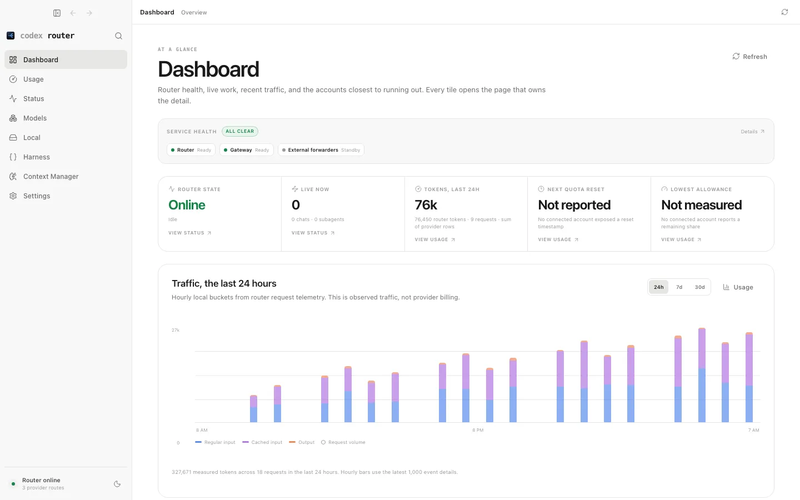
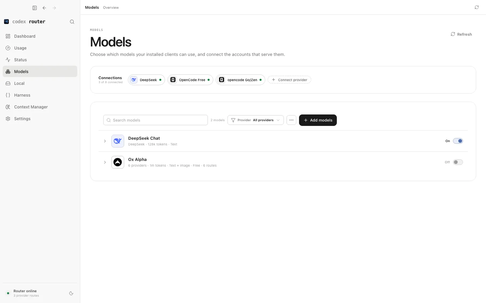

如果你已經使用過 **Codex**，可能會想知道：「能不能保留熟悉的 Coding Agent 介面，又把部分模型請求送到其他模型？」這正是某些 **Codex Router** 開源專案試著解決的事情。

不過要先提醒：**「Codex Router」不是唯一的產品名稱，也不是 OpenAI 官方 Codex 的內建功能名稱。**網路上有不只一個同名或類似專案。為了讓初學者能跟著做，本文**只討論明確的這個專案**：[`duolahypercho/codex-router`](https://github.com/duolahypercho/codex-router)，官方教學網站為 [codex-router.com](https://codex-router.com/)。切勿把其他同名工具的指令、配置檔混用。

**Codex Router 是路由工具，不是另一個 Codex Coding Agent**。它協助已安裝的 Agent 連接不同供應商或本機模型；若你尚未接觸 Coding Agent，建議先從 [OpenCode 入門](/brad-log/posts/opencode-beginner-guide/)建立基本概念。

> **本文狀態：學習整理。** 已核對截至 2026-11-11 的專案安裝與使用說明。下方是真實的專案官方 UI 截圖；沒有在使用者電腦上安裝 Codex Router、沒有用真實 Provider 金鑰完成推論，因此只列出**預期的驗收方式**，不宣稱已實測連線成功。

## 1. 先看官方的兩個主要畫面



*圖 1：`duolahypercho/codex-router` 專案的官方 Dashboard 截圖。來源：[官方原始圖片](https://github.com/duolahypercho/codex-router/blob/main/docs-site/public/app/control-center-dashboard.png)。這是官方展示資料，**不是本文實測的服務狀態或使用量**。*

看這張畫面，先辨認三件事：左側 **Dashboard / Models / Status / Usage** 的導覽；中間的 **Service Health / Router State**；下方的 **Traffic**。如果你的畫面是「Router Online」，只代表路由服務可能啟動，不代表已接上免費且相容的模型。



*圖 2：官方 **Models** 畫面。來源：[官方原始圖片](https://github.com/duolahypercho/codex-router/blob/main/docs-site/public/app/control-center-models.png)。請注意 **Connect provider、Add models、On/Off**。畫面中的 DeepSeek 等名稱只是示例，**不是本文推薦的免費模型**。*

| 看到的 UI | 用來做什麼 | 要核對的安全點 |
| --- | --- | --- |
| **Dashboard / Status** | 查看本機 Router 是否正常運作 | Online 不代表 Provider 一定連線成功 |
| **Models → Connections** | 看已連接的供應商 | 知道請求與程式碼會送往哪個供應商 |
| **Connect provider** | 新增一個模型服務入口 | 金鑰只填官方受保護欄位 |
| **Add models / On-Off** | 將模型加入清單並決定是否啟用 | 先確認費率，再啟用；避免付費備援模型 |
| **Usage** | 觀察請求與模型使用記錄 | 本機 Token 計數不一定等於供應商實際帳單 |

## 2. 理解 Codex、Router、Provider 的關係

本系列把這個工具的架構簡化為：

```text
你 → Codex（Coding Agent）→ Codex Router（本機）→ Model Provider → 模型
```

依本專案設計，本機可涉及 Codex 側路由埠（文件示例為 `4202`）與 LiteLLM 兼容橋接（示例為 `4200`）；這些是**預設架構細節，不要把本機服務直接曝露到公網**。實際部署因版本和選項而不同，請以 [官方 Install](https://codex-router.com/install/) 與當下的 `doctor` 輸出為準。

你也可能在官方頁面看到本機模型、OpenRouter、原生帳號的選項；要記住一條原則：**Router 只是決定請求怎麼走，不保證所連的模型免費。** 若上游是付費模型，透過 Router 一樣可能產生費用。

## 3. 安裝前檢查：先保護已有的 Codex 設定

官方安裝說明提到的常見依賴包括：

- **Codex CLI 或 App**：Router 是在它的基礎上工作，不是替代它。
- **Node.js 22.19+**（以目前官方版本要求為準）。
- **Git**：取得可審查的專案程式碼。
- **Python 3.10+ 與 `uv` 或 `venv`**：部分安裝／LiteLLM 路線會需要。

先在終端機檢查：

```bash
node --version
git --version
python3 --version
codex --version
```

少任何一項時，先到該軟體官網依正常方式安裝。**最重要的是：先備份你現有的 Codex 設定檔**，避免工具安裝改變你本來使用的模型來源或登入狀態。備份檔不要提交 Git，更不要把帶 Token 的內容貼到教學網站。

## 4. 從官方原始碼安裝，而不是盲目執行遠端腳本

官方文件提供安裝腳本與引導式流程。本篇採用**先取得原始碼、先檢查，再執行**的方式：

```bash
git clone https://github.com/duolahypercho/codex-router.git
cd codex-router
```

打開 `README.md`、`install.sh` 和 [官方安裝文件](https://codex-router.com/install/)確認來源與腳本內容，再視需要執行：

```bash
./install.sh --target codex --guided
```

如果你還沒決定任何模型提供者，官方也有類似 `--no-provider --no-discovery` 的安裝選項，可以先準備本機路由環境、稍後再設置 Provider。**無 Provider 並不代表已能呼叫模型**。

不要直接複製來路不明的 `curl | sh` 指令、不要在讀不懂腳本時加 `sudo`，也不要在終端機貼上陌生網站要求的 Token。安裝精靈若準備改動原本的 Codex 設定，先記錄更動內容與復原方式。

### 畫面操作 ①：安裝完成的 CLI 自我檢查

依目前官方 CLI 範例，在專案資料夾執行：

```bash
./bin/model-router codex doctor
./bin/model-router codex providers
```

**要看什麼：** `doctor` 應提供可讀的設定、依賴或連線健康資訊，`providers` 應列出目前配置的供應商。它們是**查驗指令，不是本文已獲得的真實輸出**。如安裝器更動命令位置或語法，依當前 `--help` 與官方 README 修改。

## 5. 從 Models 畫面新增免費模型

這個步驟先有一個前提：你的版本已按官方文件啟用本機控制台，且可以看到圖 1 的 Dashboard。若 CLI 有自己的 UI 啟動方式，**以官方當期說明和終端機實際網址為準**，不要隨便對網路開放本機埠。

1. 點左側 **Models**（圖 2）。
2. 在上方 **Connections** 找 **Connect provider**，選你打算使用的來源（例如 OpenRouter）。
3. 如果使用 OpenRouter，只在安全的 Provider 設定表單輸入練習用 API Key。
4. 點 **Add models**，選擇 [OpenRouter 免費模型列表](https://openrouter.ai/collections/free-models)中目前價格為 `$0`、有工具呼叫能力、且與此 Router 協定相容的具體 `:free` 模型。
5. 確認該模型的 **On / Off** 狀態；把不打算使用、可能收費的模型維持停用。
6. 打開 **Usage** 導覽，先認識如何查看流量；正式發出請求後還要對照**上游供應商帳戶的實際帳單／額度**。

**這裡容易誤解：** 截圖中的 Dashboard Token 統計和 Models 清單是官方測試資料，不代表我們選定的模型一定免費。能否選 `:free`、是否能處理 Codex 工具呼叫及協定轉接，都需在實際版本核對。

## 6. 第一次驗證：先讀、不改、再看 Logs

如果已完成 Codex 與 Router 的連接，**先不要把大型真實 Repository 給 Agent**。建立全新空資料夾 `codex-router-playground`，在這個資料夾啟動 Codex，先提出唯讀要求：

> 請只規劃一個最小 Python 練習：`hello.py` 含 `greet(name)`，`test_hello.py` 用標準 `unittest` 測試。先不要建立任何檔案、不執行命令、不讀取練習資料夾以外的內容。

然後人工確認：

1. Codex 是否顯示已選定的模型與期望的路由環境？
2. **Dashboard / Usage / Status** 是否顯示一次合理的請求事件？
3. 上游 OpenRouter 的 Usage 是否仍在免費額度內？
4. 如果只看到 Codex 回覆，**不要直接推斷請求必定經過 Router**；需要對照 Router Logs 或其他可觀測資訊。

進一步才允許 Agent 只建立 `hello.py` 與 `test_hello.py`，每次動作先人工核准，並在自己終端機執行：

```bash
python3 -m unittest -v
python3 hello.py
git status --short
```

預期 Python 顯示 `Hello, Brad!` 且測試通過；**這是你應自行驗證的標準，非作者已跑出的結果**。

## 7. 安全與故障排查

| 問題 | 建議檢查 |
| --- | --- |
| `doctor` 顯示缺少依賴 | Node、Python、Git、uv 或安裝路徑是否符合 README |
| Codex 原本設定異常 | 先用備份還原；不要反覆執行覆寫式腳本 |
| Dashboard Online 但無請求 | Codex 是否真的指向本機 Router；看 Router 日誌 |
| Provider 401／403 | 金鑰、額度、Provider 授權；不要公開完整錯誤中的 Key |
| 可以問答但無工具動作 | 模型 Tool Calling／協定相容性不足，或 Agent 權限未給 |
| 模型顯示 Free 但產生費用 | 核對每條路由、上游供應商計費與備援模型，立即停止測試 |

**資安底線：** Router 在本機運行不代表你的程式碼不出網。外部 Provider 仍可能取得問題內容、檔案片段與執行結果。把本機控制台綁在 loopback、不要公開 Token、不要讓模型拿到私人 Repository，才是第一個練習該做的事。

## 總結與系列導覽

`duolahypercho/codex-router` 特別適合**已經熟悉 Codex、願意管理本機依賴與 Provider 路由**的人。它的設定層比單純安裝 VS Code 擴充功能多，因此新手應先記錄版本、備份原設定，並從 `doctor` 和 Models／Usage 畫面逐步驗證。

系列：[OpenCode](/brad-log/posts/opencode-beginner-guide/) · [Cline](/brad-log/posts/cline-beginner-guide/) · [Kilo Code](/brad-log/posts/kilo-code-beginner-guide/) · [Claude Code Router](/brad-log/posts/claude-code-router-beginner-guide/) · **Codex Router** · [工具比較](/brad-log/posts/coding-agent-router-comparison/)。

### 官方參考

- [duolahypercho/codex-router 原始碼與 README](https://github.com/duolahypercho/codex-router)
- [Codex Router 官方安裝](https://codex-router.com/install/)
- [Codex Router 官方網站](https://codex-router.com/)
- [OpenRouter 免費模型](https://openrouter.ai/collections/free-models)
- [OpenRouter Pricing](https://openrouter.ai/pricing)

最後核對：2026-11-11（台灣時間）。
