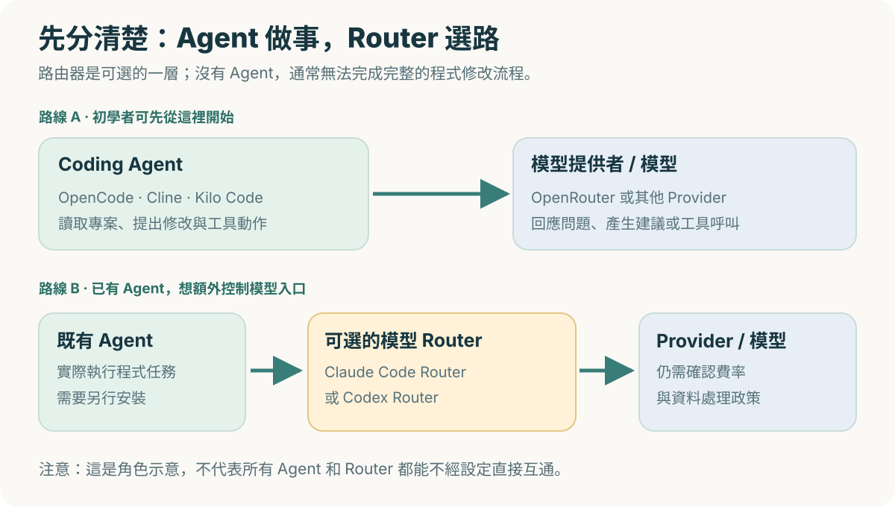
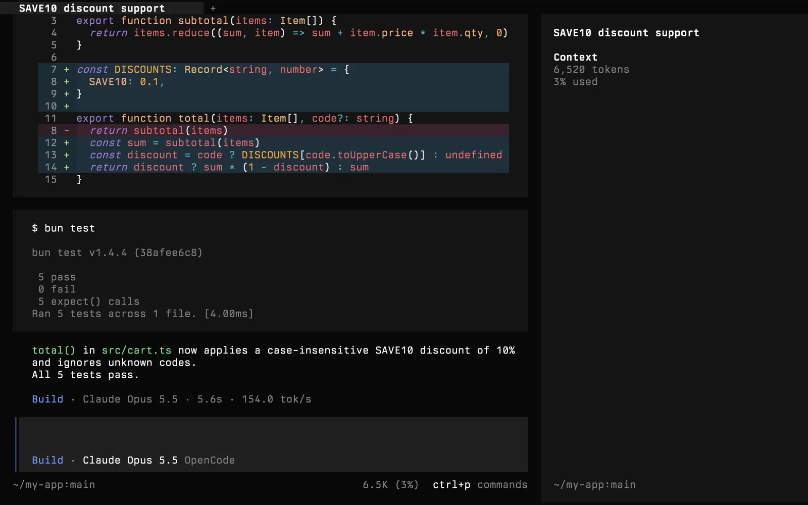
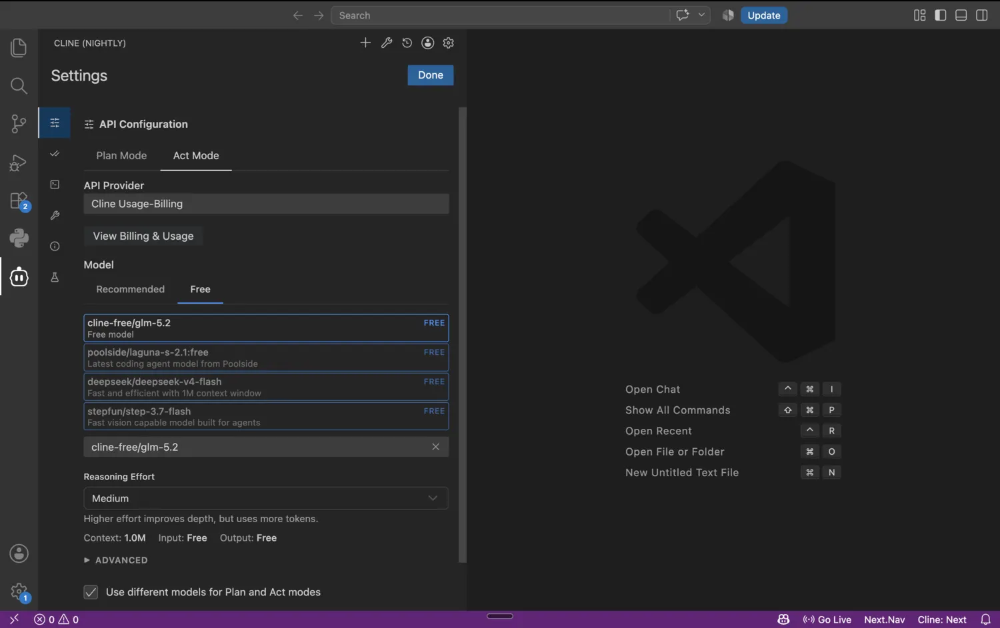
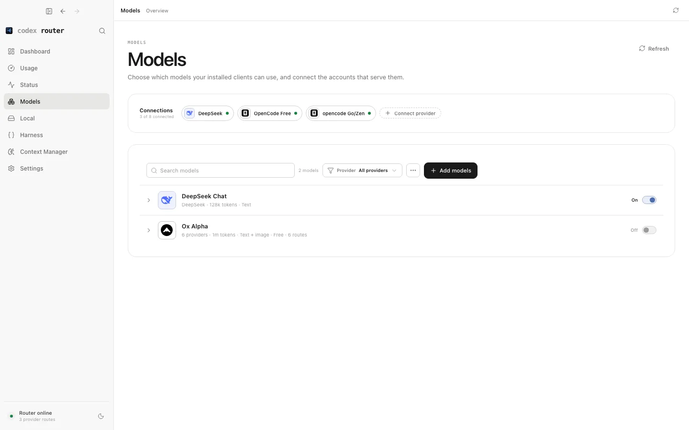

我們已經各自認識五項工具：**OpenCode、Cline、Kilo Code、Claude Code Router、Codex Router**。如果剛入門，最容易困惑的不是安裝指令，而是「它們到底是做同一件事嗎？」

答案是：**不是。前三項主要是 Coding Agent；後兩項主要是模型 Router**。要公平比較，先把工作角色分清楚，再挑你真正需要的工具。

> **本文範圍：** 2026-11-11 根據各專案官方資料的功能與入門流程整理。這是**功能／操作負擔的比較**，不是用固定測試集測出來的效能排名；本文沒有在相同模型與環境下進行 benchmark，因此不提供毫無證據的「最好」結論。免費模型、UI 與支援整合可能變動。

## 1. 第一張圖：先區分 Agent 與 Router

*圖 1：原創概念圖。OpenCode、Cline、Kilo Code 是你與程式碼互動的 Agent；Claude Code Router、Codex Router 側重模型請求路由。**圖中的連線是概念性角色示意，並非聲稱每一組 Agent／Router 都可以直接無設定互通。***

你的需求如果是「幫我理解專案、改程式、跑測試」，**優先挑 Coding Agent**。你的需求如果是「已經有 Agent，但想自己決定背後用哪家模型」，才需要研究 Router。

## 2. 五個工具的核心差異

| 工具 | 主要角色 | 主要操作入口 | 初學者第一次要做的事 | 額外注意 |
| --- | --- | --- | --- | --- |
| **OpenCode** | Coding Agent | 終端機、桌面 | 安裝 CLI、`/connect`、`/models` | 版本 V1／V2 權限欄位差異 |
| **Cline** | Coding Agent | VS Code 側邊欄 | 裝擴充功能、選 Provider、Plan → Act | 免費活動模型和 OpenRouter 路線不同 |
| **Kilo Code** | Coding Agent | VS Code、CLI | 裝擴充功能、選 Profile／Provider、Ask → Code | Kilo Gateway 與 OpenRouter 不同 |
| **Claude Code Router** | 模型 Router | 本機管理 UI／CLI | 安裝 CCR、設 Provider 與任務路由 | **還要有**可連接的 Coding Agent |
| **Codex Router** | 模型 Router | 本機 CLI／控制台 | 備份 Codex 設定、安裝、`doctor`、設模型 | 本文指明特定獨立專案，並非官方 Codex 功能 |

表中的「主要入口」只是適合初學者的起點，不是完整平台支援表；各專案還會陸續新增其他介面。需要最新版本請看文末第一手來源。

## 3. 介面怎麼選？用真實畫面想像工作方式

如果你喜歡在終端機處理 Git、Python、Docker，先看 **OpenCode** 的官方終端機畫面：

*官方 OpenCode 真實產品畫面（[來源](https://github.com/anomalyco/opencode/blob/dev/services/site/public/brand/screenshots/opencode-terminal-dark.webp)）。這是介面示例；畫面中模型不代表免費推薦。*

如果你每天都用 VS Code，偏好在同一個編輯器看 Agent 的計畫與修改，**Cline** 的官方畫面更直觀：

*Cline 官方 Nightly 截圖（[來源](https://docs.cline.bot/getting-started/free-models)）。可辨認 Plan／Act 和模型設定，正式版 UI 可能不同。*

如果你已經有 Agent，只是想知道請求如何發送、哪個模型被啟用，則可看 **Codex Router** 的 Models 控制台：

*獨立 Codex Router 專案官方截圖（[來源](https://github.com/duolahypercho/codex-router/blob/main/docs-site/public/app/control-center-models.png)）。它管理的是模型入口，**不是直接寫程式的聊天面板**。*

另兩個工具的詳細操作畫面，請分別看 [Kilo Code 圖解](/brad-log/posts/kilo-code-beginner-guide/)及 [Claude Code Router 的 Providers／Router 圖解](/brad-log/posts/claude-code-router-beginner-guide/)。

## 4. 「完全不花錢」這件事，各工具有什麼差別？

要拆成**三筆不同的成本**：

| 成本類別 | 可能的費用 | 我們的零支出做法 |
| --- | --- | --- |
| **工具軟體** | 某些商業訂閱、付費功能 | 優先使用上述開源工具本身可免費取得的功能 |
| **模型推論** | 每次 Prompt／輸入與輸出 Token 費用 | 只選當下官方標示 `$0` 且支援 Tool Calling 的免費模型，不儲值 |
| **其他加值功能** | 背景任務、Auto-complete、雲端執行、額外服務 | 不啟用未確認費率的選項，也不設定付費備援路由 |

**OpenRouter 的 `:free` 型號不是永遠不變的清單。**免費模型也可能有每日次數限制、不支援 Coding Agent 工具呼叫，或資料政策不同。Cline 與 Kilo 亦可能提供各自的活動免費模型或 Gateway，**不要把各家免費路線當成同一個帳號／同一組價格**。

Router 特別要注意**多條路由**：即使 Default 是免費模型，Background／Think／Fallback 若還是付費模型，就可能違背「零支出」的原則。每次更新設定後，都要對照模型提供商的實際費率和用量。

## 5. 依你的使用習慣，我會這樣開始

### A. 我是初學者，幾乎都在 VS Code 寫程式

先讀 [Cline](/brad-log/posts/cline-beginner-guide/) 或 [Kilo Code](/brad-log/posts/kilo-code-beginner-guide/)，**只選其中一個安裝**，避免把兩套 Provider 設定搞混。先完成空白 Playground、唯讀提問、核准兩個檔案、自己跑 Python 測試。

- 想先理解**Plan → Act** 的審批流程：Cline 會比較符合本文教學順序。
- 想比較 **Ask / Plan / Code** 等 Agent 模式或 Kilo Gateway：Kilo Code 值得先讀。

這不是誰功能絕對較強的結論，而是初學者學習路線的選擇。

### B. 我熟悉終端機，想直接從專案目錄操作

先讀 [OpenCode 入門](/brad-log/posts/opencode-beginner-guide/)。練習 `opencode`、`/connect`、`/models`，再用 `git status`、`unittest` 人工驗證。不必一開始就加 Router。

### C. 我已經使用某個 Agent，想研究模型路由

先了解 [Claude Code Router](/brad-log/posts/claude-code-router-beginner-guide/) 的 Provider 與 Router 介面，確認上游免費模型和每條路由。只有明確需要時才加入這一層，不要在最初練習增加不必要的環境變數。

### D. 我主要用 Codex，想自己管理模型入口

看 [Codex Router](/brad-log/posts/codex-router-beginner-guide/)。它有更多系統依賴和可能變更既有 Codex 設定的步驟，因此**先備份、先審查安裝腳本、先跑 `doctor`**，再考慮加入其他模型。

## 6. 安全差異：加一層 Router，不等於更私密

| 你需要問自己的問題 | Agent | Router |
| --- | --- | --- |
| 誰能讀取、修改本機檔案？ | Agent 的權限與工具配置決定 | Router 本身不取代 Agent 的檔案授權 |
| 哪些程式碼會送到模型？ | Agent 組合 Prompt／上下文 | Router 可能把這些內容轉送到外部 Provider |
| 誰決定要不要 `git push`？ | Agent 提議動作，**人**應審批 | Router 不負責替你審查 Git 操作 |
| 要保護什麼秘密？ | Repository、`.env`、終端機輸出 | Provider API Key、管理控制台、日誌及本機埠 |

第一次練習請用**完全公開且無憑證**的資料夾。任何畫面截圖都要檢查使用者名稱、內網 URL、API Key、付款資訊與工作專案路徑。**模型由本機 Router 轉送出去，並不等於模型在本機執行。**

## 7. 用同一道題目公平比較，不比口號

如果你真的想知道哪個 Agent 更適合自己，可以在相同環境對 OpenCode、Cline、Kilo Code 各做一次小練習：

1. 每次都從**新的空資料夾**開始，使用相同、已核對免費且支援工具的模型（若某工具不相容就如實註記）。
2. 同一個 Prompt：建立 `greet(name)` 和 Python `unittest`，並禁止額外依賴。
3. 紀錄它有沒有**先提出計畫**、幾次要求授權、實際改了哪些檔案。
4. 自己執行 `python3 -m unittest -v`，記錄是否通過、是否需要人工修正。
5. 最後才比較操作順不順、成本有沒有維持零與你是否信任權限提示。

要比較 Router，就應固定相同的 Agent、模型與 Prompt，記錄路由是否成功、Logs 是否清楚、是否有多付一層設定負擔。**不要把不同類型工具強行放在同一個成功率排名裡。**

## 總結：先選介面，再決定是否需要路由

我的建議很簡單：**只有一個 Coding Agent 就足夠開始學習**。熟悉它怎麼處理檔案、授權、模型與測試後，才會更知道自己是否需要 Router。工具可以不花錢，但軟體自由不代表模型無限免費，這條界線永遠要記得。

### 五篇工具教學（依序閱讀）

1. [OpenCode 入門：安裝、模型設定與基本使用](/brad-log/posts/opencode-beginner-guide/)
2. [Cline 入門：在 VS Code 使用免費模型完成第一個任務](/brad-log/posts/cline-beginner-guide/)
3. [Kilo Code 入門：安裝、免費模型與 Agent 模式操作](/brad-log/posts/kilo-code-beginner-guide/)
4. [Claude Code Router 入門：用本機閘道管理不同模型](/brad-log/posts/claude-code-router-beginner-guide/)
5. [Codex Router 入門：安裝與設定 Codex 模型路由](/brad-log/posts/codex-router-beginner-guide/)

### 第一手資料

- [OpenCode 官方文件](https://opencode.ai/docs)
- [Cline 官方文件](https://docs.cline.bot/cline-overview)
- [Kilo Code 官方文件](https://kilo.ai/docs/getting-started/installing)
- [musistudio/claude-code-router](https://github.com/musistudio/claude-code-router)
- [duolahypercho/codex-router](https://github.com/duolahypercho/codex-router)
- [OpenRouter 免費模型與費率](https://openrouter.ai/collections/free-models)

最後核對：2026-11-11（台灣時間）。
