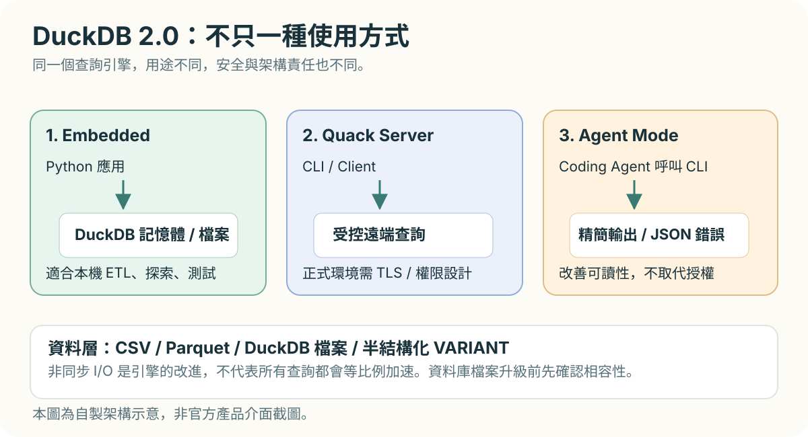

提到 DuckDB，你可能想到的是「在筆電直接查 Parquet 的 SQL 引擎」，或 Python 裡的 `duckdb.sql(...)`。但是在 2026 年 10 月 21 日發布的 **DuckDB 2.0.0 LTS** 裡，官方把 Server、Agent Mode、Async I/O 和半結構化資料支援放到了很重要的位置。

於是問題來了：**DuckDB 是不是要取代 PostgreSQL 或 ClickHouse，成為下一個萬用資料庫？**

我認為目前不能這樣下結論。DuckDB 2.0 的新能力值得研究，但選型仍得回到併發、權限、可用性、資料更新模式和團隊維運能力。這篇從 Data Engineer 的工作場景出發，整理哪些變化能直接用上、哪些不應被標題誤導。

官方 2.0 發布文章在 Hacker News 引起數百票和數十則留言的討論；這是社群關注的訊號，**不是「效能最佳」的獨立證明**。

> **驗證狀態：部分實作完成。** 2026-11-16 已在隔離環境使用 **DuckDB Python 套件 2.0.0** 執行 `VARIANT` 查詢範例，並核對實際輸出。Quack Server、遠端 S3 I/O、Agent CLI 模式與生產環境部署僅依官方文件整理，**本文未做端對端或負載測試**。

## 1. 一張圖先看懂：它正在擴張哪些用途？



_圖 1：自製架構示意，不是官方產品畫面。三種用法的共同點是 DuckDB 查詢引擎；不同的是邊界、連線方式與權限責任。_

| 能力               | 初學者的理解方式                    | 資料工程實務用途                 | 要注意什麼                                 |
| ------------------ | ----------------------------------- | -------------------------------- | ------------------------------------------ |
| **Embedded SQL**   | Python 程式裡直接跑 SQL             | 本機 ETL、資料探索、單元測試     | 避免多人寫同一份檔案時的衝突               |
| **Quack Protocol** | 讓 DuckDB 有 Client/Server 連線路徑 | 多程序查詢與受控服務化           | 不是部署了就自動擁有完整資料庫服務維運能力 |
| **Agent Mode**     | 讓 Coding Agent 更容易讀 CLI 輸出   | Agent 輔助探索、查詢與排錯       | Agent 仍可能提出危險 SQL，權限需要另外限制 |
| **Async I/O**      | 背景同時發出多個讀取要求            | Parquet、CSV、遠端物件儲存查詢   | 效能改善依查詢、網路和儲存條件而異         |
| **VARIANT**        | 同一欄能儲存不同結構的半結構化資料  | 事件 JSON、API payload、日誌探索 | 仍要定義必填欄位、資料品質與查詢契約       |

官方說明 DuckDB 2.0.0 是 LTS 版本，至少支援至 2027 年 10 月；具體版本支持狀態以 [DuckDB Release Calendar](https://duckdb.org/release_calendar) 為準。

## 2. 先釐清：DuckDB 2.0 才第一次支援 Server 嗎？

**不是。** 官方指出，Quack Protocol 於 1.5.3 已開始提供 Client/Server 的方式；2.0 是把這條路線做得更完整，並加入便利的 `CONNECT` 敘述。[來源：DuckDB 2.0 發布文章](https://duckdb.org/2026/10/21/announcing-duckdb-200)

理解成兩種不同架構就好：

1. **嵌入式**：Python／應用程序本身載入 DuckDB，直接執行 SQL。
2. **服務化**：一個 DuckDB 程序提供 Quack 連線，其他 Client 透過協定查詢。

官方 CLI 範例提供 `duckdb -serve` 與 `duckdb -connect` 的模式，但這裡要特別注意：**伺服器預設只監聽 localhost**。跨主機連線應透過具 TLS 的 Reverse Proxy 保護；官方明言 `allow_other_hostname` 的直接對外暴露方式只適合測試。這些是安全邊界，不是隨便打開一個 Port 就完成正式服務化。

此外，Server 讓遠端可以連線，不代表 DuckDB 自動具有 PostgreSQL 式的所有交易、權限與高可用特性。正式選型應針對工作負載驗證。

## 3. 我最想讓 Data Engineer 試的：VARIANT

很多資料管線進來的是 JSON 事件：一筆是 `click`，另一筆是 `purchase`，兩者欄位不完全相同。DuckDB 2.0 把 `VARIANT` 做成第一級型別，可容納不同形狀的資料，且不只是把 JSON 原文當文字存起來。

### 步驟 A：建立練習環境

在全新的目錄裡：

```bash
mkdir duckdb2-playground
cd duckdb2-playground
python3 -m venv .venv
source .venv/bin/activate
python -m pip install 'duckdb==2.0.0'
python -c 'import duckdb; print(duckdb.__version__)'
```

**正常結果：** 最後一行顯示 `2.0.0`。Windows PowerShell 可用 `.venv\Scripts\Activate.ps1`，或直接執行虛擬環境裡的 Python。此例只在記憶體資料庫做練習，不需要雲端帳號、S3 金鑰或開放 Port。

### 步驟 B：放入兩種不同形狀的 JSON

建立 `variant_example.py`，輸入：

```python
import duckdb

db = duckdb.connect(":memory:")
db.execute("""
    CREATE TABLE events AS
    SELECT 1 AS event_id,
           '{"event":"click","x":10}'::JSON::VARIANT AS payload
    UNION ALL
    SELECT 2 AS event_id,
           '{"event":"purchase","total":99}'::JSON::VARIANT
""")

rows = db.execute("""
    SELECT event_id, variant_type(payload), variant_keys(payload)
    FROM events ORDER BY event_id
""").fetchall()

for row in rows:
    print(row)
```

執行：

```bash
python variant_example.py
```

### 真正執行的驗證結果

完整 [實測程式](https://github.com/bradcocox/brad-log/blob/main/examples/data-engineering/duckdb2/variant_example.py) 另外加入了斷言。2026-11-16 使用 DuckDB 2.0.0 的結果如下：

```text
DuckDB version: 2.0.0
(1, 'OBJECT', ['event', 'x'])
(2, 'OBJECT', ['event', 'total'])
PASS: both JSON shapes are readable as VARIANT
```

注意 `variant_keys` 只讓我們知道有什麼 key，**不代表事件必填欄位都存在或符合業務規則**。正式 ETL 還是應做 schema 演進、型別驗證、null 檢查與不合格資料隔離。

## 4. Agent Mode 對 Coding Agent 的影響

如果你先前讀過本站的 [OpenCode 入門](/brad-log/posts/opencode-beginner-guide/)，可能會想到：當 Agent 呼叫資料庫 CLI，收到很長的表格輸出時，模型得讀一大堆不必要的字元。

DuckDB 2.0 的 Agent Mode 會用較精簡的 Markdown 表格、明確的截斷訊息及 JSON 格式錯誤來改善這個問題。官方說自己的 TPC-H 實驗裡，Agent 需要讀取的輸出量減少 59%；這**只代表官方特定實驗的輸出量結果**，不等於模型準確率提升 59%，也不是成本必然下降 59%。

官方 CLI 可用 `-agent` 手動啟用、`-no-agent` 關閉。本文沒有實際安裝 CLI 驗證這兩個模式，所以只列出供讀者依[官方 Agent Mode 文件](https://duckdb.org/docs/stable/clients/cli/agent_mode)探索的方向。

**安全提醒：** 「讓 Agent 讀得更容易」與「讓 Agent 有權修改資料」是兩回事。第一次連線請先用唯讀、非敏感資料；不要把憑證、客戶資料或生產資料庫直接交給 Agent。

## 5. 最重要的升級風險：資料庫檔案格式

DuckDB 官方明確寫出：**2.0 建立的資料庫檔案，舊於 2.0 的 DuckDB 版本無法開啟**。但是 2.0 仍能讀寫原有的舊版資料庫檔案，原有格式也可保持對舊版本可讀。

這代表「在本機用 2.0 新建一個 `.duckdb`，再交給仍在用 1.x 的服務」，不是可靠的相容流程。

升級前我會這樣做：

1. **備份**原始 `.duckdb` 檔案與套件鎖定版本。
2. 在隔離的 shadow 環境測試 2.0，不直接對唯一一份正式檔案操作。
3. 確認資料產生者與所有讀取者的版本；特別是排程、容器映像檔和 Notebook。
4. 比對關鍵 SQL 結果、檔案格式、讀寫相容性，以及回退流程。
5. 如果用到外部 Extension、Quack 或自訂 Parser，另做專門驗證。

上面是升級檢查建議，**本文未執行跨版本檔案回退測試**。詳見 [DuckDB 2.0 Migration Guide](https://duckdb.org/docs/2.0/operations_manual/migration) 與[官方 2.0 發布文章的 Migrating to 2.0 段落](https://duckdb.org/2026/10/21/announcing-duckdb-200)。

## 6. DuckDB、ClickHouse、PostgreSQL 要怎麼選？

先問工作負載，而不是只問新版本多快。

| 典型問題                                  | 優先研究的方向              | 理由與限制                                 |
| ----------------------------------------- | --------------------------- | ------------------------------------------ |
| Python 專案本機分析 Parquet、建立測試資料 | DuckDB                      | 嵌入式、SQL 友善，降低獨立服務維運需求     |
| 高併發即時分析與儀表板                    | ClickHouse 或其他 OLAP 引擎 | 需驗證併發、索引、資料到達延遲與營運成本   |
| 業務交易、應用程式資料寫入與約束          | PostgreSQL 等 OLTP 資料庫   | 交易語義、鎖定、備援與維運工具通常是關鍵   |
| 多個引擎共用歷史資料                      | Iceberg 等開放表格格式      | 要處理 Catalog、Schema、兼容性、治理與維護 |

表格是**選型起點，不是絕對排名**。同一個系統也可能用 PostgreSQL 儲存業務資料、Iceberg 管歷史資料、DuckDB 做臨時分析。

## 7. 留給大家的問題

> 如果 DuckDB 已能提供遠端查詢，你願意把原本「Python 裡一個嵌入式工具」升級成團隊共用的服務嗎？你的第一個阻礙會是安全、併發、維運，還是高可用？

我會先拿它做**受控的內部查詢服務或 ETL 小型驗證**，完成延遲、權限、併發與故障復原測試之後，才討論能不能接替既有服務。

延伸閱讀：[Polars 2.0：如何讓資料列順序可驗證？](/brad-log/posts/polars-2-streaming-order-guide/)。

### 官方來源與查核日期

- [DuckDB：Announcing 2.0.0 LTS（2026-10-21）](https://duckdb.org/2026/10/21/announcing-duckdb-200)
- [DuckDB：Release Calendar](https://duckdb.org/release_calendar)
- [DuckDB：Agent Mode](https://duckdb.org/docs/stable/clients/cli/agent_mode)
- [DuckDB：VARIANT Type](https://duckdb.org/docs/stable/sql/data_types/variant)
- [DuckDB：Quack Protocol](https://duckdb.org/docs/2.0/quack/overview)

最後查核：2026-11-16（Asia/Taipei）。
