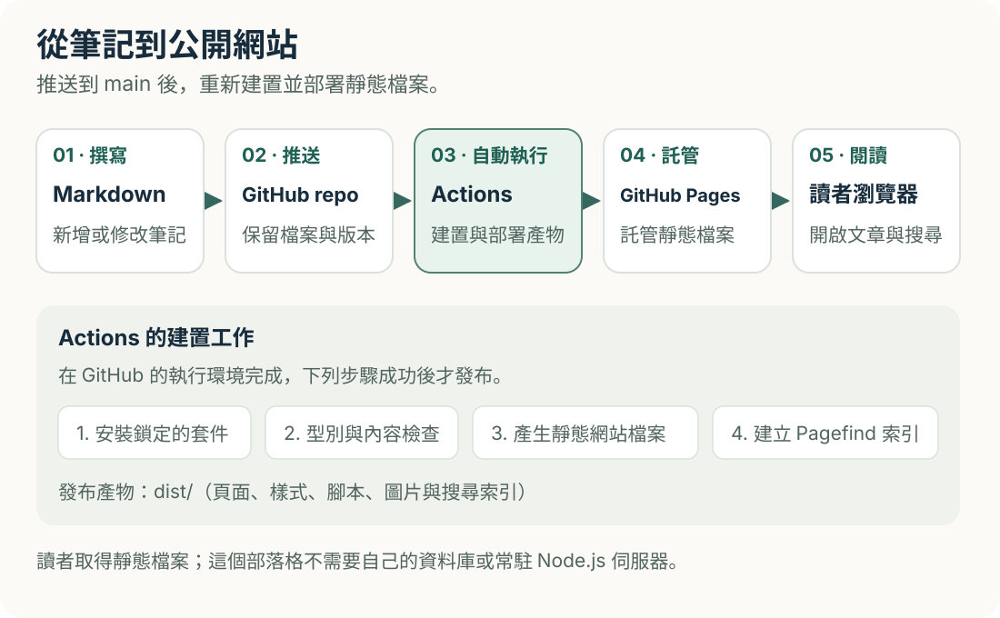
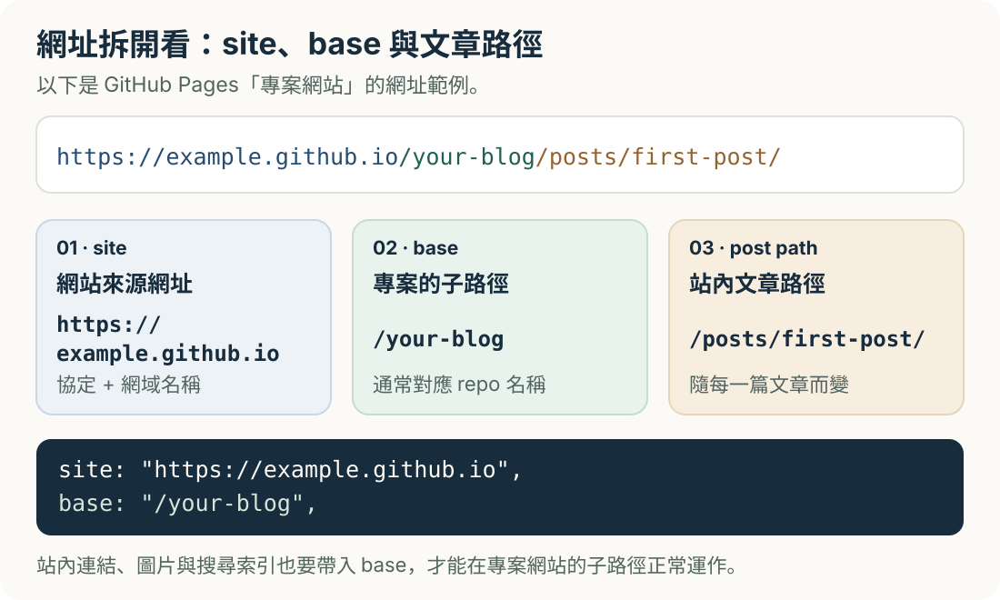
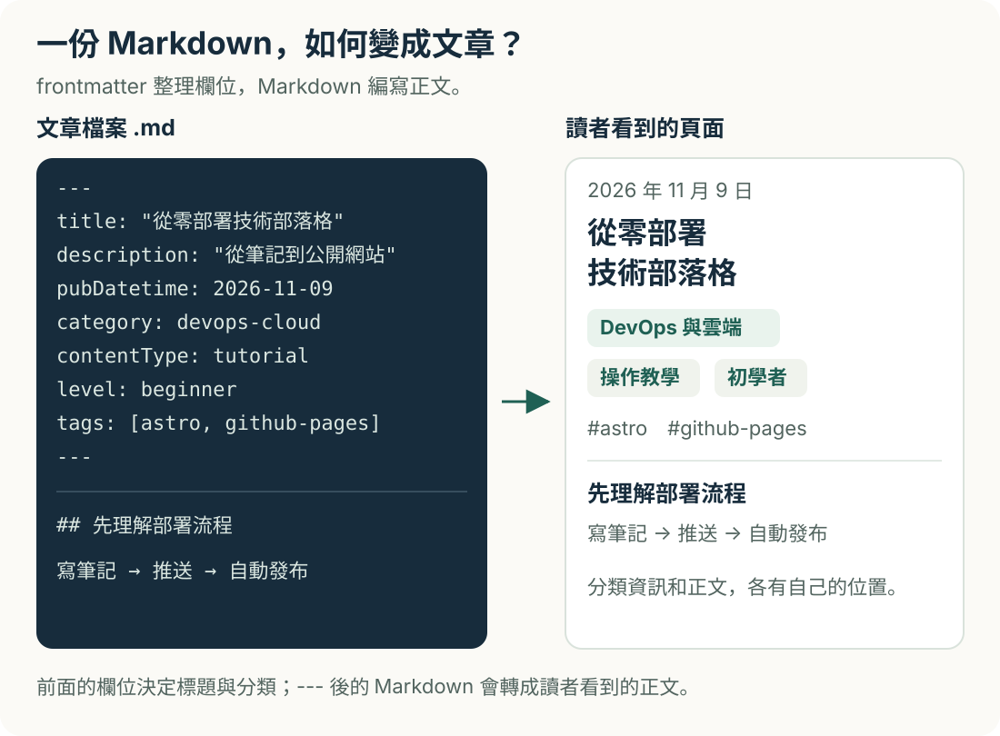
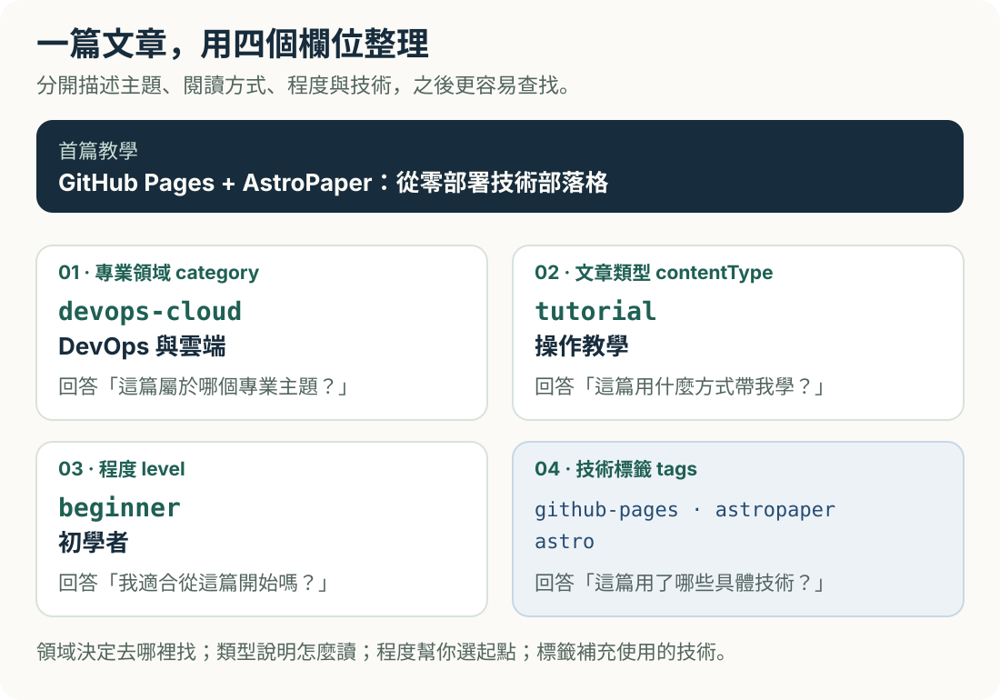
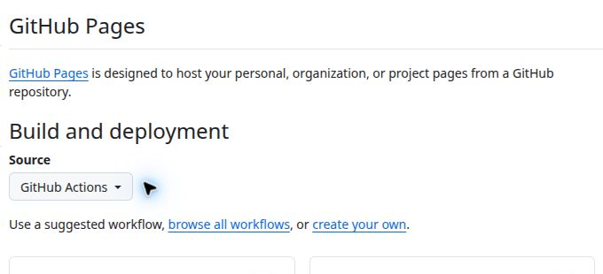

想把技術筆記放上網，第一個問題常常不是「要寫什麼」，而是：GitHub 已經有一個 repository，接下來到底要做什麼，才會變成可以閱讀的網站？

這篇記錄 Brad.log 採用的組合：**用 Markdown 寫文章、AstroPaper 提供版型、Astro 建置網站，再由 GitHub Actions 發布到 GitHub Pages**。後續新增筆記，就沿用同一條發布流程。

本文以第一次架站的讀者為對象。範例帳號統一寫成 `YOUR_GITHUB_USERNAME`，範例儲存庫叫 `your-blog`；操作前請換成自己的資料。本文使用的原始碼在 [bradcocox/brad-log](https://github.com/bradcocox/brad-log)，完成部署後的網站位址是 [Brad.log](https://bradcocox.github.io/brad-log/)。

## 先看整條流程



*圖 1：更新網站的起點是修改原始碼；Actions 負責把它轉成讀者能開啟的網頁。*

| 名詞 | 在這個網站裡負責什麼 | 可以怎麼理解 |
| --- | --- | --- |
| Git | 記錄檔案的版本與變更 | 可以回頭查看的修改紀錄 |
| GitHub repository，簡稱 repo | 保存文章、圖片、程式與 Git 歷史 | 網站的原始資料夾 |
| Markdown | 用純文字寫標題、段落、清單與程式碼 | 文章的寫作格式 |
| Astro | 把文章與版型建置成網頁檔案 | 網站建置工具 |
| AstroPaper | 提供 Astro 部落格的版型與功能 | 部落格的起始專案 |
| GitHub Actions | 按設定自動安裝套件、檢查、建置及部署 | 收到更新後執行工作的機器 |
| GitHub Pages | 對外提供建置完成的靜態網站 | 讀者實際造訪的網站空間 |

「靜態」表示發布出去的是 HTML、CSS、JavaScript 等檔案；文章更新後會重新產生這些檔案。它很適合筆記與教學，但不會因此自動擁有登入系統或資料庫。[GitHub Pages 官方說明](https://docs.github.com/en/pages/getting-started-with-github-pages/creating-a-github-pages-site)也區分了儲存庫內容與實際發布的網站。

## 1. 選定起點：跟做成品，或理解模板如何接進既有 repo

這裡有兩種起點，**選一種即可**。本文後續的分類介面與安全檢查指令，以 Brad.log 的完整原始碼為準。

### 路線 A：以完整的 Brad.log 開始

這條路適合想直接保留領域分類、繁體中文介面與本文部署設定的讀者。

1. 登入 GitHub，開啟 [Brad.log 儲存庫](https://github.com/bradcocox/brad-log)。
2. 按 **Fork**，選自己的帳號，把新儲存庫命名為 `your-blog`。
3. 確認儲存庫為 **Public**。本文採用 GitHub Free 的公開儲存庫 Pages 使用方式。
4. 在自己的新儲存庫按 **Code**，複製 HTTPS 網址。
5. 在要存專案的資料夾開啟終端機，執行：

```bash
git clone https://github.com/YOUR_GITHUB_USERNAME/your-blog.git
cd your-blog
git remote -v
```

**為什麼要確認 remote？** `origin` 應指向自己的儲存庫，之後的 `push` 才會更新自己的網站。若 Fork 後 Actions 尚未啟用，進入 **Actions** 分頁，閱讀提示並啟用工作流程。

**成功檢查：** 本機資料夾裡有 `package.json`、`astro.config.ts`、`astro-paper.config.ts` 與 `src/content/posts/`；`git remote -v` 顯示自己的 GitHub 路徑。

### 路線 B：本次已有 README 的 repo，如何安全接入 AstroPaper？

Brad.log 的起點是已經初始化、含 README 與 `.gitignore` 的儲存庫。這時不能把 **Use this template** 當成「替既有 repo 套版」：GitHub 的這個功能會建立**新儲存庫**，不是把模板合併進原本的 repo。[官方模板文件](https://docs.github.com/en/repositories/creating-and-managing-repositories/creating-a-repository-from-a-template)有說明這個差別。

接入既有 repo 的重點是保留自己的 `.git` 與歷史，再把模板原始檔加入。下面是在一個工作資料夾內取得本次模板快照的方法；若已走路線 A，不必再做。

```bash
git clone https://github.com/YOUR_GITHUB_USERNAME/your-blog.git
git clone https://github.com/satnaing/astro-paper.git astro-paper-source
git -C astro-paper-source archive --format=zip --output=../astro-paper-source.zip 6f61e2dc0e45bbcefc05f4055f293cd7f81bcb03
```

解壓縮 `astro-paper-source.zip`，以檔案管理員把模板檔案複製到自己的 `your-blog`。`git archive` 產生的壓縮檔不包含來源儲存庫的 `.git`。遇到同名檔案時，逐一比較：保留自己的 README 內容、合併 `.gitignore` 規則，保留 AstroPaper 的授權與著作權聲明。不要整包覆蓋自己的 `.github`；部署工作流程依本文建立，先理解內容再啟用。

```bash
cd your-blog
git status
git log --oneline -5
```

**成功檢查：** 原本的 commit 還在，模板檔案呈現為新增或修改；不需要刪除 `.git`，也不需要 `git push --force`。

這一步取得的是 [AstroPaper 原版](https://github.com/satnaing/astro-paper)。本文的六大領域、文章類型、程度與驗證狀態，是 Brad.log 加上的功能，不是原版欄位。要直接重現相同分類 UI，請走路線 A；若自行擴充原版，需要一起實作 `src/data/domains.ts`、`src/content.config.ts` 與 `src/pages/categories/`，不能只貼文章的分類欄位。

## 2. 安裝工具，先在自己的電腦看見網站

本篇對應的版本如下。這是為了讓本機與部署環境一致，不代表永遠使用這些版本。

| 項目 | 本次設定 | 記錄位置 |
| --- | --- | --- |
| AstroPaper | 7.1.0，來源快照 `6f61e2dc0e45bbcefc05f4055f293cd7f81bcb03` | 上游來源紀錄 |
| Astro | `^7.4.5`；實際安裝版依鎖定檔 | `package.json`、`pnpm-lock.yaml` |
| Node.js | 24.22.1 | `.nvmrc`、部署 workflow |
| pnpm | 11.25.0 | `package.json` 的 `packageManager` |

先從 [Node.js 官方下載頁](https://nodejs.org/en/download)選擇對應版本，安裝 [Git](https://git-scm.com/downloads)，並準備可編輯文字檔的編輯器。安裝後重新開啟終端機：

```bash
git --version
node --version
npm install -g pnpm@11.25.0
pnpm --version
```

`node --version` 應為 `v24.22.1`，`pnpm --version` 應為 `11.25.0`。固定 pnpm 版本，能減少與專案鎖定檔不一致的情況；安裝方式可查 [pnpm 官方文件](https://pnpm.io/installation)。

本文的 Git、Node 與 pnpm 指令可在 macOS、Linux、Windows 的終端機使用。Windows PowerShell 若因指令碼執行原則擋住 `pnpm`，可改用 `pnpm.cmd` 或在命令提示字元執行；不必為了架站停用系統保護。`.nvmrc` 是版本提示，使用官方安裝程式的人仍須自行確認 Node 版本。

回到 `your-blog` 資料夾，先安裝依賴：

```bash
pnpm install --frozen-lockfile
```

`pnpm-lock.yaml` 記錄依賴的確切版本；`--frozen-lockfile` 要求安裝時遵守它。如果失敗，先讀錯誤，確認 pnpm 版本與鎖定檔有一起取得，不要第一時間刪掉鎖定檔。

接著完成下一節的網站網址設定，再執行 `pnpm dev`。終端機會列出本機預覽網址，請以它顯示的連接埠為準；使用本文的 `base` 時，網址還要包含 `/your-blog/`。停止預覽可按 `Ctrl+C`。

**成功檢查：** 能在瀏覽器開啟首頁，點開文章，且終端機沒有建置錯誤。此時只是在本機預覽，還沒公開發布。

## 3. 設定網址與網站名稱：分清楚 site 和 base

GitHub 的專案網站網址長這樣：

```text
https://YOUR_GITHUB_USERNAME.github.io/your-blog/
```



*圖 2：`site` 放網域；`base` 放專案路徑。兩邊重複填入 repo 名稱會導致錯誤網址。*

在 `astro-paper.config.ts` 的 `site` 區塊修改下列欄位；保留其他設定：

```ts
site: {
  url: "https://YOUR_GITHUB_USERNAME.github.io",
  title: "我的技術筆記",
  description: "記錄技術學習、實作與排錯。",
  author: "你的公開筆名",
  profile: "https://github.com/YOUR_GITHUB_USERNAME",
  ogImage: "brad-log-og.png",
  lang: "zh-TW",
  timezone: "Asia/Taipei",
  dir: "ltr",
},
```

`ogImage` 對應 `public/` 裡的分享預覽圖片。跟做初期可以沿用檔案讓建置通過，正式經營前應換成自己的圖與檔名。

在 `astro.config.ts` 的既有 `defineConfig` 物件中確認：

```ts
site: config.site.url,
base: "/your-blog",
trailingSlash: "always",
```

同檔案的 `i18n.locales` 設為 `["zh-TW"]`，`defaultLocale` 為 `"zh-TW"`，`prefixDefaultLocale` 為 `false`。不要為了貼這幾行而刪掉原本的整份設定，Markdown、樣式與 sitemap 等整合仍需要保留。

再把 `astro-paper.config.ts` 的 GitHub 社群連結與 `features.editPost.url` 改成自己的公開儲存庫。編輯來源連結的格式為 `https://github.com/YOUR_GITHUB_USERNAME/your-blog/blob/main/`，結尾保留 `/`；不使用的連結可以移除。

**成功檢查：** 預覽頁面顯示自己的名稱；首頁、文章、圖片、搜尋與返回連結都位於 `/your-blog/` 下。原理與帳號網站的例外情況，可看 [Astro 的 GitHub Pages 部署文件](https://docs.astro.build/en/guides/deploy/github/)；若儲存庫名稱本身是 `YOUR_GITHUB_USERNAME.github.io`，便是另一種站點配置，不應照抄此處的專案 `base`。

## 4. 寫第一篇文章，讓筆記有地方可找

新增 `src/content/posts/my-first-note.md`。檔案最前面的兩組 `---` 之間叫 **frontmatter**，用途是告訴網站文章的標題、時間與分類；下面才是讀者會看到的正文。

```markdown
---
title: 我的第一篇 Git 學習筆記
pubDatetime: 2026-11-09T12:00:00+08:00
description: 整理 repository、commit 與 push 的差別。
featured: false
draft: true
category: developer-tools
contentType: note
level: beginner
status: learning
tags:
  - git
  - github
---

## 今天要釐清的問題

commit 與 push 分別在什麼時候使用？

## 操作與觀察

在這裡記錄實際執行的步驟、看到的結果與仍不確定的地方。

## 下一步

列出下一次要練習的項目。
```

日期請換成實際發文時間；`+08:00` 表示 UTC+8。這個範例先用 `draft: true`，準備公開時才改成 `false`。想看草稿的完整呈現，可在本機暫時設為 `false` 預覽，但提交前要確認最終值。



*圖 3：左側是寫作格式，右側是網站呈現的對照示意；frontmatter 會成為文章資訊，不直接以 YAML 顯示給讀者。*

AstroPaper 的文章位於 `src/content/posts/`，不是舊教學可能出現的 `src/data/blog/`。原版欄位與圖片寫法可查 [AstroPaper 寫作文件](https://astro-paper.pages.dev/posts/adding-new-posts-in-astropaper-theme/)。

### 專業領域、文章類型與標籤各做一件事



*圖 4：領域回答「這篇在談哪個專業方向」，標籤則方便跨領域找特定工具。*

每篇文章必須選一個 `category`：

| `category` 值 | 網站顯示 |
| --- | --- |
| `data-engineering` | 資料工程 |
| `backend-api` | 後端與 API |
| `devops-cloud` | DevOps 與雲端 |
| `ai-llm` | AI 與 LLM |
| `system-design` | 系統設計 |
| `developer-tools` | 開發工具 |

其他資訊則獨立設定：

| 欄位 | 可用值 | 未填時 |
| --- | --- | --- |
| `contentType` | `tutorial` 步驟教學、`note` 學習筆記、`troubleshooting` 實作與排錯、`reading` 閱讀紀錄 | `note` |
| `level` | `beginner`、`intermediate`、`advanced` | `beginner` |
| `status` | `learning` 持續學習中、`verified` 已實作驗證 | `learning` |
| `tags` | 自訂技術關鍵字，例如 `git`、`docker` | 空陣列 |

`verified` 應用在文章中的步驟已實際驗證時；有待確認的筆記保留 `learning`，讓讀者理解內容的狀態。不要只為了讓標籤好看而改成已驗證。

**成功檢查：** 將準備發布的文章設為 `draft: false` 後，能在文章列表、對應領域與標籤頁找到它。拼錯 `category` 時，建置會提出內容格式錯誤。

## 5. 到 GitHub 開啟 Pages 的 Actions 發布方式

在**自己的儲存庫**依序進入：

1. **Settings → Pages**。
2. 找到 **Build and deployment**。
3. 把 **Source** 選為 **GitHub Actions**。



*圖 5：本次操作的 Pages 設定畫面。選 GitHub Actions，讓 workflow 提供建置完成的網站。*

**為什麼這樣選？** 原始碼裡的 `.astro` 與 Markdown 需要先建置；這份專案透過 Actions 產生發布檔案，不需要另外手動維護 `gh-pages` 分支。流程規則可參考 [GitHub 自訂 Pages workflow 文件](https://docs.github.com/en/pages/getting-started-with-github-pages/using-custom-workflows-with-github-pages)。

**成功檢查：** Source 顯示 **GitHub Actions**。若沒有 Settings 權限，先確認目前開啟的是自己的 repo。

## 6. 放入自動部署工作流程

路線 A 已含 `.github/workflows/deploy.yml`；仍要讀過它，確認符合自己的需求。以下是本次版本，Action 以完整 commit SHA 固定，旁邊註明版本系列：

```yaml
name: Publish your-blog

on:
  push:
    branches: [main]
  workflow_dispatch:

permissions:
  contents: read

concurrency:
  group: pages
  cancel-in-progress: false

jobs:
  build:
    runs-on: ubuntu-latest
    timeout-minutes: 15
    steps:
      - name: Check out source
        uses: actions/checkout@3d3c42e5aac5ba805825da76410c181273ba90b1 # v7
        with:
          persist-credentials: false
      - name: Check, build, index search, and upload Pages artifact
        uses: withastro/action@a8b97df764791eb61fbf3338ef713b0e61ae05c5 # v6
        with:
          node-version: '24.22.1'
          package-manager: pnpm@11.25.0
          build-cmd: pnpm run build
          cache: false

  deploy:
    needs: build
    runs-on: ubuntu-latest
    timeout-minutes: 10
    permissions:
      pages: write
      id-token: write
    environment:
      name: github-pages
      url: ${{ steps.deployment.outputs.page_url }}
    steps:
      - name: Deploy to GitHub Pages
        id: deployment
        uses: actions/deploy-pages@368f82528645a54fb793d4d04e342629a3f51346 # v5
```

看懂五個重點就能掌握這份檔案：

- `push.branches: [main]`：更新 `main` 時自動執行；若自己的預設分支不同，要一起修改。
- `workflow_dispatch`：也能從 Actions 分頁手動執行。
- `withastro/action`：依專案設定安裝依賴、執行建置並上傳網站 artifact，也就是部署使用的輸出檔案。
- `needs: build`：建置成功後才開始部署；建置階段只有讀取原始碼的權限。
- `pages: write` 與 `id-token: write`：只給部署工作，用來授權 Pages 發布。**這個網站不需要新增 PAT、部署私鑰或任何自訂 Secret。**

`persist-credentials: false` 不把 checkout 的 Git 認證留給後續步驟；`cache: false` 是本版採用的設定。固定 SHA 能明確指出執行的 Action 程式版本，未來升級時應查閱官方版本並重新驗證，不要任意替換成網路上不明來源的 SHA。官方工具見 [withastro/action](https://github.com/withastro/action) 與 [deploy-pages](https://github.com/actions/deploy-pages)。

## 7. 建置、提交，確認公開網站真的能用

先在專案資料夾執行：

```bash
pnpm run build
pnpm preview
```

Brad.log 的 `build` 會依序檢查公開原始內容、執行 Astro 型別與內容檢查、產生網站、建立 Pagefind 搜尋索引，再檢查輸出檔案。預覽網址仍以終端機輸出為準。Pagefind 使用建置後的索引，因此要確認搜尋，請用這組指令檢查正式輸出。

在瀏覽器檢查首頁、文章、領域分類、標籤、搜尋、圖片與手機寬度。確認即將公開的文章與截圖沒有私人資訊，再停止預覽並提交：

```bash
git status
git diff
git add .
git diff --cached
git commit -m "Set up my technical blog"
git push origin main
```

`git add .` 會把目前資料夾的變更加入提交，請先看過 `git status`，並在 commit 前檢查 `git diff --cached`。圖片等二進位檔案要另外開啟檢查。如果 Git 尚未設定提交身分或推送認證，依 Git／GitHub 的提示完成設定；瀏覽器已登入，不一定代表終端機的 Git 也已登入。可使用 GitHub Desktop 的登入流程，網站部署本身仍不需要自建 PAT。

推送後，開啟儲存庫的 **Actions → 對應的最新執行紀錄**：

1. 確認執行的 commit 就是剛提交的版本。
2. 先看 `build`，再看 `deploy` 是否成功。
3. 若失敗，展開第一個失敗步驟閱讀錯誤，不要只看最後一句「Process completed」。
4. 成功後從部署紀錄或 **Settings → Pages → Visit site** 開啟公開網址。

<!-- 待補：實際成功的 Actions 執行截圖 actions-success.png。圖說須說明 build 與 deploy 均成功，並核對公開截圖沒有私人資訊；取得檔案前不插入圖片連結。 -->

**成功檢查：** 公開網址是自己的 `https://YOUR_GITHUB_USERNAME.github.io/your-blog/`；開啟文章後重新整理仍正常，分類與搜尋可用，圖片及 CSS 沒有遺失。Actions 綠燈代表流程通過，仍須到公開網站確認讀者實際看到的內容。

<!-- 待補：正式上線後的首頁截圖 site-home.png。圖說呈現領域入口與首篇教學；實際完成部署及人工檢查後再附圖。 -->

## 設定總表：下次要改東西，從哪裡找？

這張表保留本文涉及的設定位置。完整維護紀錄另見儲存庫的 [設定與維護手冊](https://github.com/bradcocox/brad-log/blob/main/docs/SETUP.md)。自己的 Fork 若有調整，應同步更新紀錄。

| 檔案或 UI 位置 | 欄位／設定 | 用途 | 本次設定或替換範例 | 如何驗證 |
| --- | --- | --- | --- | --- |
| GitHub repo → Settings | Visibility、Default branch | 公開範圍與主要分支 | Public、`main` | repo 顯示 Public；分支與 workflow 一致 |
| GitHub repo → Settings → Pages | Source | 選擇發布方式 | `GitHub Actions` | Pages 設定頁顯示正確來源 |
| GitHub repo → Settings → Environments | `github-pages` | Pages 部署環境與保護規則 | 環境規則須允許發布分支 | deploy 沒有停在不預期的審核或分支限制 |
| `.nvmrc`、workflow | Node 版本 | 統一本機與部署環境 | `24.22.1` | 本機 `node --version` 與 Actions 日誌一致 |
| `package.json` | `packageManager` | 固定套件管理工具 | `pnpm@11.25.0` | `pnpm --version` 一致 |
| `package.json` | `engines.node` | 宣告套件允許的 Node 範圍 | `>=22.23.4`；本次仍固定 24.22.1 | 安裝沒有版本不相容錯誤 |
| `pnpm-lock.yaml` | 依賴鎖定結果 | 重現相同依賴版本 | 與 `package.json` 一起提交 | `pnpm install --frozen-lockfile` 成功 |
| `astro-paper.config.ts` | `site.url` | 網站網域 | `https://YOUR_GITHUB_USERNAME.github.io` | canonical、RSS、sitemap 網域正確 |
| `astro.config.ts` | `base`、`trailingSlash` | 專案子路徑與結尾斜線 | `/your-blog`、`always` | 文章、資源路徑與重新整理正常 |
| `astro-paper.config.ts` | `site.title`、`description`、`author` | 網站與作者資訊 | 自己的名稱、摘要、公開筆名 | 首頁、頁籤與文章資訊正確 |
| `astro-paper.config.ts` | `site.lang`、`timezone`、`dir` | 語言、顯示時區與文字方向 | `zh-TW`、`Asia/Taipei`、`ltr` | HTML 語言與時間顯示正確 |
| `astro.config.ts` | `i18n` | 語言路由設定 | `zh-TW`；預設語言不加前綴 | URL 沒有多出不預期的語言路徑 |
| `astro-paper.config.ts` | `profile`、`socials`、`editPost.url` | 公開連結與文章來源入口 | 自己的公開個人頁與 repo；不用的移除 | 逐一點擊，避免連回模板作者 |
| `astro-paper.config.ts`、`public/` | `ogImage`、`dynamicOgImage` | 社群分享預覽圖 | 本版固定圖片、動態圖為 `false` | 分享圖網址可直接開啟 |
| `astro-paper.config.ts` | `posts.perPage`、`perIndex` | 文章顯示數量 | 標籤頁每頁 8 篇、首頁 4 篇 | 檢查標籤頁分頁與首頁數量；所有文章頁採完整列表篩選 |
| `astro-paper.config.ts` | `features.search`、`toc` | 搜尋與文章目錄 | `pagefind`、`true` | 正式預覽可搜尋；長文顯示目錄 |
| `astro-paper.config.ts` | `lightAndDarkMode`、`showArchives`、`showBackButton` | 主題切換、彙整及返回入口 | 本版均為 `true` | 手動點擊各入口與深淺主題 |
| `src/data/domains.ts` | 領域 ID、名稱與描述 | 分類定義的共同來源 | `developer-tools` 等六個領域 | 分類頁名稱、說明與文章數一致 |
| `src/content.config.ts` | 文章 schema | 驗證 frontmatter 格式 | 必填 `category`；其他欄位參考上表 | 錯誤欄位會在 `pnpm build` 被指出 |
| 文章 frontmatter | 標題、摘要、日期、草稿、分類 | 每篇文章的呈現與公開狀態 | 參考本文範例；更新時加 `modDatetime` | 列表、文章資訊與公開範圍正確 |
| `.github/workflows/deploy.yml` | 觸發、版本、權限與環境 | 自動建置與發布 | main push；build 讀取、deploy 發布 | Actions 正確 commit 的兩個 jobs 成功 |
| `package.json`、`scripts/check-public.mjs` | `build`、`security:check` | 檢查可公開的原始內容與輸出 | 建置前後執行掃描 | 檢查通過，再人工檢視文章和截圖 |
| `.gitignore` | 忽略規則 | 避免提交產物與本機資料 | 排除依賴、建置產物與環境檔 | `git status` 不包含不應提交的檔案 |

## 公開發布前，必須理解的資訊邊界

公開 repo 的文章原始碼、圖片與提交歷史都可被讀取。網站沒列出的檔案，也可能在 GitHub 上看得到。因此：

- **`draft: true` 只控制網站是否刊登。** 它不能保護已提交到公開 repo 的草稿。未公開內容請先保存在尚未推送的位置。
- **靜態網站不放秘密。** 密碼、token、私鑰、私人聯絡資訊、公司內網位址與未公開截圖，都不應出現在文章、原始碼或圖片中。公開教學只用明確的佔位文字。
- **`PUBLIC_` 代表可公開給前端。** Astro 的這類環境變數可進入瀏覽器程式；不要用它裝秘密。即使沒有這個前綴，只要建置程式把內容寫進 HTML 或 JavaScript，仍會公開。詳見 [Astro 環境變數文件](https://docs.astro.build/en/guides/environment-variables/)。
- **Actions Secrets 不是讓前端保密的魔法。** Secrets 可以保護工作流程設定中的敏感值，但把值輸出到靜態檔案後，訪客仍能讀取。本網站不需要新增任何 Secret；[官方 Secrets 文件](https://docs.github.com/en/actions/how-tos/write-workflows/choose-what-workflows-do/use-secrets)適合在未來真的有服務整合需求時再看。
- **`.gitignore` 不會移除已提交的內容或歷史。** 若曾誤推有效憑證，先撤銷或輪替，再依 [GitHub 敏感資料移除文件](https://docs.github.com/en/authentication/keeping-your-account-and-data-secure/removing-sensitive-data-from-a-repository)處理；單純刪檔再 commit 並不足夠。

本專案的自動掃描只能攔下一部分常見模式，無法判斷每張截圖、每段筆記是否適合公開。發布前仍要人工查看，尤其是瀏覽器分頁、帳號選單、終端機畫面與圖片背景。

## 常見卡關，從哪裡開始查？

| 現象 | 先檢查什麼 | 下一步 |
| --- | --- | --- |
| 首頁或文章 404 | Pages Source、部署狀態、網址是否有 `/your-blog/` | 對照 `site` 與 `base`，再確認實際發布 commit |
| 網頁有文字，但 CSS 或圖片不見 | 資源網址是否漏掉專案路徑 | 文章圖片優先用相對路徑；自訂元件遵循專案的 base-aware 路徑處理 |
| 安裝或建置失敗 | Node、pnpm 版本及第一個錯誤 | 回到版本表；鎖定檔需與套件設定一起提交 |
| 文章沒有出現 | `draft`、發文時間、檔名與必要欄位 | 改成準備發布的狀態；確認沒有使用未到的日期或被忽略的檔名 |
| 分類建置錯誤 | `category` 是否在六個 ID 中 | 使用正確 ID；新領域要先改定義，再補文章 |
| 本機搜尋沒結果 | 是否已產生 Pagefind 索引 | 先 `pnpm build`，再 `pnpm preview` |
| build 成功，deploy 失敗 | Pages Source、job 權限、環境限制 | 對照 workflow 與失敗步驟；不靠新增 PAT 解決 |
| 推送後還看到舊文章 | Actions 是否跑完，網址是否正確 | 核對 commit、重新整理；別把本機預覽與公開網站混淆 |

## 之後每次更新，重複這條小流程

新增文章時，在 `src/content/posts/` 建立 `.md`，填寫日期、摘要與分類，再寫下問題、操作、觀察與參考資料。修改舊文章時保留 `pubDatetime`，需要標示更新就加入 `modDatetime`，同樣使用含時區的時間格式。

準備發布後，先在本機建置與閱讀，再檢查即將提交的文字和圖片，commit、push，最後確認 Actions 與公開頁面。已有圖片建議放進 `src/assets/` 並使用相對路徑引用，提供描述內容的 alt 文字；重要設定畫面加上圖說，讓之後的自己知道該看哪裡。

學習筆記不必等到題目完全學會才開始寫。把已確認的結果、尚未釐清的問題，以及下次準備驗證的步驟分開記錄，就能逐步建立可追查、可更新的學習歷程。
