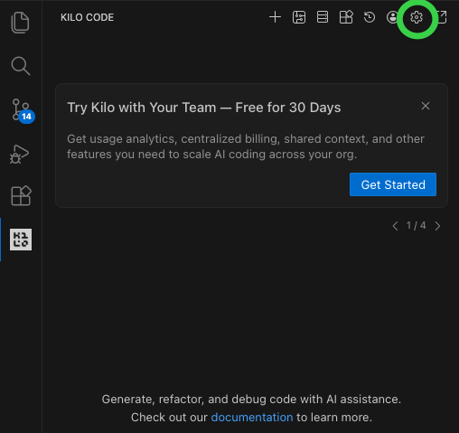
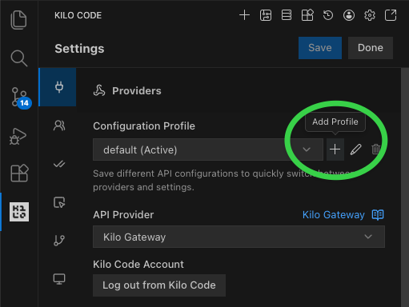

**Kilo Code** 也是一款可協助讀取程式、規劃修改與執行工具的 Coding Agent。它提供編輯器整合、CLI 與不同的 Agent 工作模式；和前一篇 [Cline](/brad-log/posts/cline-beginner-guide/) 很像，但**它們是不同專案、不同設定系統**，免費模型的來源也不能混為一談。

本文選擇 **VS Code 入門路線**，先辨認設定畫面，再準備一個 Python 小練習。我們依然以 **零支出** 為約束：不綁卡、不儲值、不自動切到付費模型，也不拿私有程式碼測試。

> **驗證狀態：學習整理。** 2026-11-11 已比對 Kilo 官方文件；下方是官方專案文件附的**真實介面截圖**，屬於當時的擴充功能畫面，與持續演進中的新版本／Pre-release 不保證完全一致。本文未執行帶金鑰的完整模型任務，驗收輸出只是讀者應實際確認的結果。

## 1. 先看兩張實際操作畫面



*圖 1：官方的 Kilo Code 設定入口。點右上角**齒輪**進入設定；畫面中「Try Kilo with Your Team」是商業試用提示，**不是本文必需的步驟，也不需要點 Get Started**。[官方截圖來源](https://github.com/Kilo-Org/kilocode/blob/main/packages/kilo-docs/public/img/mistral-setup/01-open-kilo-code-settings.png)*



*圖 2：官方示範建立 **Configuration Profile**。綠圈處是加號；**API Provider** 下拉選單位於中間偏下的位置。此截圖的預設 Provider 是 `Kilo Gateway`，而非 OpenRouter。[官方截圖來源](https://github.com/Kilo-Org/kilocode/blob/main/packages/kilo-docs/public/img/mistral-setup/02-add-configuration-profile.png)*

畫面辨識對照：

| 在畫面看到 | 代表什麼 | 本篇怎麼用 |
| --- | --- | --- |
| **Settings 齒輪** | 進入 Kilo 專用設定 | 先找到它，不要誤開 VS Code 全域設定 |
| **Providers** | 供應商設定分頁 | 決定模型 API 從哪裡來 |
| **Configuration Profile** | 保存不同供應商設定的配置 | 可另建專屬練習 Profile，避免覆蓋常用工作設定 |
| **API Provider** | 選 Kilo Gateway 或 OpenRouter 等入口 | 根據你選的免費路線填寫，不要混用金鑰 |

**版本提醒：** Kilo Code 的 VS Code 擴充功能與 CLI 正在演進，某些新版可能改由 `kilo.jsonc` 管理項目或顯示新的 UI。若與圖片不同，請先確認版本，再對照[官方安裝](https://kilo.ai/docs/getting-started/installing)及[設定](https://kilo.ai/docs/getting-started/settings)文件；不建議盲目照抄舊截圖。

## 2. 安裝：從 VS Code 裡找到 Kilo Code

1. 打開 [VS Code](https://code.visualstudio.com/download)。
2. 左側點 **Extensions**，搜尋 **Kilo Code**，核對官方名稱與發布者後點 **Install**。如看到穩定版、Pre-release 選項，以當下官方安裝文件指定的版本為準。
3. 開啟 Kilo Code 面板。先確認能看到輸入區、模式或 Agent 選擇與設定入口。
4. 在新資料夾 `kilo-playground` 中工作，避免包含任何工作機密、`.env`、SSH 金鑰或私人資料。

如果你喜歡終端機，官方也提供另一種安裝路線：

```bash
npm install -g @kilocode/cli
kilo
```

CLI 安裝依照官方說明需有相容的 Node.js；**這是替代路線，不代表本篇要同時安裝擴充功能和 CLI。** 新版 CLI 的 `/models` 可以協助查看模型，功能／按鍵依版本可能不同。

**成功檢查：** 在 Kilo 面板內可以開啟設定，而且專案 Explorer 顯示 `kilo-playground`。

## 3. 選免費模型前，先分清兩個 Provider

### 方式 A：Kilo 自家 Gateway 的免費模型

Kilo 官方[免費使用說明](https://kilo.ai/docs/getting-started/using-kilo-for-free)會列出當期免費方案、配額和可用模型，常見入口像 `kilo-auto/free`。這種型號透過 **Kilo Gateway**，不等於 OpenRouter 的 `:free`。

操作時：

1. 打開圖 1 的齒輪，前往圖 2 的 **Providers**。
2. 確認使用的是 Kilo Gateway；視目前介面完成必要的免費帳號登入。
3. 選擇當期官方明確標示**免費**的模型／自動免費路由。
4. **查看額度與資料政策**。某些免費提供者可能保留或使用輸入資料；只能使用完全公開、無秘密的練習程式。

注意：**免費對話模型不等於所有服務都免費**。Auto-complete、Background Tasks、其他輔助模型可能有各自設定；如果你要求完全零支出，應檢查或暫停自動補全，並避免選擇收費的背景模型。

### 方式 B：自己連 OpenRouter 的免費模型

1. 在 [OpenRouter](https://openrouter.ai/)建立免費帳號與專用 API Key。
2. 開啟 Kilo **Settings → Providers → API Provider**，在下拉選單中找 **OpenRouter**。
3. 將 Key **只貼到官方的 API Key 欄位**。不要把它放進 Prompt、Repository、教學截圖或程式碼。
4. 在模型欄位選擇當下 [OpenRouter 免費模型清單](https://openrouter.ai/collections/free-models)中**明確為 `$0` 的 `:free` 模型**；還要確認支援 Tool Calling。
5. 點 Save／套用，回到聊天面板再次確認目前顯示的 Provider 與完整模型 ID。

如果 UI 顯示不同欄位，請先核對 Kilo 版本與[官方設定文件](https://kilo.ai/docs/getting-started/settings)，不要把其他工具的 JSON 設定直接貼給 Kilo。特別注意 **Kilo 的 `permission` 與 OpenCode V2 的 `permissions` 不是同一個設定格式**。

| 預期看到的結果 | 意味著什麼 | 若沒有出現 |
| --- | --- | --- |
| Provider 清楚顯示 Kilo Gateway 或 OpenRouter | 你知道金鑰／流量送去哪裡 | 回設定核對 Profile 和 Provider |
| 模型完整 ID 含 `:free` 或為官方免費路由 | 有機會符合零費率 | 到官方價格頁再次查證；不是只看名稱 |
| 保存後回到對話面板 | 可以開始本地練習 | 先檢查登入和表單警告，不必付費升級 |

## 4. 選 Agent 模式：先 Ask，再 Code

Kilo 內建多個角色／工作模式，概念上可先分為兩類：

| Agent 模式 | 適合做什麼 | 初學時的建議 |
| --- | --- | --- |
| **Ask** | 理解問題、詢問解法、閱讀說明 | 第一次任務先用它，不讓模型一開始就改程式 |
| **Plan** | 分解較大的任務 | 要求列出檔案範圍、風險與驗證方法 |
| **Code** | 在授權範圍內修改和執行 | 確認計畫後才使用，逐次批准敏感動作 |

實際可用名稱和預設權限請以[官方 Agents 文件](https://kilo.ai/docs/code-with-ai/agents/using-agents)及本機設定為準。特別要留意桌面版／部分設定可能提供**高度自主執行**，本篇不建議先開啟這種模式。

## 5. 第一個練習：讓 Kilo 寫兩個 Python 檔案

### 畫面操作 ①：先開空專案、選 Ask

在 VS Code **File → Open Folder** 選 `kilo-playground`。如果有 Git，可先在終端機執行：

```bash
git init
```

在 Kilo 的 **Ask** 模式輸入：

> 先不要修改檔案。請規劃一個最小 Python 專案：`hello.py` 定義 `greet(name)` 回傳 `Hello, {name}!`；`test_hello.py` 用內建 `unittest` 驗證。只在目前練習資料夾工作，不讀其他資料夾，不安裝套件。

**觀察點：** 回覆應是可檢查的計畫，包含檔名和測試。若提議安裝依賴或讀其他檔案，先要求縮小範圍。

### 畫面操作 ②：切 Code，逐步核准

切換到 **Code**，輸入：

> 按照剛剛的計畫建立兩個檔案；`python3 hello.py` 應顯示 `Hello, Brad!`。每次檔案修改或命令執行都先讓我審查。不要建立其他檔案，不要推送 Git，不要傳送資料到新網址。

如果 Kilo 顯示檔案變更或工具呼叫：

1. 看清楚**完整檔案路徑**，必須仍在 `kilo-playground`。
2. 看清楚 Shell 指令，拒絕未要求的安裝、刪除或對外連線。
3. 只批准必要動作，並查看編輯器 Diff。
4. 如果模型無法使用工具，先檢查免費模型的 Tool Calling 支援，不要自動改成付費模型。

### 畫面操作 ③：自己跑測試

打開 VS Code 的 Terminal，執行：

```bash
python3 -m unittest -v
python3 hello.py
git status --short
```

Windows 可使用 `py` 代替 `python3`。**預期成功**：測試通過、輸出 `Hello, Brad!`、只有兩個本次練習檔案出現。這是你的驗收清單，**不是文章已完成的實測紀錄**。新檔案尚未被 Git 追蹤時，`git diff` 不一定列出內容，請直接在編輯器逐行讀檔。

## 6. 避免踩到的三個坑

1. **免費模型來源搞混**：`kilo-auto/free` 屬於 Kilo 路線，OpenRouter 的 `:free` 屬於另一條路線。看清 Provider 才知道成本和資料會送去哪裡。
2. **照抄舊介面**：官方文件可能同時有 CLI、新版擴充功能及較舊的 UI 圖片。當 Settings 長得不同時先查版本，不要盲點。
3. **把自動授權當成方便**：即使在免費模型上，寫檔、Shell、外部工具仍可能操作本機資料。請維持逐次確認。

若有真正的錯誤輸出，請先隱藏主機名稱、使用者名稱與金鑰，再尋求協助。不要把完整設定檔直接貼上網路。

## 總結與系列導覽

Kilo Code 很適合想研究**多種 Agent 模式與 Provider 工作流程**的人。但初學者最重要的事情是先看清楚使用的是哪一個 Gateway、哪個模型、是否真的免費，以及 Agent 能做哪些動作。

系列文章：[OpenCode](/brad-log/posts/opencode-beginner-guide/) · [Cline](/brad-log/posts/cline-beginner-guide/) · **Kilo Code** · [Claude Code Router](/brad-log/posts/claude-code-router-beginner-guide/) · [Codex Router](/brad-log/posts/codex-router-beginner-guide/) · [工具比較](/brad-log/posts/coding-agent-router-comparison/)。

### 官方參考

- [Kilo — 安裝](https://kilo.ai/docs/getting-started/installing)
- [Kilo — 認證與登入](https://kilo.ai/docs/getting-started/setup-authentication)
- [Kilo — 免費使用](https://kilo.ai/docs/getting-started/using-kilo-for-free)
- [Kilo — Agents](https://kilo.ai/docs/code-with-ai/agents/using-agents)
- [Kilo — Settings](https://kilo.ai/docs/getting-started/settings)
- [Kilo 官方專案](https://github.com/Kilo-Org/kilocode)

最後核對：2026-11-11（台灣時間）。
