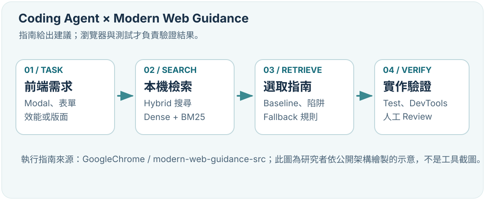
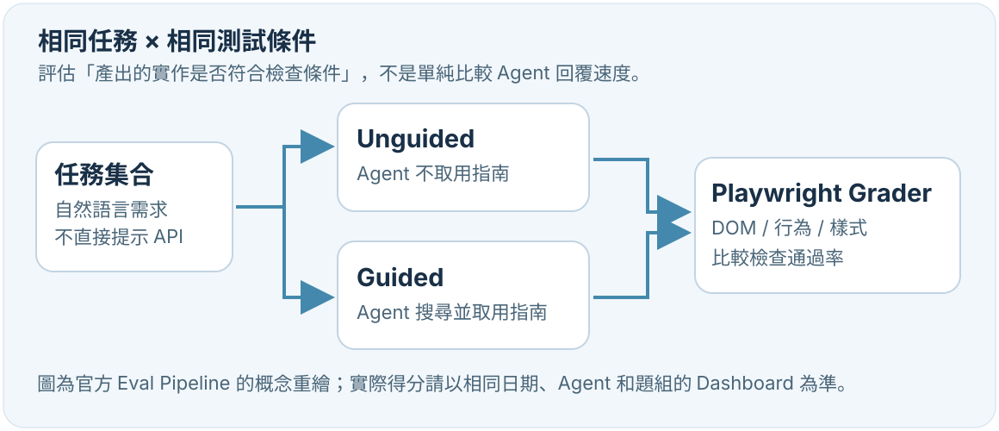

> **系列 04／04｜截至 2026-11-23｜原始碼／公開 Evals 研究，非獨立 Benchmark。** 本文列出的通過率來自 Google 官方公開評測，不能當成作者親自重跑，也不應外推為所有專案的成功率。

## 系列導覽

[01 介紹](../modern-web-guidance-overview/) · [02 CLI 入門](../modern-web-guidance-quickstart/) · [03 舊專案現代化](../modern-web-guidance-modernization/) · **04 架構與評測（本篇）**

## 1. 一套 Markdown 指南，為什麼不直接全部餵給 Agent？

Agent 的 Context Window 有限，整份文件塞進去不只浪費 Token，也可能讓模型被不相關規則干擾。Modern Web Guidance 的核心策略是：**先用非常短的本機查詢找候選，再只將符合任務的指南注入 Context。**

[Source Repo](https://github.com/GoogleChrome/modern-web-guidance-src) 的 `src/rag/` 展示了這個 Retrieval 機制，和「把一份巨大的 AGENTS.md 放進每個 Prompt」不同。



*圖 1：依官方公開 CLI 與架構文件繪製的概念流程，非實際運行截圖。*

## 2. 本機搜尋怎麼做到小而快？

官方 [RAG 開發文件](https://github.com/GoogleChrome/modern-web-guidance-src/blob/main/src/rag/README.md) 說明目前採取 **Dense Retrieval + BM25** 混合檢索：

| 元件 | 職責 | 為什麼值得注意？ |
| --- | --- | --- |
| Static Embedder | 把短的英文 Query 投影到 256 維向量空間 | 執行時不用下載大型推論框架 |
| 預先建立的文件向量 | 對指南片段使用建置時產生、快取的 Embedding | 文件較長的語意資訊不需每次即時計算 |
| BM25 | 針對 API 名稱、HTML/CSS 關鍵字做詞彙匹配 | 特定 API 名稱常比語意模糊搜尋更可靠 |
| RRF 融合 | 將 Dense 與 BM25 排名結合 | 避免單一路徑漏掉候選 |
| `retrieve` | 依 ID 回傳真正的指南 | 不是先把所有資料送進 Agent |

RAG 文件描述使用 **Reciprocal Rank Fusion（k=60）**，同時對搜尋結果設有適當的拒絕機制，避免離題 Query 一定硬湊出某份指南。當 `retrieve` 內容過大時，CLI 會將輸出寫至暫存檔，減少終端機工具輸出被中途截斷的風險。

Google 的技術文章記錄過架構演進：從 507 MB 的 C++ 綁定方案，演變成約 23 MB 的 JS 搜尋，再精簡到約 7 MB 等級的套件方案。**這些是官方對不同設計方案的敘述，不是本文量測的現在安裝大小或執行時間。**

參考：[Paul Irish — Local vector search for coding agents](https://developer.chrome.com/blog/mwg-technical-deep-dive) · [`src/rag/README.md`](https://github.com/GoogleChrome/modern-web-guidance-src/blob/main/src/rag/README.md)。

## 3. 不只有指南，還有校準與評測

這個 Source Repo 特別值得研究的，是它不只發布 `guide.md`，還維護 `demo.html`、`expectations.md`，並透過正式評測流程測試 Agent 是否真的能應用知識。



*圖 2：依 [官方 Eval Pipeline](https://github.com/GoogleChrome/modern-web-guidance-src/blob/main/README.md) 重繪的概念圖。實際測試集合與 grader 細節可見 Source Repo；非作者重新執行的數據。*

| 評測階段 | 驗證對象 |
| --- | --- |
| 設計真實任務 | 需求以自然語言描述，刻意不點名特定 Web API |
| 寫出 Golden Solution | 確認檢查條件可被正確實作滿足 |
| 校準 Grader | Golden 應通過、原始基礎頁應失敗 |
| Agent 執行 | 同一任務比較 **Unguided** 與 **Guided** |
| Playwright Grader | 驗證 DOM、實際行為、Computed Style、無障礙狀態 |
| 彙整 | 比較符合任務要求的檢查通過率與改善幅度 |

## 4. 官方 Evals 改善幅度，應該怎麼解讀？

官方 [1.0 README 評測快照](https://github.com/GoogleChrome/modern-web-guidance-src/blob/main/README.md) 在 2026-11-08 記錄：

| Agent（官方當時模型） | Tasks / Assertions | 不使用 → 使用指南 | 差距 |
| --- | ---: | ---: | ---: |
| Antigravity CLI（Gemini 4 Argon） | 214 / 1,673 | 58% → 94% | **+36 個百分點** |
| Codex CLI（GPT-6.1 Sol） | 215 / 1,795 | 54% → 82% | **+28 個百分點** |
| Claude Code（Opus 5.5） | 215 / 1,801 | 57% → 88% | **+31 個百分點** |

這些不是「Coding Agent 速度提升 36%」，也不是「成功交付一個完整商業網站的機率」。它們是**特定任務集合、Agent 與模型版本之下，符合自動檢查項目的比例**。此外三個 Agent 的 Assertions 數量並不相同，不宜直接把分數解讀成模型排行榜。

若要用於自己公司的技術選型，需要建立自己的任務集合：例如 Dashboard、登入流程、資料表格、手機版互動，將瀏覽器版本、模型費用、測試可靠性和維護成本一起納入。

完整資料：[官方 Eval Dashboard](https://googlechrome.github.io/modern-web-guidance-src/) · [EVALS 文件](https://github.com/GoogleChrome/modern-web-guidance-src/blob/main/docs/EVALS.md)。

## 5. 與 Chrome DevTools for agents、Vercel React Best Practices 差在哪？

這幾項工具容易被誤認為同一類「幫 AI 寫前端」工具，但實際上責任不同。

| 工具 | 主要作用 | 優先使用時機 |
| --- | --- | --- |
| **Modern Web Guidance** | 決定 Web API／設計模式、支援與 Fallback | **寫程式之前** |
| [Chrome DevTools for agents](https://developer.chrome.com/docs/devtools/agents) | 在 Chrome 中檢查實際頁面、操作、效能與錯誤 | **寫完後驗證／偵錯** |
| [Vercel React Best Practices](https://github.com/vercel-labs/agent-skills) | React／Next.js 的效能與 Framework 實作規則 | React 專案內的特定優化 |
| [Web Platform Baseline](https://web-platform-dx.github.io/web-features/) | Web 功能在不同瀏覽器支援狀況的資料來源 | 判斷 API 採用門檻 |

**它們不是四選一。** 例如 React 專案同時需要知道「是否應用原生 Popover」、避免重複渲染，並在 Chrome 檢查互動和 INP；三種工具可能分別在不同階段提供價值。

真正能提高品質的流程是：

```text
需求與瀏覽器支援政策
  → Modern Web Guidance：查設計指引
  → Agent：實作
  → React / framework rules：檢查框架用法
  → DevTools for agents：在真實頁面驗證
  → Tests / 人工 Review：決定能否發布
```

## 6. 它能成為公司內部 Coding Agent 的標準嗎？

我認為**可以作為 Web Platform 知識來源之一**，但需要補上企業自己的設計系統、支援瀏覽器政策和品質門檻。

適用場景：團隊有多種 Agent，但希望在 HTML/CSS/API 的實作選擇上有共同依據；或定期整理舊 UI 程式碼，又不願只靠模型回覆判斷是否值得改。

不適合把它當作：完整的 WCAG 稽核工具、Security Scanner、所有 Framework 的官方最佳實務、替代 Chrome／Firefox／Safari 實機測試的工具。

官方社群 Issue 也提醒我們工具仍在改進。例如 [#1872](https://github.com/GoogleChrome/modern-web-guidance-src/issues/1872) 討論未篩選的 `list` 可能消耗大量 Token；[#3680](https://github.com/GoogleChrome/modern-web-guidance-src/issues/3680) 提到 Agent 回覆末尾的指南清單過於冗長。這些是**個別使用者回饋，不是統計性的滿意度結論**。

## 重點回顧

- 它用本機 Dense + BM25 混合搜尋，把相關的指南**按需注入** Agent。
- Source Repo 的價值不只是規則文件，還包含可校準的 Golden、Expectations 和 Evals。
- 官方通過率改善幅度很值得觀察，但**不能當成通用成功率或速度 Benchmarks**。
- **Modern Web Guidance 負責「怎麼寫」；DevTools 負責「畫面與執行結果如何」**；框架專門規則則能補足特定技術棧。
- 真正落地仍要用團隊自己的任務、瀏覽器政策、Regression Tests 來驗證。

**上一篇：** [legacy-scan 實戰](../modern-web-guidance-modernization/)　｜　**系列起點：** [Modern Web Guidance 是什麼？](../modern-web-guidance-overview/)

**參考來源：** [本機 RAG 架構](https://github.com/GoogleChrome/modern-web-guidance-src/blob/main/src/rag/README.md) · [官方技術深讀](https://developer.chrome.com/blog/mwg-technical-deep-dive) · [EVALS](https://github.com/GoogleChrome/modern-web-guidance-src/blob/main/docs/EVALS.md) · [Eval Dashboard](https://googlechrome.github.io/modern-web-guidance-src/) · [Chrome DevTools for agents](https://developer.chrome.com/docs/devtools/agents) · [Vercel Agent Skills](https://github.com/vercel-labs/agent-skills)
