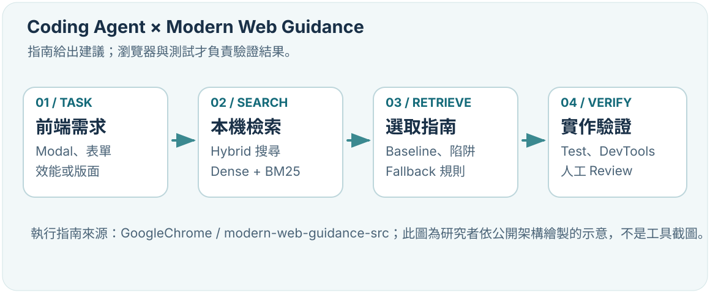

> **Modern Web Guidance 系列 01／04｜資料核對：2026-11-23｜狀態：官方文件與原始碼研究，非安裝實測。** 這系列以每篇約 5–10 分鐘閱讀為目標，附章節目錄、上下篇導航與來源。

## 本系列閱讀地圖

| 章節 | 主題 | 適合誰 |
| --- | --- | --- |
| **01｜本篇** | 為什麼 Coding Agent 需要 Modern Web Guidance？ | 先了解工具定位 |
| 02 | [安裝與實際使用：search、retrieve、Agent Skills](../modern-web-guidance-quickstart/) | 想跟著做的初學者 |
| 03 | [legacy-scan：如何更新舊前端，又不破壞跨瀏覽器相容性？](../modern-web-guidance-modernization/) | 有現成前端 Repo 的工程師 |
| 04 | [技術深讀：本機檢索、Evals，與 DevTools MCP 怎麼搭？](../modern-web-guidance-architecture-evals/) | 想了解設計與選型的工程師 |

## 1. AI 會寫前端，為什麼還需要這個工具？

想像你要求 Coding Agent：「幫我加一個有動畫、可按 Escape 關閉的 Dialog。」模型可能產生一堆事件監聽器、額外狀態和依賴套件；在某些需求下，其實可以優先考慮原生 `<dialog>`、`showModal()`、`::backdrop` 和 CSS 動畫。

重點**不是所有 JavaScript 都不好**，而是模型往往從大量既有範例學到舊式實作；即使 API 已推出，仍可能不知道跨瀏覽器注意事項、焦點管理或降級策略。

[Modern Web Guidance](https://developer.chrome.com/docs/modern-web-guidance) 由 Web 平台專家整理可供 Agent 讀取的專題指南，讓它在**寫程式之前先查詢現代 Web API 的用法**。它不提供模型，也不是新一個 Coding Agent。

Google 在 **2026-11-10 發布 1.0 穩定版**，並由 Chrome、Edge、Firefox／MDN 團隊與社群共同維護。1.0 發布時官方宣布 203 篇用途指南、涵蓋約 250 項 Web Features；內容持續變動，所以不要把發行當天數量誤寫成永久定值。

**資料來源：** [1.0 官方發布文章](https://developer.chrome.com/blog/modern-web-guidance-v1) · [v1.0.0 Release Notes](https://github.com/GoogleChrome/modern-web-guidance/releases/tag/v1.0.0) · [治理文件](https://github.com/GoogleChrome/modern-web-guidance-src/blob/main/GOVERNANCE.md)。

## 2. 你給的 GitHub Repo，和真正要安裝的 Repo 不一樣

| Repository | 角色 | 你通常會在這裡做什麼？ |
| --- | --- | --- |
| [modern-web-guidance-src](https://github.com/GoogleChrome/modern-web-guidance-src) | **Source**：專家編寫的原始指南、CLI、搜尋引擎、評測工具 | 研究架構、貢獻指南、看 Evals |
| [modern-web-guidance](https://github.com/GoogleChrome/modern-web-guidance) | **Distribution**：發布給 Agent／開發者安裝的 Skills | 透過 Skills CLI 或 Plugin 安裝 |
| [Chrome 開發者文件](https://developer.chrome.com/docs/modern-web-guidance) | 使用者教學與正式公告 | 取得安裝步驟與功能定位 |
| [公開 Eval Dashboard](https://googlechrome.github.io/modern-web-guidance-src/) | 可檢視 Agent 評測資料 | 對照日期、Agent 與個別用例 |

如果你的目標只是「讓 Codex 或 Claude Code 寫出更好的前端」，**不需要 Clone Source Repo 才能使用**。真正研究底層機制時，才會進入 `src/rag/`、`src/harness/`、`guides/` 等目錄。

## 3. 整體流程：它究竟怎麼幫助 Agent？



*圖 1：依 [官方 README](https://github.com/GoogleChrome/modern-web-guidance-src/blob/main/README.md) 的 Search → Retrieve 工作方式自行繪製的概念圖，**不是實際產品截圖**。*

Coding Agent 執行前端任務時，Skill 指示它先用一小段英文查詢，例如 `confirmation modal dialog`。CLI 在本機找出最相關的指南 ID，Agent 再用 `retrieve` 讀取具體做法、瀏覽器支援狀態與注意事項。

| 層級 | Modern Web Guidance 負責 | 它**不會**自動替你做的事 |
| --- | --- | --- |
| 知識 | 告訴 Agent 哪些原生 API 值得優先考慮 | 取代你整個產品的需求定義 |
| 檢索 | 從指南中選出與任務最相關的內容 | 永遠找對所有需求 |
| 相容性 | 加入 Baseline 與 Fallback 建議 | 保證你的所有使用者瀏覽器都支援 |
| 實作 | 讓 Agent 使用指南修改程式 | 保證程式實際運作、無回歸 |
| 驗證 | 提供範例與 Evals 方法論 | 取代你專案本身的測試／瀏覽器 QA |

**最重要的界線：它提供「更好的實作依據」，不是「執行驗證的證據」。**

## 4. 它關注哪些前端問題？

| 領域 | 可以探索的現代能力 | 應注意 |
| --- | --- | --- |
| UI / Layout | Container Queries、Subgrid、Anchor Positioning | 不同瀏覽器與版本的支援落差 |
| 互動組件 | `<dialog>`、Popover API、原生命令控制 | 焦點、鍵盤、Light Dismiss |
| 動畫體驗 | View Transitions、Scroll-driven Animations | Reduced Motion 和降級 |
| 效能 | LCP、INP、影像優先順序、Task Scheduling | 需要真實效能量測 |
| Forms / A11y | 原生驗證、語意 HTML、ARIA | 功能成立不等於可用性已驗證 |
| 安全與 Web AI | HTML Sanitization、瀏覽器內建能力 | 需要判斷 API 成熟度與資料政策 |

不必把每個新 API 都塞進專案。**如果舊方法已經正確、效能足夠且相容性更好，不應因為「新」就盲目改寫**。

## 5. Baseline 的價值：不是「Chrome 能跑」就算完成

[Web Features / Baseline](https://web-platform-dx.github.io/web-features/) 把跨瀏覽器支援狀態轉化為可查詢的參考資料。Modern Web Guidance 在指南中運用這些狀態協助判斷：某項 API 是否可直接採用，或應補上 Feature Detection、Fallback 等。

例如：一個只有部分瀏覽器支援的視覺加分效果，允許優雅降級；但影響付款、登入或主要操作的元件，不能因為「新功能很酷」就忽略不支援的使用者。

官方還對 **Origin Trial** 和較不穩定的新功能做了取用閘門：指南可能仍可被搜尋到，但 `retrieve` 需要在專案的 `.mwgrc` 明確開啟對應選項。這是避免 Agent 把實驗性功能默默寫進正式產品的一層保護；不是對所有 Bug 的保證。

## 6. 成本、隱私與仍值得觀察的地方

Modern Web Guidance 是一套公開 Skills / CLI；**你原本使用的模型訂閱、Token 及 Agent 執行成本仍然存在**。

CLI 的指南檢索可以在本機進行，不需要替每次查詢呼叫遠端模型 API；但**首次安裝／更新仍需下載套件**。依官方 [Telemetry 聲明](https://github.com/GoogleChrome/modern-web-guidance/blob/main/README.md)，啟用時可能傳送匿名工具使用資料，包括 Agent 名稱、指南 ID 與搜尋字串，不包含原始使用者 Prompt。若要關閉：

```bash
export DISABLE_TELEMETRY=1
```

在公司內部環境，還需檢查 Agent 本身是否會把程式碼或錯誤訊息送往外部模型；**CLI 本機搜尋不等於整條 AI 工作流完全離線**。

## 重點回顧

- **這不是模型也不是另一個 Coding Agent**，而是讓 Agent 學會查詢現代 Web 指南的 Skills / CLI。
- 你提供的 `-src` Repo 包含原始指南、評測和搜尋程式，安裝用的 Repo 另有其址。
- 最有價值的是原生 API、跨瀏覽器 Baseline 與合理的 Fallback，而不是追求最新語法。
- 它可以補強程式碼產生品質，但仍需要真實瀏覽器、測試與人工 Review。
- **下一篇：** [跟著裝、查、讀一份指南](../modern-web-guidance-quickstart/)。

**研究來源：** [官方首頁](https://developer.chrome.com/docs/modern-web-guidance) · [Google 1.0 公告](https://developer.chrome.com/blog/modern-web-guidance-v1) · [Source README](https://github.com/GoogleChrome/modern-web-guidance-src) · [GOVERNANCE](https://github.com/GoogleChrome/modern-web-guidance-src/blob/main/GOVERNANCE.md) · [Baseline](https://web-platform-dx.github.io/web-features/)
