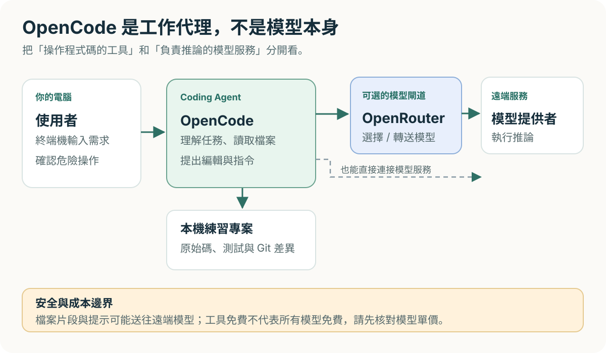
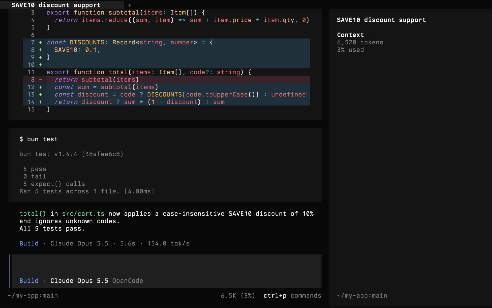
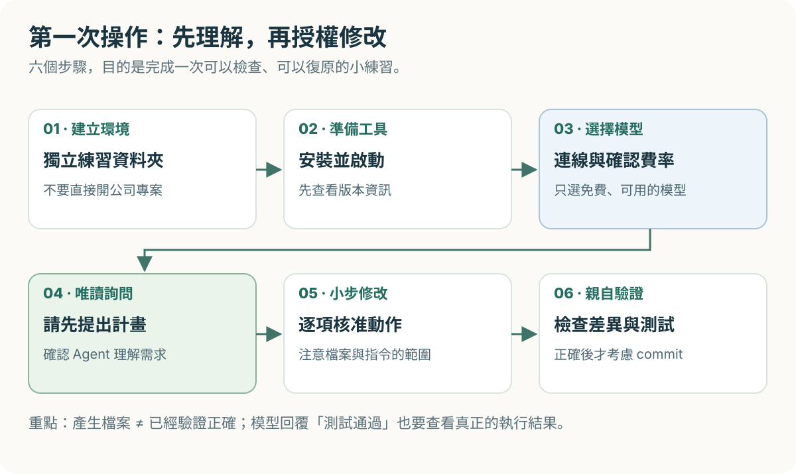
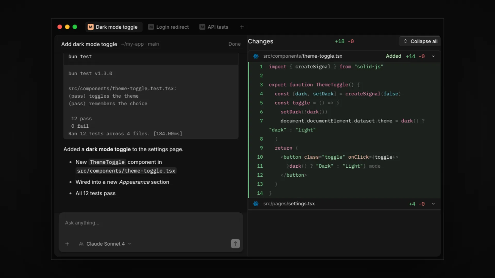
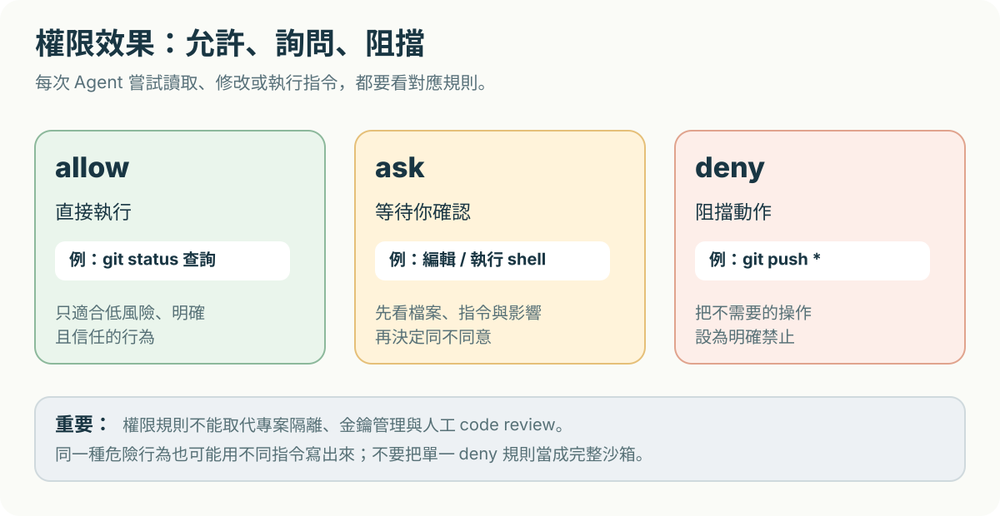

寫程式時，我們可能已經習慣把問題貼給 AI，再自己複製回答、修改檔案。如果希望 AI 能**直接閱讀專案、提出修改、協助執行測試**，就會接觸到另一類工具：Coding Agent。

這篇介紹的 **OpenCode**，是一款開源 Coding Agent。它可以在終端機操作，也有桌面與網頁介面。初學者先從終端機版本認識整個流程，之後換介面會更容易理解。

本文會從零開始做一個很小的 Python 練習，並示範如何選擇 **OpenRouter 的免費模型**。**不需要訂閱付費方案，也不會要求儲值。**不過，免費模型仍可能有額度和功能限制，實際使用前一定要再核對。

> **本文驗證狀態：學習整理。** 截至 2026-11-11，安裝指令、設定欄位與功能說明已對照官方文件；本文的流程圖是作者製作的示意圖，另附上 **OpenCode 官方專案提供的真實產品介面截圖**。官方範例畫面不代表本文已完成實測，且範例中使用的模型可能是付費模型。本文尚未以免費模型完成端對端測試，不會把預期結果偽裝為實測紀錄。

## 這篇會學到什麼？

完成閱讀與練習後，你應該能回答以下問題：

1. OpenCode、OpenRouter、AI 模型，各自負責什麼？
2. OpenCode 要怎麼安裝，並確認自己的版本？
3. 如何選擇免費模型，避免誤用付費 API？
4. 怎麼讓 Agent 幫忙修改一個小專案，又能保留人工檢查？
5. 哪些資料不能傳送給遠端模型？權限該怎麼設？

## 1. 先弄懂：OpenCode 和 OpenRouter 不是同一件事



*圖 1：OpenCode 是操作專案的 Agent；OpenRouter 是**可選**的模型轉接服務；真正產生回覆的是模型。*

| 名詞 | 它在做什麼？ | 初學者的理解方式 |
| --- | --- | --- |
| **OpenCode** | 讀取專案、組織任務、呼叫工具、提出檔案修改與執行指令 | 幫你工作的程式助理 |
| **AI 模型** | 根據收到的文字、程式碼與上下文產生回覆或工具呼叫 | 助理背後的推論能力 |
| **OpenRouter** | 提供一個入口，連接不同模型及其服務提供者 | 模型的轉接站；並非必要 |
| **Git** | 記錄檔案版本，供你比較與復原 | 修改紀錄與安全網 |

最重要的區別：**安裝 OpenCode，不等於已經擁有免費且無限使用的 AI 模型。** OpenCode 本身可以免費使用，但你連接的模型可能按用量收費。本篇只使用官方列出的免費模型選項，不把付費模型當成預設。

同時要留意資料路徑：為了解決程式問題，Agent 可能把提示、必要的程式碼片段或錯誤訊息送到遠端模型。**公司私有程式碼、客戶資料、API 金鑰、密碼與憑證不適合拿來做第一次練習。**

官方參考：[OpenCode 介紹](https://opencode.ai/docs)、[OpenCode 模型提供者](https://opencode.ai/docs/providers)、[OpenRouter 免費模型列表](https://openrouter.ai/collections/free-models)。

## 2. 開始之前，準備這些東西

| 項目 | 必須嗎？ | 用途 |
| --- | --- | --- |
| 終端機 | 必須 | 以 CLI 啟動 OpenCode；macOS Terminal、Linux 終端機或 Windows PowerShell 均可 |
| Node.js 與 npm | 使用本篇 npm 安裝方式時必須 | 取得 OpenCode CLI；若改用官方獨立執行檔則不需要透過 npm 安裝 |
| Git | 建議 | 查看哪些檔案被更動 |
| Python 3 | 練習時需要 | 執行本篇示範的 Python 程式與單元測試 |
| OpenRouter 免費帳號 | 選用此路線時需要 | 取得免費模型的連線方式 |
| 付費訂閱或信用卡儲值 | **不需要** | 本篇不使用付費服務 |

先打開終端機確認電腦已有的工具：

```bash
node --version
npm --version
git --version
python3 --version
```

如果 Windows 上沒有 `python3` 指令，可嘗試 `py --version`。尚未安裝的工具，請從 [Node.js](https://nodejs.org/en/download)、[Git](https://git-scm.com/downloads)、[Python](https://www.python.org/downloads/) 官方網站取得。實際版本以你電腦顯示為準；不必為了照抄別人的版號而任意降級。

**成功檢查：** 每條已安裝工具的指令都顯示版本，而不是 `command not found` 或 `not recognized`。

## 3. 安裝 OpenCode，先確認使用的是哪個版本

### 先認識真正的操作畫面



*官方產品截圖 A：終端機介面的任務紀錄、程式碼修改和測試輸出。來源：[OpenCode 官方 GitHub 專案](https://github.com/anomalyco/opencode/blob/dev/services/site/public/brand/screenshots/opencode-terminal-dark.webp)。**這是官方展示素材，不是本篇實測；畫面中可能有付費模型名稱，請勿照選。***

看到畫面後先辨認三個區域：**對話紀錄**顯示 Agent 準備做什麼；**工具／檔案變動**說明它碰了哪些內容；**執行輸出**才能提供測試是否真的執行的證據。不同終端機大小和版本會改變排版，不必追求與截圖完全相同。

以下以 OpenCode **V2 官方文件**為準。這點特別重要，因為網路搜尋仍會找到 V1 的設定範例，兩版的權限欄位名稱不同。

使用 npm 安裝：

```bash
npm install -g @opencode/cli
opencode --version
```

安裝完成後，`opencode --version` 應能顯示版本號。**請先看輸出，不要假設每個環境拿到的版本都相同。**如果指令無法執行，先重新開啟終端機，檢查 npm 全域執行檔是否在 `PATH` 中。

其他官方安裝方式：

- macOS（有 Homebrew）：`brew install anomalyco/tap/opencode-v2`
- 有 pnpm 的環境：`pnpm add -g --allow-build=@opencode/cli @opencode/cli`
- 不想透過套件管理器安裝：到 [OpenCode 官方文件](https://opencode.ai/docs)下載對應作業系統的獨立執行檔

官方也提供 `curl ... | bash` 一行安裝，但它會直接執行網路下載的腳本。本篇選擇 npm 指令，方便讀者了解安裝來源；若使用腳本，應先取得並審閱內容。**不要為了安裝工具而直接關閉系統防護或隨意使用最高管理權限。**

**成功檢查：** 你可以從官方文件確認安裝來源，終端機能執行 `opencode --version`，而且知道自己裝的是哪一版。

## 4. 建立練習專案，避免碰到重要檔案



*圖 2：把第一次使用當成受控實驗。先理解 Agent 想做什麼，再讓它修改檔案。*

先不要把 OpenCode 開在公司的專案、雲端同步的個人文件目錄，或包含 `.env` 的程式庫內。建立一個**全新的空資料夾**：

```bash
mkdir opencode-playground
cd opencode-playground
git init
```

Windows PowerShell、macOS 和 Linux 都能使用上面這組基本指令。`git init` 只是在此資料夾開始記錄版本，不會幫你上傳到 GitHub。

現在啟動 OpenCode：

```bash
opencode
```

依照 [官方 CLI 文件](https://opencode.ai/docs/cli)，在專案目錄執行 `opencode` 會開啟終端機介面；若之後想用非互動方式操作，也有 `opencode run "..."`。不過初學時，我比較建議用互動介面，逐步確認它要執行的操作。

**成功檢查：** 終端機已進入 OpenCode 的互動介面，而且目前工作位置是剛建立的 `opencode-playground`。

#### 畫面操作對照：第一次打開時

| 你要做的動作 | 在畫面找什麼 | 看到不同結果時 |
| --- | --- | --- |
| 確認成功啟動 | OpenCode 的互動輸入區與目前專案 | 若回到一般 shell，先查 `opencode --version` |
| 連接提供者 | 在輸入區鍵入 `/connect` | 指令列表若不同，查目前版本的官方 Providers 文件 |
| 切換模型 | 鍵入 `/models`，核對**完整模型 ID** | 不要只看名稱；要確認是否為 `:free` |
| 送出第一個任務 | 在輸入區貼上第 6 節的唯讀提示 | 先核對是否出現要求讀檔／跑指令的授權提示 |

## 5. 連接 OpenRouter：先選免費、支援工具呼叫的模型

OpenCode 支援多種模型提供者，**OpenRouter 只是其中一條路線**。選它的理由是可以用同一個入口認識不同模型，之後介紹其他 Coding Agent 時也能比較連線方式。

### 5-1. 取得 OpenRouter 連線資訊

1. 進入 [OpenRouter 官方網站](https://openrouter.ai/)，建立或登入免費帳號。
2. 在帳號的 API Keys 管理畫面建立一把**專供練習**的金鑰。金鑰通常只會完整顯示一次，請妥善保管。
3. 回到 OpenCode 的互動介面，輸入 `/connect`。
4. 選擇 **OpenRouter**，依畫面提示完成帳號連接或金鑰輸入。
5. 輸入 `/models`，查看目前能使用的模型。

這是 [OpenCode Provider 官方流程](https://opencode.ai/docs/providers)的 `/connect` → `/models`。不要把真正的金鑰寫進教學文章、聊天截圖、README、`opencode.jsonc` 或 Git commit。**下面所有範例都不包含真實金鑰。**

### 5-2. 免費模型應該怎麼選？

在 [OpenRouter 免費模型列表](https://openrouter.ai/collections/free-models)查看目前供應的模型，再核對模型詳細頁：

- **價格**：確認輸入與輸出價格都是 `$0`，且你選的是正確的 `:free` 版本。
- **工具呼叫（Tool Calling）**：Coding Agent 需要模型能正確要求讀檔、修改或執行命令；免費不保證支援這個能力。
- **可用性**：免費模型可能暫時無法使用、被限流，或未出現在 OpenCode 的可選模型清單。
- **資料政策**：遠端服務會處理你送出的內容；閱讀模型提供者與 OpenRouter 的資料處理條款。

OpenRouter 有提供 `openrouter/free` 這種自動選擇免費模型的路由，但**自動選到免費模型，不等於一定能完整執行 Coding Agent 的工具呼叫**。本篇建議先挑選 `/models` 中**明確列出、價格為零、支援工具呼叫**的具體模型，避免每次切換模型而難以排錯。

為了不讓文章變成過期的模型名單，我不把任何單一免費模型名稱寫死成推薦預設值。讀者可以用官方清單選擇當下真正可用的一款。

### 5-3. 免費額度並不是無限

OpenRouter 的 [Pricing 頁面](https://openrouter.ai/pricing)列出免費方案有每日請求數限制；截至本文查閱時，免費帳號的免費模型一般以 **50 requests/day** 為主要限制，部分 `:free` 模型亦有每分鐘限制。實際規則可能調整，請以帳號與官方頁面為準。

**本系列堅持零支出：**不升級、不儲值、不選付費模型；如果模型不可用，先停下來查看額度與設定，不要用「先綁卡試試」解決。

**成功檢查：** `/models` 能顯示你已連接的提供者，且你已在官方價格頁確認所選模型的費率與工具支援情況。此時還沒有保證「整個 Agent 工作流程已成功」，下一節才開始驗證。

## 6. 第一次實作：讓 Agent 建立簡單的 Python 程式

這個練習只需要 Python 標準函式庫，不用下載外部套件，也不會部署到網際網路。

### 第一步：先請它解釋，不要直接動手

在 OpenCode 對話框輸入：

> 目前是新建的練習專案。請先確認所在目錄，告訴我你準備如何建立一個 `greet(name)` 函式，以及如何用 Python `unittest` 驗證它。先只提出計畫，不要新增、修改、刪除檔案，也不要執行指令。

先看 Agent 是否正確理解工作目錄和需求。如果它仍要求執行工具，可以先拒絕這次操作並重新說明範圍；**文字要求並不是安全沙箱**，所以後面還會設定權限。

### 第二步：要求它小範圍建立檔案

確認計畫後再輸入：

> 請只在目前練習目錄新增 `hello.py` 與 `test_hello.py`。`hello.py` 應有 `greet(name)` 函式，回傳 `Hello, {name}!`，直接執行時顯示 `Hello, Brad!`。`test_hello.py` 請使用標準函式庫 `unittest`，測試 `greet("Brad")`。不要安裝依賴、不要讀取其他資料夾、不要連線外部服務，也不要提交或推送 Git。修改前請讓我確認動作。

這段需求刻意限定**檔名、行為、套件與禁止事項**。當 Agent 提出寫檔或執行指令的授權請求時，先看清楚路徑和完整命令，再決定是否同意。

### 第三步：離開互動介面後，親自檢查

如果習慣圖形化檢查 Diff，也可以認識 OpenCode 的桌面版：



*官方產品截圖 B：桌面版的檔案與修改差異檢視。來源：[OpenCode 官方 GitHub 專案](https://github.com/anomalyco/opencode/blob/dev/services/site/public/brand/screenshots/opencode-desktop.webp)。畫面是官方展示專案，並非本篇 Python 練習。版本不同時，欄位與按鈕位置可能變動。*

讀這張圖時先找「**被改動的檔案**」和「**差異內容**」：新增的程式碼不代表正確，必須回到自己的練習專案開檔確認。桌面介面不是完成本篇的必要條件。

回到練習資料夾的終端機，執行：

```bash
git status --short
python3 -m unittest -v
python3 hello.py
```

Windows 如果使用 Python Launcher，改成：

```powershell
py -m unittest -v
py hello.py
```

此練習的**預期結果**是：`unittest` 找到測試且通過，執行 `hello.py` 顯示 `Hello, Brad!`。這是**驗收條件，不是本文已跑出的測試紀錄**。

`git status --short` 會列出新增或修改的檔案。對於尚未被 Git 追蹤的新檔案，`git diff` **不會直接顯示內容**，請用編輯器開啟 `hello.py`、`test_hello.py` 逐行查看；若之後開始追蹤檔案，再用 `git diff` 比較修改。只有你確認程式碼、輸出與檔案範圍都正確，才考慮 `git add` 或 `git commit`。

**成功檢查：** 只有預期的檔案出現，程式和單元測試能在你的電腦執行，沒有多餘的網路呼叫或奇怪的腳本。

## 7. 設定權限：讓敏感動作先詢問



*圖 3：對初學者來說，「一般寫檔與 Shell 指令先問我」是容易理解的起點。*

OpenCode V2 在專案根目錄可以使用 `opencode.jsonc` 設定檔。先以編輯器在**練習專案**建立此檔案，加入以下規則：

```jsonc
{
  "$schema": "https://opencode.ai/config.json",
  "permissions": [
    { "action": "read", "resource": "*.env*", "effect": "deny" },
    { "action": "edit", "resource": "*", "effect": "ask" },
    { "action": "shell", "resource": "*", "effect": "ask" },
    { "action": "shell", "resource": "git status *", "effect": "allow" },
    { "action": "shell", "resource": "git diff *", "effect": "allow" },
    { "action": "shell", "resource": "git push", "effect": "deny" },
    { "action": "shell", "resource": "git push *", "effect": "deny" }
  ]
}
```

讀取規則的效果如下：

| 設定 | 意義 | 本篇的使用方式 |
| --- | --- | --- |
| `allow` | 符合規則的操作直接執行 | 只對明確、低風險的 Git 查詢使用 |
| `ask` | 先詢問使用者 | 編輯檔案、一般 Shell 指令 |
| `deny` | 阻擋符合規則的動作 | 範例阻擋讀取 `.env` 類檔案，以及直接 `git push` |

**版本陷阱：** OpenCode **V2** 使用 `permissions`（複數）、`shell`、`subagent`；許多舊教學的 **V1** 範例使用 `permission`、`bash`、`task`。不能把兩組設定混著抄。官方 V2 文件也明確指出：**後面匹配的規則會覆蓋前面匹配的規則**。[詳細參考：OpenCode Permissions](https://opencode.ai/docs/permissions)。

這份設定只是*示範如何降低誤操作機率*，不是萬無一失的防火牆。例如 Git 仍有其他寫法能完成類似操作，某些工具也可能透過其他管道對外連線。所以**獨立練習目錄、最小授權、不要放入秘密，以及人工審查**仍然必要。設定完成後重新啟動 OpenCode，觀察權限提示是否符合預期。

## 8. 進一步可以做什麼？

熟悉第一個練習之後，再慢慢嘗試以下功能。每次只加入一項，才容易知道問題出在哪裡。

| 功能 | 用途 | 初學者先做什麼？ |
| --- | --- | --- |
| 更多模型 | 比較回覆品質、速度與穩定度 | 用 `/models` 手動切換；先確認價格 |
| CLI 非互動執行 | 用 `opencode run "..."` 取得單次結果 | 先用無敏感內容的唯讀任務測試 |
| 自訂 Agent | 把固定工作、規則做成可重用角色 | 先建立只解釋程式、不修改檔案的 Reviewer |
| MCP 工具連接 | 讓 Agent 取得更多外部工具 | 先理解權限、資料流向與外部服務成本 |
| 本機模型 | 在符合硬體條件時使用本機推論 | 先確認模型能否支援工具呼叫與所需記憶體 |

自訂 Agent 的官方位置包括專案內 `.opencode/agents/`，可以把只負責 Code Review 的指令放在 Markdown 檔中；詳見 [OpenCode Agents](https://opencode.ai/docs/agents)。本篇不要求安裝任何 MCP Server 或額外服務。

## 9. 常見問題與排查順序

| 情況 | 可能原因 | 建議先確認 |
| --- | --- | --- |
| `opencode` 找不到指令 | 安裝失敗或 `PATH` 未更新 | 重新開啟終端機；再看 npm 安裝輸出與 `opencode --version` |
| 設定檔沒有產生預期效果 | 看到了 V1 的舊範例，或格式、位置錯誤 | 查版本；核對 V2 的 `permissions` 和 `opencode.jsonc` |
| `/models` 裡沒有需要的模型 | 連線未完成、模型下架或提供者不可用 | 重新檢查 `/connect`、OpenRouter 清單與完整模型 ID |
| 可以聊天卻無法改檔、測試 | 模型工具呼叫能力不足、權限被拒絕 | 核對模型是否支援 Tools，閱讀權限提示 |
| 顯示限流、額度不足 | 免費方案有流量或每日請求限制 | 查看 OpenRouter 帳號用量；等待額度恢復，不必儲值 |
| 回覆說測試通過，但結果不對 | AI 回覆不等於真實執行結果 | 自行查看檔案、終端機輸出與 `unittest` 測試 |

## 10. 成本與安全檢查清單

| 檢查項目 | 本篇建議 |
| --- | --- |
| OpenCode 軟體 | 使用官方開源 CLI，不購買額外訂閱 |
| OpenRouter | 使用免費帳號和當下標示 `$0` 的模型，不儲值 |
| 額度 | 預期會有每日／每分鐘限制；不足就停止，不切付費模型 |
| API Key | 只輸入到官方連線流程；不寫進 repo、文章或截圖 |
| 專案內容 | 用獨立練習資料夾；不放工作機密、客戶資料或密碼 |
| Agent 動作 | Shell 和修改先確認，完成後人工看檔案與測試 |
| 發布文章 | 截圖遮住帳號、金鑰、私人路徑與機敏內容；公開 Git 歷史也會留痕 |

寫技術筆記時容易忽略一件事：**就算圖片只顯示一小段終端機，也可能露出電腦帳號、內網主機名稱或 API Key。**正式發布前應檢查原始圖片、程式碼區塊、錯誤訊息和提交歷史。本篇不展示任何真實憑證或模型金鑰。

## 總結：OpenCode 適合什麼樣的人？

如果你已經會用終端機開啟專案，也想更深入理解 AI 如何讀檔、寫檔、執行測試，OpenCode 是值得認識的開源 Coding Agent。它的特色不在於綁定某一家模型，而是能在同一個工作介面整合不同提供者。

但它並不是「裝完就能無限制免費寫程式」：模型成本、免費額度、工具呼叫能力，以及資料能否傳送到遠端，仍要由使用者逐項確認。對初學者而言，先在空目錄完成可檢查的 Python 小練習，比直接交給 Agent 處理大型專案更能學到核心概念。

這是 Brad.log 的 **Coding Agent 工具介紹系列第一篇**。想認識其他工具，可以接著讀：[Cline 入門](/brad-log/posts/cline-beginner-guide/)、[Kilo Code 入門](/brad-log/posts/kilo-code-beginner-guide/)、[Claude Code Router 入門](/brad-log/posts/claude-code-router-beginner-guide/)、[Codex Router 入門](/brad-log/posts/codex-router-beginner-guide/)，最後再看[工具比較與選擇指南](/brad-log/posts/coding-agent-router-comparison/)。每一篇都以工具本身為主角，不用聳動標題排名。

### 官方參考資料與查閱時間

- [OpenCode — Intro（V2）](https://opencode.ai/docs)
- [OpenCode — CLI](https://opencode.ai/docs/cli)
- [OpenCode — Providers](https://opencode.ai/docs/providers)
- [OpenCode — Permissions](https://opencode.ai/docs/permissions)
- [OpenCode — Agents](https://opencode.ai/docs/agents)
- [OpenRouter — Free Models](https://openrouter.ai/collections/free-models)
- [OpenRouter — Pricing](https://openrouter.ai/pricing)

最後查閱：**2026-11-11（台灣時間）**。官方介面、模型名稱、配額和政策可能隨時間變動，遇到差異請以最新官方文件為準。
