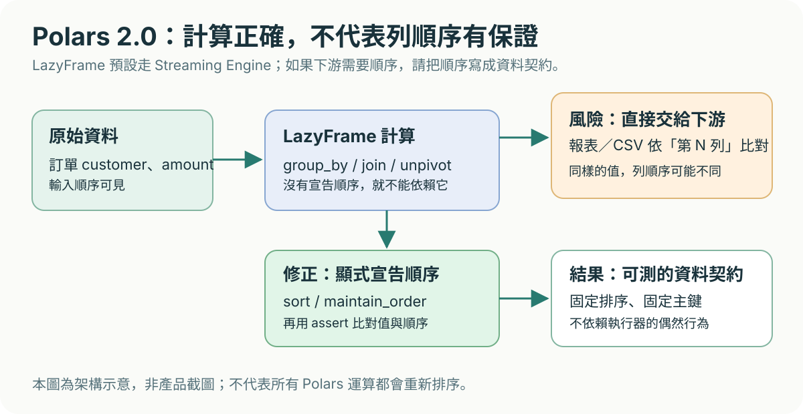

如果一條 ETL 管線昨天輸出的 CSV 第一列是 Amy，今天卻變成 Bob，**數字都正確，但順序不同**，算不算出錯？

對資料庫來說，沒有 `ORDER BY` 的結果本來就不能依賴列順序。但在現實工作裡，下游可能把第一列當成第一名、用 Excel 比對第 N 列，甚至把資料列順序當作快取鍵的一部分。這種隱含假設，正是 **Polars 2.0** 升級時最值得注意的地方。

2026 年 10 月 6 日，Polars 發布 2.0。官方宣布 Lazy API 預設使用 Streaming Engine，並加入更完整的記憶體不足時磁碟暫存（out-of-core）能力；[r/dataengineering 的發布討論](https://www.reddit.com/r/dataengineering/comments/1wz10m5/python_polars_20_release/)也累積數百票，值得實際研究。但這**不等於** Polars 2.0 會把每一條資料管線算錯。問題在於：部分運算本來就沒有承諾輸出順序，現在更不能依賴它「剛好」照舊排列。

> **驗證狀態：部分實作完成。** 本文的 `group_by`、`sort`、`join(maintain_order="left")` 範例已於 2026-11-16 在隔離環境使用 **Python 3.12、Polars 2.0.0** 執行並通過斷言。未對真實大型資料測效能，也未驗證所有 1.x → 2.0 的相容性。實際輸出如下，與未執行的建議會分開標示。

## 先看圖：問題發生在哪裡？



_圖 1：這是自製概念圖，不是產品截圖。重點是「資料值正確」和「列順序確定」是兩份不同的契約。_

## 1. Polars、LazyFrame、Streaming 到底是什麼？

| 名詞                 | 用白話理解                                       | 對 Data Engineer 的意義                                  |
| -------------------- | ------------------------------------------------ | -------------------------------------------------------- |
| **Polars**           | 用 Python／Rust 操作表格資料的開源工具           | 讀檔、清洗、聚合與轉換                                   |
| **LazyFrame**        | 先描述要做什麼，最後才真正執行                   | 能做最佳化、減少不必要的讀取                             |
| **Streaming Engine** | 以較小的批次處理資料，不必等全部資料都載入才開始 | 減少記憶體壓力，但不應預設自然列順序                     |
| **Out-of-core**      | 特定運算記憶體不足時，把中間資料暫存到磁碟       | 提升部分大型資料工作負載的可完成性，不等於完全不需要 RAM |

在 Polars 2.0 中，`LazyFrame.collect()` 的 `engine="auto"` 仍是預設，但這個 `auto` 會選擇 Streaming Engine。官方文件特別提醒：`group_by`、`join`、`unpivot` 等不要求保持順序的操作，可能輸出不同順序。對於確實需要順序的地方，**加上 `.sort(...)`**；對於需要維持 join 左表順序的情況，可使用 `maintain_order="left"`。[來源：官方 2.0 Migration Guide](https://docs.pola.rs/releases/upgrade/2/)

不要誤會成「Streaming = 每次都亂序」：有些小資料每次仍會得到相同輸出。真正的風險是**這個順序不受契約保證**，不能用目前恰巧的執行結果當依據。

## 2. 五分鐘完成一個可重現的實驗

### 步驟 A：建立隔離練習環境

先準備 Python 3.11 以上的環境，以下示範使用一般 Python 虛擬環境。在全新資料夾執行：

```bash
mkdir polars2-playground
cd polars2-playground
python3 -m venv .venv
source .venv/bin/activate
python -m pip install 'polars==2.0.0'
python -c 'import polars as pl; print(pl.__version__)'
```

Windows PowerShell 啟用環境時，改用 `.venv\Scripts\Activate.ps1`；若系統禁止執行啟用腳本，可直接呼叫虛擬環境中的 Python，不必關閉安全政策。

**看哪裡？** 最後一行應顯示 `2.0.0`。如果不是，先確認目前使用的 `python` 和安裝套件的環境是否相同。這裡固定版號是為了重現本文，不是要你的正式環境直接升級。

### 步驟 B：把「順序」寫進轉換邏輯

在 `polars2-playground` 建立 `order_check.py`，貼上以下程式：

```python
import polars as pl

orders = pl.LazyFrame({
    "customer": ["Bob", "Amy", "Bob", "Amy"],
    "amount": [20, 10, 30, 5],
})

totals = (
    orders.group_by("customer")
    .agg(pl.col("amount").sum().alias("total"))
    .sort("customer")  # 我們明確要求依 customer 排序
    .collect()
)

expected = pl.DataFrame({
    "customer": ["Amy", "Bob"],
    "total": [15, 50],
})
assert totals.equals(expected)
print(totals)
print("PASS: values and ordering")
```

執行：

```bash
python order_check.py
```

**正常結果：** 表格會先列 Amy、再列 Bob；金額分別為 `15`、`50`，最後出現 `PASS`。注意程式裡的 `.sort("customer")`：不是為了美觀，而是避免下游依賴隱含順序。

### 已實際跑出的輸出

下面是 2026-11-16 在 **Polars 2.0.0** 執行完整範例的終端機輸出摘錄，並非 AI 想像的畫面；執行環境與檔案有實際版本紀錄：

```text
Polars version: 2.0.0
Grouped totals with explicit sort:
shape: (2, 2)
┌──────────┬───────┐
│ customer ┆ total │
│ ---      ┆ ---   │
│ str      ┆ i64   │
╞══════════╪═══════╡
│ Amy      ┆ 15    │
│ Bob      ┆ 50    │
└──────────┴───────┘
PASS: business values and output ordering are verified
PASS: left-join input order is preserved explicitly
```

可直接查看／下載此篇完整、已執行的 [原始練習程式](https://github.com/bradcocox/brad-log/blob/main/examples/data-engineering/polars2/order_check.py)。它比文中精簡範例多了左表順序的 Join 斷言。

## 3. Join 有順序需求時，怎麼寫？

假設 `left` 是依需求排好的訂單，`right` 是查找用的維度資料：

```python
left = pl.LazyFrame({"id": [3, 1, 2]})
right = pl.LazyFrame({
    "id": [1, 2, 3],
    "label": ["A", "B", "C"],
})

joined = left.join(
    right,
    on="id",
    how="left",
    maintain_order="left",  # 明確保留左表的順序
).collect()

assert joined["id"].to_list() == [3, 1, 2]
```

本文已在 Polars 2.0.0 實際驗證。**`maintain_order` 不等於結果一定最快**；如果你的報表只需要依 ID 固定排序，最後再 `.sort("id")` 通常更容易理解。也不要拿沒有唯一鍵的資料只靠列順序判定是否重複。

## 4. 升級之前，最容易漏掉的四種風險

| 檢查項目                      | 可能出現的問題                   | 建議做法                                  |
| ----------------------------- | -------------------------------- | ----------------------------------------- |
| `group_by`、`join`、`unpivot` | 只看資料列位置的比對失敗         | 若順序是需求，顯式排序或 `maintain_order` |
| 記憶體不足                    | Out-of-core 不是所有運算都支援   | 量測峰值 RAM、磁碟空間與溢寫行為          |
| `pl.concat()` 等 API          | 2.0 更嚴格，舊版寬鬆行為可能改變 | 閱讀官方 Migration Guide，測錯誤資料      |
| 舊的 profiling／schema 程式   | 有 API 移除或行為變更            | 固定版本、跑整套回歸測試                  |

官方的 2.0 發布文章有自家 TPC-H／TPC-DS 基準測試，但它比較的是特定硬體、資料規模與查詢組合；**不能直接推論你的 ETL 一定比 DuckDB 快**。面對真實工作負載，請同時量測總時間、峰值 RAM、磁碟 I/O 與結果一致性。[來源：Polars Release of 2.0](https://pola.rs/posts/release-polars-2/)

## 5. 如果這是正式資料管線，我會怎樣驗收？

1. 在測試環境固定 1.x 與 2.0 的套件版本，使用同一份輸入資料。
2. **先比業務值**：總筆數、唯一鍵、缺值、加總、分組結果，而不是直接比檔案每一列。
3. **再比順序契約**：只有對外宣告有順序的輸出，才檢查排序鍵和列順序。
4. 增加極端測資：重複鍵、Null、空表、多檔案、記憶體壓力。
5. 最後才比較效能，並保留回退方案；特別檢查 `LazyFrame.profile()` 等移除的 API。

這些是**生產環境的建議測試清單**，不是本文已完成的全面壓力測試。

## 6. 值得討論的問題

> 假如一條資料管線所有數值都對，但輸出的資料列順序和昨天不一樣，你會把它當成 Bug、Breaking Change，還是使用者本來就不該依賴的行為？

我比較傾向把答案寫在**資料契約**裡：需要排序就定義排序鍵；不需要排序就不讓測試依賴偶然順序。這個原則不只適用於 Polars，也適用於 SQL、Spark 與其他並行執行引擎。

延伸閱讀：[DuckDB 2.0 到底改變了什麼？](/brad-log/posts/duckdb-2-server-agent-variant-guide/)。

### 原始資料與查核日期

- [Polars 官方：Release of Polars 2.0（2026-10-06）](https://pola.rs/posts/release-polars-2/)
- [Polars 官方：Version 2.0 Upgrade Guide](https://docs.pola.rs/releases/upgrade/2/)
- [Polars GitHub：2.0 Benchmark（供自行複現，不代表第三方獨立測試）](https://github.com/pola-rs/polars-2.0-benchmark)
- [Reddit r/dataengineering：Polars 2.0 發布討論](https://www.reddit.com/r/dataengineering/comments/1wz10m5/python_polars_20_release/)

最後查核：2026-11-16（Asia/Taipei）。
